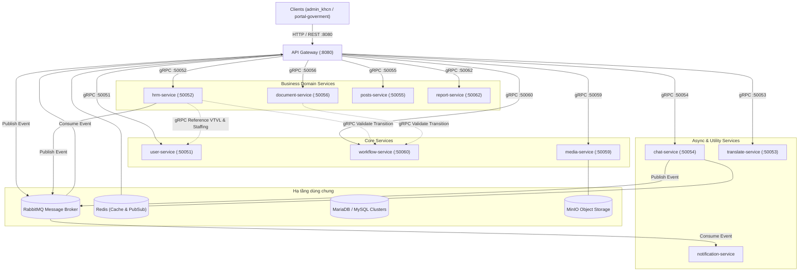

# Dependency Map (Bản Đồ Phụ Thuộc Hệ Thống Thực Tế)

Dự án Đắk Lắk Government Platform hoạt động theo mô hình Microservices phân tán. Tài liệu này đặc tả toàn bộ các mối quan hệ phụ thuộc tĩnh và động giữa API Gateway, các Microservices, Message Broker, Cache và Cơ sở dữ liệu.

---

## 1. Sơ Đồ Tổng Thể Phụ Thuộc Hệ Thống

---

## 2. Bảng Mapping gRPC Services & Ports

| Tên Microservice | Port gRPC Mặc định | Package Symbol | Proto Path | Trách nhiệm chính phục vụ Gateway |
|---|---|---|---|---|
| **`user-service`** | `50051` | `USER_PACKAGE` `AUTH_PACKAGE` `PBAC_PACKAGE` `ORGANIZATION_PACKAGE` | `users/user.proto` `users/auth.proto` `users/pbac.proto` `users/organization.proto` | Xác thực JWT, cấp quyền PBAC, cây tổ chức & cấu trúc Vị trí việc làm (VTVL) định biên. |
| **`hrm-service`** | `50052` | `EMPLOYEE_PACKAGE` `TASK_PACKAGE` `KPI_PACKAGE` `MASTER_PLAN_PACKAGE` | `hrm/employee.proto` `hrm/task.proto` `hrm/kpi.proto` `hrm/master_plan.proto` | Hồ sơ nhân sự, phân công công việc, thẩm định tiến độ và đánh giá xếp loại KPI. |
| **`document-service`** | `50056` | `DOCUMENT_PACKAGE` `DOSSIER_PACKAGE` `CABINET_PACKAGE` `MINUTES_PACKAGE` | `document/document.proto` `document/dossier.proto` `document/cabinet.proto` `document/minutes.proto` | Văn bản đến/đi, hồ sơ lưu trữ, biên bản họp số hóa. |
| **`posts-service`** | `50055` | `POST_PACKAGE` `BANNER_PACKAGE` `PORTAL_MENU_PACKAGE` | `posts/post.proto` `posts/banner.proto` `posts/portal_menu.proto` | Tin tức, chuyên mục, banner, cấu hình cổng thông tin điện tử. |
| **`workflow-service`** | `50060` | `WORKFLOW_PACKAGE` | `workflow/workflow.proto` | Điều phối BPMN, kiểm tra điều kiện chuyển trạng thái cho Task/Document. |
| **`report-service`** | `50062` | `REPORT_PACKAGE` | `reports/report.proto` | Mẫu biểu báo cáo động, dashboard tài chính và thống kê số liệu. |
| **`translate-service`** | `50053` | `TRANSLATE_PACKAGE` | `translate/translation.proto` | Dịch thuật tài liệu, văn bản đa ngữ. |
| **`media-service`** | `50059` | `MEDIA_PACKAGE` | `media/media.proto` | Tải lên, ký số, mã hóa và phân phối file qua MinIO. |
| **`chat-service`** | `50054` | `CHAT_PACKAGE` | `chat/chat.proto` | Hội thoại trực tuyến, phòng chat công việc và tin nhắn nội bộ. |

---

## 3. Bản Đồ Hàng Đợi RabbitMQ (Message Broker Queues)

| Tên Queue RabbitMQ | Prefetch Count | Producers (Nơi phát tín hiệu) | Consumers (Nơi nhận xử lý) | Mục đích nghiệp vụ |
|---|---|---|---|---|
| `gateway_queue` | 50 | `hrm-service`, `chat-service`, `document-service` | `api-gateway` | Chuyển tiếp các sự kiện real-time lên Socket.IO cho Client. |
| `chat_events_queue` | 50 | `chat-service` | `chat-service` (Workers), `api-gateway` | Đồng bộ tin nhắn, trạng thái đọc (read receipts), notification. |
| `ai_tasks_queue` | 10 | `api-gateway`, `user-service` | AI Assistant Worker | Xử lý tóm tắt văn bản, gợi ý việc làm, trợ lý ảo thông minh. |
| `integration_events_queue` | 100 | `api-gateway`, `document-service` | Integration Workers | Đồng bộ văn bản và dữ liệu liên thông LGSP Tỉnh và Cổng DVC. |
| `notification_queue` | 50 | Toàn bộ các Domain Services | `notification-service` | Gửi thông báo In-app, đẩy Email qua SMTP Adapter. |

---

## 4. Quy Tắc Ràng Buộc Phụ Thuộc (Dependency Constraints)

1. **Service Data Sovereignty:** Tuyệt đối không có bất kỳ kết nối chéo CSDL nào giữa các service. Mọi tương tác BẮT BUỘC qua gRPC hoặc RabbitMQ.
2. **Gateway Context Delegation:** Lời gọi gRPC từ Gateway sang các microservices luôn phải đính kèm `GatewayContextToken` (`this.getGrpcMetadata(req)`).
3. **Async Decoupling:** Các tác vụ thông báo, nhật ký, phân tích AI nặng không được chạy đồng bộ gây nghẽn gRPC, bắt buộc ủy quyền qua RabbitMQ event.
