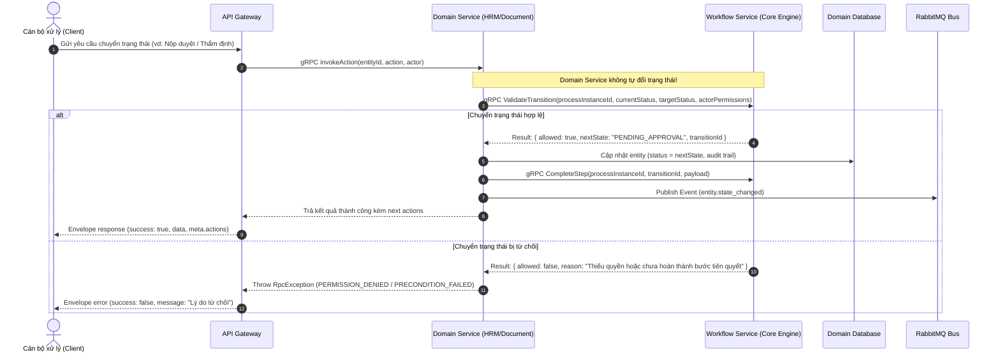
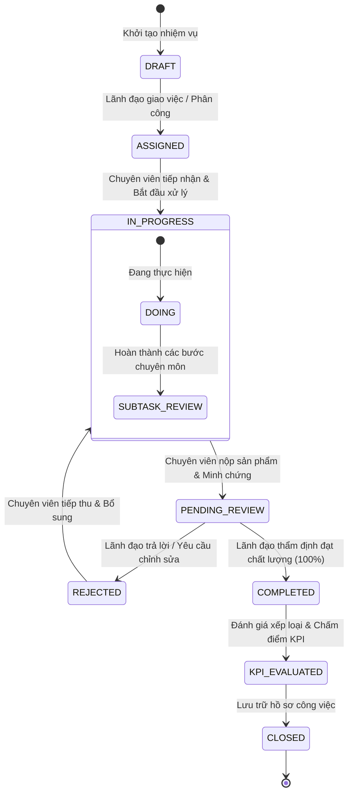

# Workflow Map (Kiến Trúc Quy Trình & Máy Trạng Thái BPMN)

Tài liệu này đặc tả kiến trúc điều phối quy trình nghiệp vụ tập trung của nền tảng, cơ chế ủy quyền giữa các Domain Services (`hrm-service`, `document-service`) và `workflow-service`, cùng vòng đời trạng thái (Lifecycle State Machines).

---

## 1. Mô Hình Điều Phối Quy Trình Tập Trung

`workflow-service` là **Source of Truth duy nhất** cho toàn bộ định nghĩa tiến trình (BPMN Workflow Definitions), vòng đời thực thể và điều kiện chuyển bước (State Transitions).

---

## 2. Máy Trạng Thái Điển Hình (Ví dụ: Vòng Đời Nhiệm Vụ - Task Lifecycle)

Quy trình giao việc và kiểm soát chất lượng thực hiện theo máy trạng thái chuẩn:

---

## 3. Phân Làn Trách Nhiệm (Swimlanes & Phân Quyền PBAC)

| Phân làn (Swimlane) | Vai trò thẩm quyền | Quyền hạn tương ứng trong Quy trình |
|---|---|---|
| **Lãnh đạo Cơ quan / Ban** | Phê duyệt cấp cao, ký phát hành, đánh giá toàn diện | Phê duyệt kế hoạch tổng thể, ký duyệt văn bản, chấm điểm tập thể. |
| **Lãnh đạo Phòng / Đơn vị** | Giao việc, đôn đốc, thẩm định sản phẩm | Phân công chuyên viên chủ trì/phối hợp, trả lại hồ sơ yêu cầu sửa, xác nhận hoàn thành công việc. |
| **Chuyên viên / Người xử lý** | Thực hiện nghiệp vụ trực tiếp | Cập nhật tiến độ (% hoàn thành), nộp minh chứng, giải trình, gửi yêu cầu gia hạn. |
| **Rule Engine Tự Động** | `workflow-service` | Tự động chuyển trạng thái "Quá hạn" (OVERDUE) khi hết thời hạn, tự tính điểm KPI theo công thức. |

---

## 4. Ràng Buộc Kiến Trúc Bắt Buộc Đối Với Workflow

1. **Tuyệt đối cấm Hard-code State Transitions ở Domain Service:**
   - Các coder agent khi viết logic tại `hrm-service` hay `document-service` **CẤM TUYỆT ĐỐI** tự ý viết:
     `if (status === 'DOING') status = 'COMPLETED'` mà không thông qua `workflow-service`.
2. **Idempotency & Distributed Outbox:**
   - Khi mạng chập chờn, mọi lệnh chuyển trạng thái phải sử dụng `ProcessedCommand` (chống Duplicate Event) và `OutboxEvent` (đảm bảo tính toàn vẹn dữ liệu) tại CSDL local trước khi đồng bộ về `workflow-service`.
3. **Data Sovereignty:**
   - `workflow-service` chỉ lưu trữ cấu trúc tiến trình (`WorkflowInstance`, `CurrentNode`, `StateHistory`), không lưu ruột chi tiết dữ liệu nghiệp vụ (như nội dung bài viết, file đính kèm hay danh sách nhân sự).
