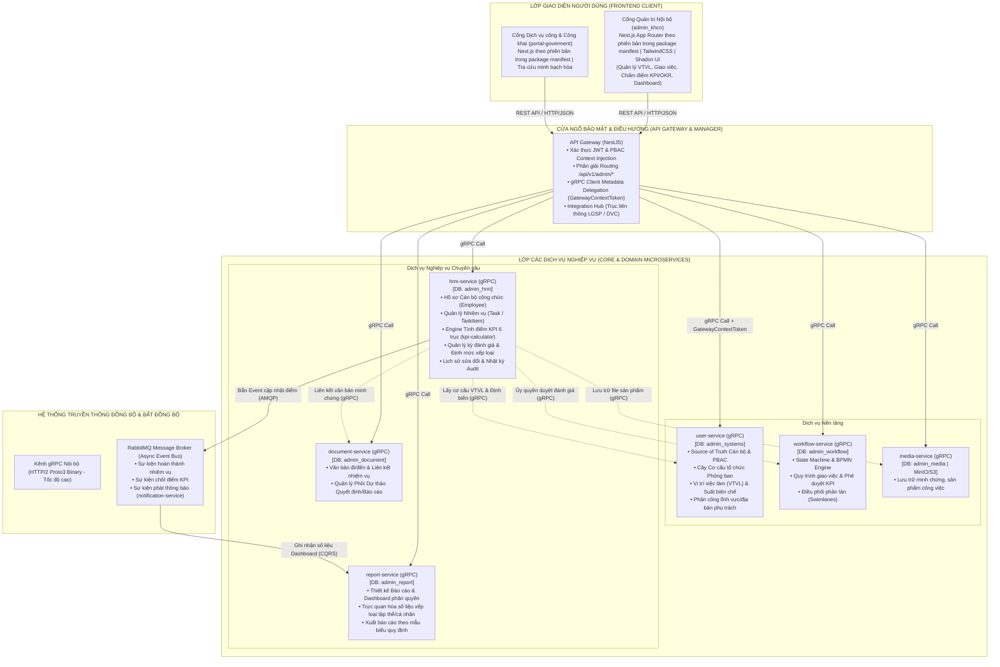
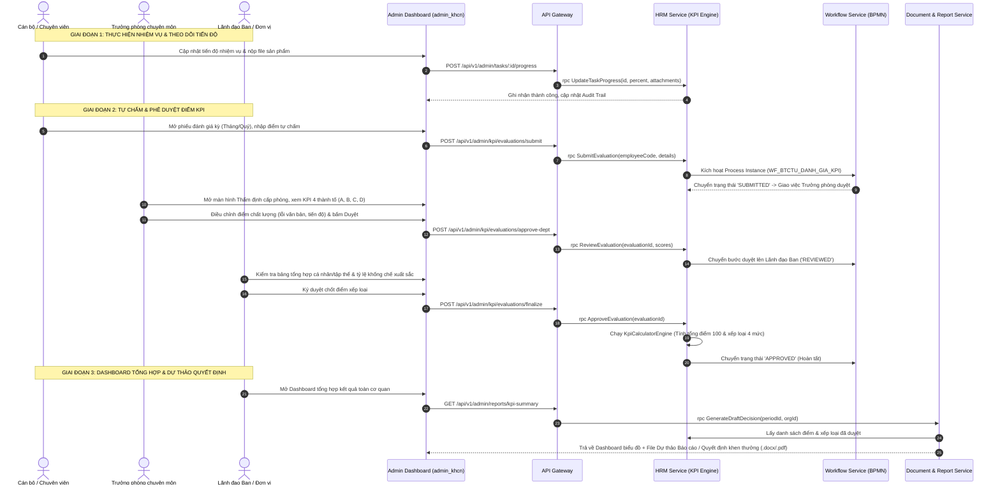

# Command: kpi-answer — Xây dựng Bài trả lời & Rà soát Phần mềm Quản lý, Đánh giá KPI/OKR

**Mục tiêu:** Cung cấp giải pháp kỹ thuật, rà soát 9 nhóm chức năng theo đề bài và vẽ sơ đồ kiến trúc dựa trên bằng chứng hiện tại trong repo.

---

> **Yêu cầu kiểm chứng:** Bảng, endpoint, service, công thức và sơ đồ bên dưới là danh sách cần rà soát, không phải kết luận mặc định. Xác minh từng mục bằng schema/proto/controller/service/UI/test hiện hành; dẫn file hoặc lệnh và phân loại ĐÃ XÁC MINH / CHƯA ĐỦ BẰNG CHỨNG / KHÔNG TÌM THẤY. Không khẳng định “100% hoàn thành” hoặc kết luận pháp lý khi thiếu bằng chứng/source chính thức. Lấy phiên bản framework từ package manifest hiện tại.

## I. MA TRẬN RÀ SOÁT TÍNH NĂNG THEO ĐỀ BÀI (FEATURE AUDIT MATRIX)

Bảng đối chiếu 9 nhóm chức năng tối thiểu theo đề bài với hiện trạng mã nguồn thực tế trong repo (`user-service`, `hrm-service`, `workflow-service`, `report-service`, `api-gateway`, `admin_khcn`):

| STT | Nhóm chức năng theo đề bài | Service chủ quản (Source of Truth) & CSDL | Các bảng CSDL / Proto / Endpoint thực tế | Trạng thái hiện tại | Đánh giá & Rà soát chi tiết |
| :---: | :--- | :--- | :--- | :---: | :--- |
| **1** | **Quản lý cán bộ, công chức, phòng chuyên môn và vị trí việc làm (VTVL)** | **`user-service`** (`admin_systems`) & **`hrm-service`** (`admin_hrm`) | • `user-service`: `Organization`, `JobTitle`, `OrganizationStaffing`, `StaffingSlot`, `StaffingSlotDomain`, `StaffingSlotGeographicArea`, `StaffingSlotMonitoredUnit` • `hrm-service`: `Employee`, `JobPosition` • Proto: `users/users.proto`, `hrm/employee.proto` | **Cần kiểm chứng** | Chuẩn hóa toàn bộ VTVL định biên, phòng chuyên môn và cơ cấu tổ chức tại `user-service`. `hrm-service` đồng bộ mã chức danh, số hiệu công chức và lưu hồ sơ nhân sự chi tiết. Giao diện quản lý tại `admin_khcn/features/hrm/components/Employee*Client.tsx`. |
| **2** | **Quản lý nhiệm vụ và bộ tiêu chí KPI/OKR** | **`hrm-service`** (`admin_hrm`) & **`workflow-service`** (`admin_workflow`) | • `hrm-service`: `Task`, `TaskCategory`, `TaskTemplate`, `KpiPeriod`, `KpiCriterion`, `KpiRuleSet`, `KpiFormTemplate` • Proto: `hrm/task.proto`, `hrm/kpi.proto` • Endpoints: `POST /tasks`, `POST /kpi/criteria`, `POST /kpi/periods` | **Cần kiểm chứng** | Hỗ trợ lập kế hoạch công việc (nhiệm vụ thường xuyên, đột xuất, nhiệm vụ trọng tâm theo NQ 18, 05-HD/TU). Quản lý cấu hình tiêu chí KPI 6 trục, ma trận trọng số động theo mảng việc (`DOM_THAM_DINH`, `DOM_VAN_THU`, `DOM_IT_ATTT`, `DOM_THAM_MUU`). |
| **3** | **Cập nhật, theo dõi kết quả thực hiện nhiệm vụ** | **`hrm-service`** (`admin_hrm`) & **`media-service`** (`admin_media`) | • `hrm-service`: `TaskProgress`, `TaskItem`, `TaskAttachment`, `TaskComment` • UI: `task-detail-drawer.tsx`, `task-detail-processing-tab.tsx`, `task-respond-dialog.tsx` • Engine: Cảnh báo trễ hạn (Deadline Warning) | **Cần kiểm chứng** | Cán bộ cập nhật % tiến độ, đính kèm file minh chứng kết quả (kết nối `media-service`). Hỗ trợ luồng xin gia hạn thời gian giải quyết công việc được duyệt trước 24h để không bị trừ điểm tiến độ. |
| **4** | **Tự động tính điểm, xếp loại theo tháng, quý, năm** | **`hrm-service`** (`admin_hrm`) & **`workflow-service`** | • `hrm-service`: `KpiCalculatorEngine` (`kpi-calculator.engine.ts`), `KpiEvaluation`, `RankQuotaRule` • Method: `rpc CalculatePersonalKpi` • Rule: Xếp loại 4 mức (Xuất sắc, Tốt, Hoàn thành, Không hoàn thành) kèm khống chế tỷ lệ theo định ngạch | **Cần kiểm chứng** | Tự động hóa 100% công thức: Điểm tổng = Điểm chung (30đ) + Điểm nhiệm vụ (70đ quy đổi từ KPI 4 thành tố $A\% \times w_A + B\% \times w_B + C\% \times w_C + D\% \times w_D$). Khống chế tỷ lệ Hoàn thành xuất sắc nhiệm vụ không vượt quá trần quy định (15% - 20%). |
| **5** | **Tổng hợp kết quả cá nhân và tập thể** | **`hrm-service`** (`admin_hrm`) & **`report-service`** (`admin_report`) | • `hrm-service`: `KpiEvaluationAggregate`, `task-kpi.service.ts` • Method: `rpc GetEvaluationStats` • UI: `task-dashboard.tsx` | **Cần kiểm chứng** | Tự động gom nhóm điểm theo Phòng ban/Đơn vị (Group By / Average Score), tính điểm trung bình tập thể phòng ban, so sánh hiệu suất giữa các chuyên viên và giữa các phòng chuyên môn trực thuộc. |
| **6** | **Phân quyền người sử dụng và phê duyệt kết quả** | **`user-service`** (PBAC) & **`workflow-service`** (BPMN) | • `user-service`: `PbacPolicy`, `Role`, `UserRole` • `workflow-service`: `WF_BTCTU_DANH_GIA_KPI` (Quy trình đánh giá gồm các bước: Tự chấm -> Trưởng phòng duyệt -> Hội đồng thẩm định -> Lãnh đạo Ban phê duyệt) • Method: `rpc SubmitEvaluation`, `rpc ApproveEvaluation` | **Cần kiểm chứng** | Phân quyền PBAC kiểm soát chặt chẽ theo `organizationId`. Quy trình duyệt đa cấp ủy quyền cho `workflow-service` điều phối trạng thái (`DRAFT` -> `SUBMITTED` -> `REVIEWED` -> `APPROVED`), chống can thiệp chéo thẩm quyền. |
| **7** | **Lưu lịch sử chỉnh sửa, cập nhật dữ liệu** | **`hrm-service`** (`admin_hrm`) | • `hrm-service`: `TaskHistory`, `KpiEvaluationHistory` • UI: `task-detail-history-tab.tsx` • Audit: Ghi nhận `actorId`, `oldValue`, `newValue`, `actionType`, `timestamp` | **Cần kiểm chứng** | Ghi vết kiểm toán (Audit Trail) bất biến cho mọi thao tác cập nhật tiến độ, giao lại việc, gia hạn hạn chót, thay đổi điểm số chấm của lãnh đạo phòng và lãnh đạo ban. |
| **8** | **Tra cứu, thống kê, báo cáo và xuất kết quả** | **`report-service`** (`admin_report`) & **`hrm-service`** | • `report-service`: `ReportDefinition`, `ReportRun`, `DatasetSnapshot` • `hrm-service`: `rpc FindEvaluations` • Xuất dữ liệu: Excel / PDF Export engine | **Cần kiểm chứng** | Tra cứu bộ lọc đa chiều theo phòng ban, quý, năm, ngạch công chức. Tích hợp engine sinh file Excel/PDF bảng tổng hợp kết quả đánh giá xếp loại theo mẫu biểu hành chính. |
| **9** | **Dashboard tự động tổng hợp, dự thảo báo cáo / quyết định theo mẫu** | **`report-service`** & **`document-service`** & **`admin_khcn`** | • `report-service`: `ReportTemplate`, `ReportWidget` • `document-service`: `DocumentTemplate`, `Dossier` • UI: Widget biểu đồ động (Bar, Pie, Radar 6 trục KPI), nút sinh Dự thảo Quyết định xếp loại khen thưởng | **Cần kiểm chứng** | Dashboard trực quan hóa phân bổ điểm số và xếp loại toàn cơ quan; tự động điền dữ liệu KPI vào phôi văn bản (Template engine) để xuất ra dự thảo Báo cáo tổng kết và Quyết định xếp loại cán bộ công chức trình Lãnh đạo ký duyệt. |

---

## II. SƠ ĐỒ KIẾN TRÚC HỆ THỐNG TỔNG THỂ (MERMAID SYSTEM ARCHITECTURES)

### 1. Sơ đồ Kiến trúc Microservices & Luồng Dữ liệu (System Architecture Diagram)

---

### 2. Sơ đồ Luồng Đánh giá KPI & Dự thảo Quyết định (BPMN / Sequence Workflow)

---

## III. MÔ TẢ ĐẶC TẢ KỸ THUẬT CHO 9 NHÓM CHỨC NĂNG

### 1. Quản lý cán bộ, công chức, phòng chuyên môn và VTVL
- **Nguyên tắc Source of Truth**: Bắt buộc sử dụng thực thể từ `user-service`.
- **Cấu trúc dữ liệu**:
  - `Organization`: Quản lý sơ đồ hình cây của đơn vị và các phòng chuyên môn trực thuộc.
  - `JobTitle`: Danh mục chức danh, vị trí việc làm (ngạch Chuyên viên, Chuyên viên chính, Trưởng phòng, Phó Trưởng phòng...).
  - `OrganizationStaffing` & `StaffingSlot`: Đề án định biên vị trí việc làm, số lượng biên chế được giao và đã tuyển dụng.
  - `StaffingSlotDomain`: Phân công lĩnh vực phụ trách (Tổ chức cán bộ, Bảo vệ chính trị nội bộ, Đào tạo bồi dưỡng...).
  - `Employee` (`hrm-service`): Hồ sơ công chức, mã số ngạch, chức vụ hiện tại, phòng ban công tác.

### 2. Quản lý nhiệm vụ và bộ tiêu chí KPI/OKR
- **Phân loại nhiệm vụ**:
  - Nhiệm vụ theo kế hoạch thường xuyên (`KHOI_LUONG_KH`).
  - Nhiệm vụ đột xuất do Lãnh đạo Ban giao bổ sung (`KHOI_LUONG_DOT_XUAT`).
  - Nhiệm vụ tham mưu đề án / chuyên đề trọng tâm theo Nghị quyết.
- **Bộ tiêu chí KPI 6 trục & Ma trận trọng số**:
  - Trọng số $w_A$ (Khối lượng công việc - hệ số độ khó $K \in [1.0, 5.0]$).
  - Trọng số $w_B$ (Chất lượng sản phẩm - trừ điểm lỗi nhỏ 5%, lỗi trung bình 15%, lỗi nghiêm trọng 35%, thưởng sản phẩm xuất sắc +10%).
  - Trọng số $w_C$ (Tiến độ thực hiện - trước hạn +10%, đúng hạn 100%, trễ hạn trừ theo tỷ lệ %).
  - Trọng số $w_D$ (Mức độ chủ động / Trách nhiệm lãnh đạo quản lý).
  - Ma trận trọng số động thay đổi theo mảng việc (`domain_code`): Thẩm định (Chất lượng 50%), Văn thư (Khối lượng 40%), CNTT/ATTT (Tiến độ 35%), Tham mưu (Chất lượng 40%).

### 3. Cập nhật, theo dõi kết quả thực hiện nhiệm vụ
- Hỗ trợ cập nhật tiến độ nhiều lần (`TaskProgress`), ghi chú các khó khăn vướng mắc.
- Đính kèm file sản phẩm minh chứng lên `media-service`.
- Cơ chế giám sát thời hạn giải quyết: Tự động gửi cảnh báo qua WebSocket/RabbitMQ khi nhiệm vụ còn 48h, 24h hoặc quá hạn. Cho phép tạo phiếu xin gia hạn giải quyết công việc được duyệt trước 24h để bảo lưu 100% điểm tiến độ.

### 4. Tự động tính điểm, xếp loại theo tháng, quý, năm
- **Công thức tính điểm**:
  $$S_{\text{tổng}} = S_{\text{chung}} (30.0đ) + S_{\text{nhiệm vụ}} (70.0đ)$$
  $$S_{\text{nhiệm vụ}} = \frac{KPI_{\text{trung bình}}}{100} \times 70.0$$
- **Cơ chế xếp loại 4 mức tiêu chuẩn**:
  - Hoàn thành xuất sắc nhiệm vụ: Tổng điểm $\ge 90.0$ điểm (Khống chế không quá 20% tổng số cán bộ của đơn vị).
  - Hoàn thành tốt nhiệm vụ: $70.0 \le$ Tổng điểm $< 90.0$ điểm.
  - Hoàn thành nhiệm vụ: $50.0 \le$ Tổng điểm $< 70.0$ điểm.
  - Không hoàn thành nhiệm vụ: Tổng điểm $< 50.0$ điểm hoặc có vi phạm kỷ luật/lỗi nghiệp vụ nghiêm trọng.

### 5. Tổng hợp kết quả cá nhân và tập thể
- Bảng xếp hạng KPI cá nhân (Leaderboard) theo phòng ban và toàn đơn vị.
- Điểm đánh giá tập thể phòng ban được tính bằng trung bình cộng điểm cá nhân kết hợp với tỷ lệ hoàn thành các nhiệm vụ chung của phòng chuyên môn.

### 6. Phân quyền người sử dụng và phê duyệt kết quả
- Ràng buộc bảo mật PBAC kết hợp `organizationId` của cơ quan chủ quản.
- Phân vai rõ ràng:
  - Chuyên viên: Xem nhiệm vụ được giao, cập nhật tiến độ, tự chấm điểm.
  - Trưởng phòng: Giao việc cho chuyên viên, duyệt điểm cấp phòng, đánh giá điểm chung $S_{\text{chung}}$.
  - Hội đồng thẩm định / Thường trực: Thẩm định hồ sơ, kiểm tra tỷ lệ ngạch xuất sắc.
  - Lãnh đạo Ban / Thủ trưởng cơ quan: Ký phê duyệt quyết định xếp loại cuối cùng.

### 7. Lưu lịch sử chỉnh sửa, cập nhật dữ liệu (Audit Trail)
- Lưu toàn bộ vết thay đổi trong bảng `TaskHistory` và `KpiEvaluationHistory`.
- Ghi nhận định danh người thực hiện, thời gian sửa đổi, giá trị trước và sau khi thay đổi, lý do điều chỉnh điểm.

### 8. Tra cứu, thống kê, báo cáo và xuất kết quả
- Lọc theo nhiều tiêu chí: Họ tên, phòng ban, vị trí việc làm, kỳ đánh giá, mức xếp loại.
- Kết xuất dữ liệu ra file Excel theo mẫu tổng hợp của cơ quan hoặc xuất phiếu đánh giá cá nhân ra file PDF có gắn mã vạch/mã tra cứu.

### 9. Dashboard tự động tổng hợp & Dự thảo báo cáo / quyết định theo mẫu
- Giao diện Dashboard hiển thị các biểu đồ trực quan (Biểu đồ cột so sánh tiến độ phòng ban, biểu đồ tròn phân bổ mức xếp loại, biểu đồ radar 6 trục năng lực).
- Chức năng tự động móc nối số liệu kết quả đánh giá vào phôi văn bản hành chính:
  - Mẫu Báo cáo tổng kết công tác đánh giá, xếp loại cán bộ công chức tháng/quý/năm.
  - Mẫu Quyết định công nhận kết quả đánh giá, xếp loại và khen thưởng cán bộ hoàn thành xuất sắc nhiệm vụ.
