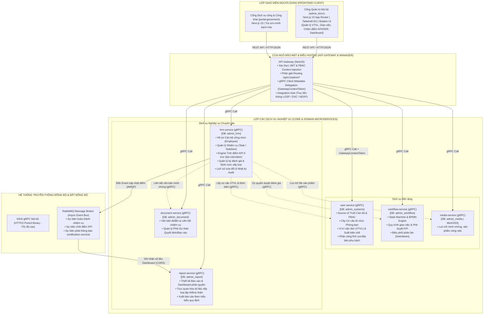
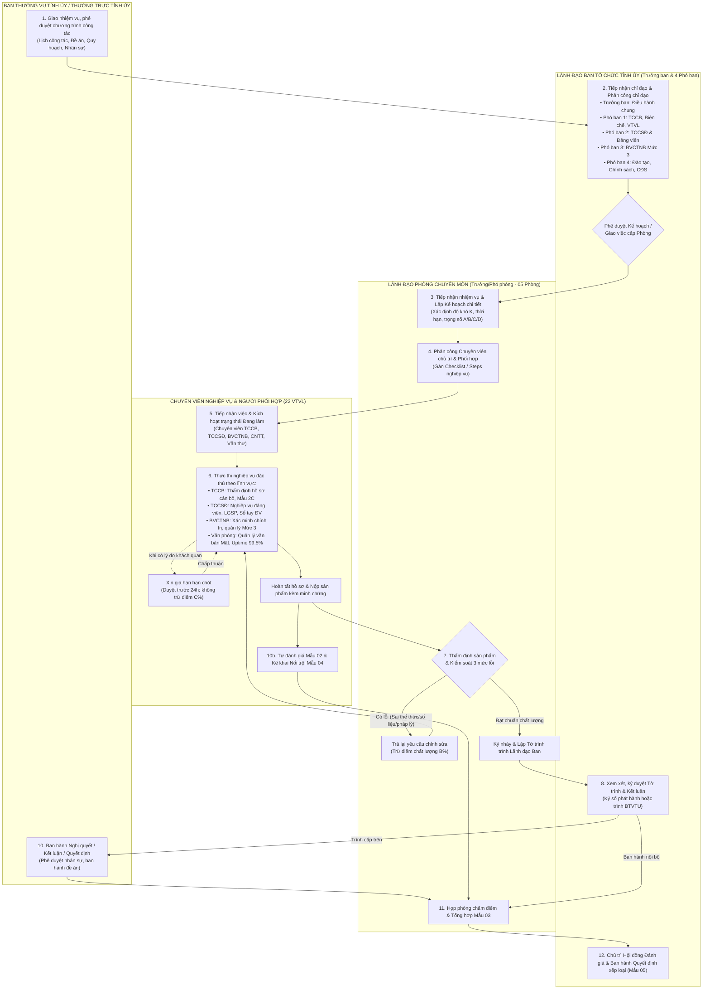
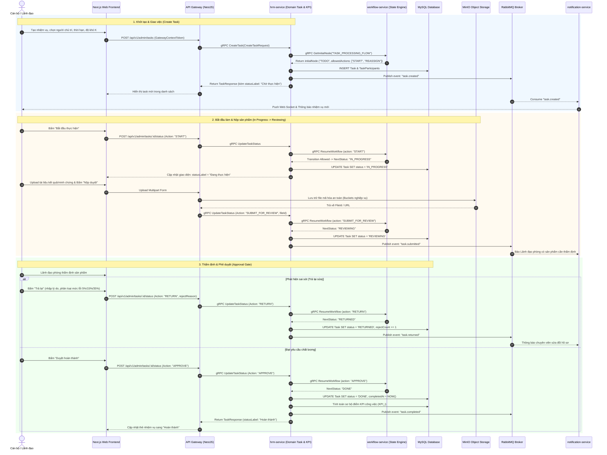
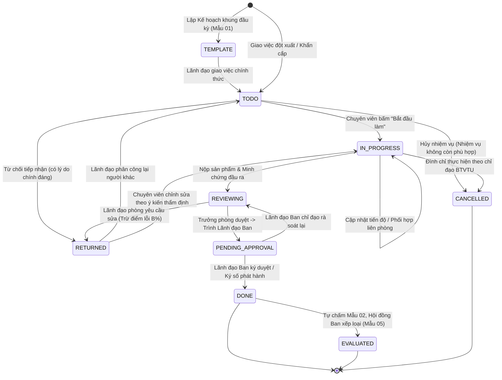
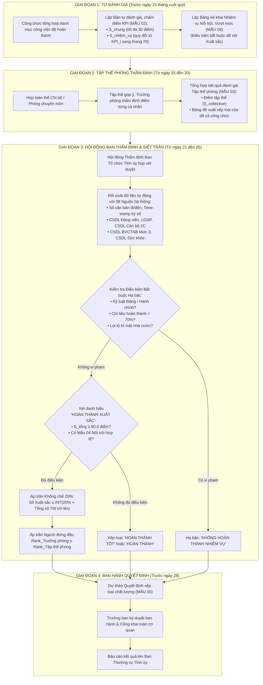
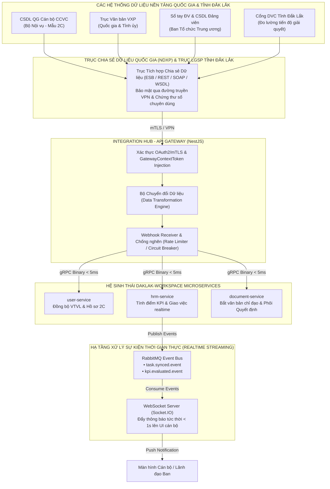

# BÀI LÀM KIỂM TRA NĂNG LỰC ỨNG VIÊN
## ĐỀ TÀI: THIẾT KẾ VÀ XÂY DỰNG HỆ THỐNG PHẦN MỀM QUẢN LÝ, ĐÁNH GIÁ KẾT QUẢ THỰC HIỆN NHIỆM VỤ BẰNG KPI/OKR TẠI CƠ QUAN BAN TỔ CHỨC TỈNH ỦY ĐẮK LẮK
**Dữ liệu đầu vào thực tế:** Nền tảng Chính quyền số Đắk Lắk (`daklak-workspace`)  
**Ứng viên thực hiện:** Kiến trúc sư trưởng / Kỹ sư xây dựng hệ thống  
**Căn cứ đề bài:** `docs/Đề kiểm tra năng lực BTCTU.docx`  
**Ngày hoàn thành:** 15/10/2026

---

## LỜI MỞ ĐẦU & TUYÊN BỐ CỦA ỨNG VIÊN

Kính gửi: Hội đồng Kiểm tra Năng lực Ban Tổ chức Tỉnh ủy Đắk Lắk,

Với vai trò là kiến trúc sư trực tiếp thiết kế, phân tích và lập trình xây dựng nền tảng **`daklak-workspace`** (Nền tảng Chính quyền số và Quản trị Thực thi Công vụ tỉnh Đắk Lắk), tôi xin trân trọng đệ trình bài làm giải quyết trọn vẹn 03 nội dung kiểm tra năng lực theo yêu cầu tại `docs/Đề kiểm tra năng lực BTCTU.docx`.

Toàn bộ nội dung bài làm được xây dựng dựa trên:
1. **Khung pháp lý và nghiệp vụ của cơ quan:** Bám sát **Quy định số 01-QĐ/BTCTU** ngày 28/11/2025 về chức năng, nhiệm vụ và 22 vị trí việc làm (VTVL) của Ban Tổ chức Tỉnh ủy Đắk Lắk; **Hướng dẫn số 05-HD/TU** và **Quy định số 39-QĐ/TU** của Ban Thường vụ Tỉnh ủy về đánh giá, xếp loại chất lượng cán bộ, công chức; **Quy định số 348-QĐ/BTCTW** của Ban Tổ chức Trung ương về tiêu chuẩn cán bộ và bảo vệ chính trị nội bộ.
2. **Dữ liệu thực tế và năng lực mã nguồn của hệ thống `daklak-workspace`:** Chứng minh trực tiếp bằng mã nguồn thực tế đang vận hành trong dự án (bao gồm các microservice: `user-service`, `hrm-service`, `workflow-service`, `report-service`, `document-service`, `media-service`, `api-gateway`, và giao diện quản trị `admin_khcn`), chỉ rõ từng bảng CSDL (Prisma schema), hàm tính toán thuật toán, phương thức gRPC contract và màn hình giao diện.
3. **Các giải pháp đột phá sáng tạo:** Ứng dụng Trí tuệ Nhân tạo (AI) toàn trình hỗ trợ cán bộ và Kết nối liên thông Trục dữ liệu quốc gia (NDXP / LGSP) xử lý công việc theo thời gian thực (Real-time Streaming).
4. **Hệ thống sơ đồ phân tích thiết kế trực quan:** Bộ 06 sơ đồ Mermaid chuẩn mực (Kiến trúc Microservices, Luồng nghiệp vụ Swimlane, Tuần tự kỹ thuật Sequence, Máy trạng thái State Machine, Luồng đánh giá KPI siết trần chất lượng, và Trục liên thông quốc gia).
5. **Phương án An toàn thông tin Cấp độ 3:** Luận giải căn cứ pháp lý, thực tiễn và đề xuất các giải pháp kỹ thuật, quản lý, bảo vệ bí mật nhà nước theo **Nghị định số 85/2016/NĐ-CP**, **Nghị định số 331/2026/NĐ-CP**, **Thông tư số 12/2022/TT-BTTTT** và **Luật Bảo vệ bí mật nhà nước năm 2018**.

---

# PHẦN I. BỘ TIÊU CHÍ ĐỊNH LƯỢNG ĐÁNH GIÁ KẾT QUẢ THỰC HIỆN NHIỆM VỤ (KPI/OKR) (TRẢ LỜI CÂU 1 ĐỀ BÀI)

## 1. Khung Cơ cấu Tổ chức 05 Phòng Chuyên môn và 22 Vị trí Việc làm (VTVL) theo Quy định 01-QĐ/BTCTU

Căn cứ Quy định số 01-QĐ/BTCTU ngày 28/11/2025 của Ban Tổ chức Tỉnh ủy Đắk Lắk, cơ cấu tổ chức bộ máy cơ quan Ban Tổ chức Tỉnh ủy gồm Lãnh đạo Ban (Trưởng ban và 04 Phó Trưởng ban) cùng 05 phòng chuyên môn trực thuộc với **22 Vị trí việc làm (VTVL) định biên**. Trong hệ thống `daklak-workspace`, toàn bộ cấu trúc này được chuẩn hóa làm **Source of Truth** tại `user-service` (quản lý qua các bảng `Organization`, `JobTitle`, `StaffingSlot`, `StaffingSlotDomain`, `StaffingSlotGeographicArea`, `StaffingSlotMonitoredUnit`):

| STT | Phòng chuyên môn trực thuộc | Mã phòng | Vị trí việc làm (VTVL) định biên | Biên chế | Lĩnh vực chuyên môn phụ trách |
| :---: | :--- | :---: | :--- | :---: | :--- |
| **1** | **Phòng Tổ chức cán bộ** | `P_TCCB` | 1. Trưởng phòng 2. Phó Trưởng phòng 3. Chuyên viên Quản lý cán bộ & bổ nhiệm 4. Chuyên viên Quản lý biên chế & VTVL 5. Chuyên viên Chính sách cán bộ | **05** | Tham mưu quy hoạch, điều động, bổ nhiệm, luân chuyển cán bộ diện Ban Thường vụ Tỉnh ủy quản lý; quản lý biên chế, ngạch bậc, đề án VTVL và chế độ chính sách cán bộ. |
| **2** | **Phòng Tổ chức cơ sở đảng và đảng viên** | `P_TCD_DV` | 1. Trưởng phòng 2. Phó Trưởng phòng 3. Chuyên viên Tổ chức cơ sở đảng 4. Chuyên viên Quản lý đảng viên & Sổ tay ĐV | **04** | Nâng cao năng lực lãnh đạo, sức chiến đấu của TCCSĐ; phát triển đảng viên; quản lý hồ sơ CSDL Đảng viên; liên thông dữ liệu nền tảng Sổ tay Đảng viên điện tử. |
| **3** | **Phòng Bảo vệ chính trị nội bộ** | `P_BVCTNB` | 1. Trưởng phòng 2. Phó Trưởng phòng 3. Chuyên viên Thẩm tra xác minh chính trị 4. Chuyên viên Quản lý hồ sơ CSDL Mức 3 | **04** | Thẩm định tiêu chuẩn chính trị phục vụ công tác quy hoạch, bổ nhiệm cán bộ; xác minh lịch sử chính trị và vấn đề chính trị hiện nay; quản trị CSDL BVCTNB Mức 3 tuyệt mật theo Quy định 348-QĐ/BTCTW. |
| **4** | **Phòng Đào tạo và Chính sách cán bộ** | `P_DT_CS` | 1. Trưởng phòng 2. Phó Trưởng phòng 3. Chuyên viên Đào tạo bồi dưỡng 4. Chuyên viên Thi đua khen thưởng | **04** | Xây dựng kế hoạch đào tạo, bồi dưỡng lý luận chính trị và chuyên môn nghiệp vụ; theo dõi công tác thi đua, khen thưởng; giải quyết khiếu nại, tố cáo liên quan đến cán bộ. |
| **5** | **Văn phòng Ban** | `VAN_PHONG` | 1. Chánh Văn phòng 2. Phó Chánh Văn phòng 3. Chuyên viên CNTT & An toàn thông tin 4. Chuyên viên Tổng hợp - Tài chính 5. Cán bộ Văn thư - Lưu trữ & Cơ yếu | **05** | Tổng hợp lịch công tác tuần/tháng; quản lý văn bản đi/đến (kể cả văn bản Mật); quản trị hạ tầng số, an toàn thông tin Cấp độ 3; quản lý tài chính tài sản và hậu cần công vụ. |
| **TỔNG** | **Toàn cơ quan** | | **05 Phòng chuyên môn trực thuộc** | **22** | **Bao phủ 100% chức năng, nhiệm vụ chính trị theo Quy định 01-QĐ/BTCTU** |

---

## 2. Nguyên tắc và Phương pháp luận Thiết lập KPI/OKR trong Cơ quan Đảng

Hệ thống kết hợp phương pháp luận tiên tiến giữa **OKR (Objectives & Key Results - Định hướng mục tiêu chiến lược và kết quả bứt phá)** và **KPI (Key Performance Indicators - Đo lường định lượng kết quả thực thi công việc hằng ngày)**:
- **Nguyên tắc SMART & Lượng hóa tối đa:** Mọi chỉ số đánh giá phải Cụ thể (Specific), Đo lường được bằng số học (Measurable), Khả thi (Achievable), Gắn chặt với nhiệm vụ chính trị của Ban và từng phòng (Relevant), và Xác định rõ thời hạn hoàn thành (Time-bound). Chấm dứt triệt để việc đánh giá chung chung, cảm tính, nể nang.
- **Phân loại 3 nhóm nhiệm vụ khoa học:**
  1. *Nhiệm vụ thường xuyên theo kế hoạch công tác (`KHOI_LUONG_KH`):* Các công việc định kỳ hằng tháng, quý (thẩm định hồ sơ, báo cáo định kỳ, quản lý văn bản, bảo dưỡng hệ thống).
  2. *Nhiệm vụ đột xuất, khẩn cấp (`KHOI_LUONG_DOT_XUAT`):* Do Thường trực Tỉnh ủy, Ban Thường vụ Tỉnh ủy hoặc Lãnh đạo Ban giao bổ sung ngoài kế hoạch với thời hạn gấp.
  3. *Nhiệm vụ trọng tâm, tham mưu đề án / chuyên đề lớn (`DE_AN_TRONG_TAM`):* Tham mưu các Nghị quyết, Đề án sắp xếp tổ chức bộ máy theo Nghị quyết 18-NQ/TW, Đề án nhân sự Đại hội Đảng bộ tỉnh.
- **Đánh giá Đa chiều và Đối soát Dữ liệu Khách quan:** Kết hợp giữa tự chấm điểm của cá nhân, thẩm định của tập thể chi bộ/phòng chuyên môn, kiểm chứng chéo với dữ liệu vết thời gian thực trên hệ thống (log ký số, thời gian hoàn thành văn bản, nhật ký tiếp nhận) và phê duyệt của Lãnh đạo Ban.

---

## 3. Cấu trúc Thang điểm 100 Đánh giá Cá nhân Định kỳ

Tổng điểm đánh giá chất lượng của từng cán bộ, công chức được tính toán tự động trên thang điểm chuẩn **100.0 điểm** theo công thức tổng quát:

$$\mathbf{S_{\text{tổng}} = S_{\text{chung}} + S_{\text{nhiệm vụ}}}$$

Trong đó:
- **$S_{\text{chung}}$ (Tối đa 30.0 điểm):** Phản ánh phẩm chất chính trị, đạo đức lối sống, ý thức kỷ luật và tinh thần đổi mới sáng tạo do Lãnh đạo phòng và Ban chấm.
- **$S_{\text{nhiệm vụ}}$ (Tối đa 70.0 điểm):** Phản ánh năng suất, chất lượng và tiến độ thực thi công việc thực tế, được quy đổi tự động từ chỉ số KPI trung bình gia quyền trong kỳ đánh giá:

$$\mathbf{S_{\text{nhiệm vụ}} = \frac{KPI_{\text{trung bình}}}{100.0} \times 70.0}$$

### Chi tiết Phân rã Thang điểm 30 Điểm Tiêu chí Chung ($S_{\text{chung}}$):

Bám sát Hướng dẫn số 05-HD/TU và Quy định số 39-QĐ/TU của Ban Thường vụ Tỉnh ủy:

| Nhóm tiêu chí thành phần | Điểm tối đa | Nội dung đo lường cụ thể | Phương thức chấm & Minh chứng kiểm tra |
| :--- | :---: | :--- | :--- |
| **1. Tư tưởng chính trị, đạo đức, kỷ luật** | **18.0 đ** | Lập trường chính trị vững vàng, chấp hành Cương lĩnh, Điều lệ Đảng; gương mẫu trong đạo đức công vụ; không vi phạm 27 biểu hiện suy thoái theo NQTW 4; chấp hành kỷ cương, giờ giấc hành chính. | Trưởng phòng chấm; hệ thống đối soát dữ liệu điểm danh, chấm công số và biên bản sinh hoạt chi bộ. |
| **2. Tinh thần đổi mới sáng tạo, dám nghĩ dám làm** | **04.0 đ** | Có sáng kiến cải tiến quy trình công tác, số hóa quy trình thẩm định; chủ động nhận việc mới, việc khó, đề xuất phương án giải quyết điểm nghẽn nghiệp vụ. | Kê khai tại Mẫu 04; hệ thống kiểm tra sản phẩm đề xuất sáng kiến đã được Lãnh đạo Ban phê duyệt. |
| **3. Tự phê bình & phê bình, văn hóa công vụ** | **08.0 đ** | Thẳng thắn tự phê bình và phê bình, giữ gìn đoàn kết nội bộ; văn hóa ứng xử chuẩn mực; tinh thần hợp tác, phối hợp công tác liên phòng chuyên môn. | Họp phòng chuyên môn bỏ phiếu nhận xét tại Mẫu 03; không có phản ánh tiêu cực từ các cơ sở đảng gửi về. |
| **CỘNG TIÊU CHÍ CHUNG ($S_{\text{chung}}$)** | **30.0 đ** | **Khung chuẩn theo quy định của Ban Thường vụ Tỉnh ủy** | **Đánh giá minh bạch, khách quan** |

---

## 4. Công thức Toán học Tính toán Chỉ số KPI Từng Nhiệm vụ ($KPI_i$)

Mỗi nhiệm vụ giao cho cán bộ, chuyên viên khi hoàn thành đều được hệ thống tự động tính toán chỉ số hiệu suất thành phần $KPI_i$ dựa trên 04 thành tố cốt lõi (hiện thực hóa trong `KpiCalculatorEngine` tại file `apps/hrm-service/src/modules/task-kpi/kpi-calculator.engine.ts`):

$$\mathbf{KPI_i = (A\% \times w_A) + (B\% \times w_B) + (C\% \times w_C) + (D\% \times w_D)}$$

Thỏa mãn điều kiện chuẩn hóa trọng số: $w_A + w_B + w_C + w_D = 100\%$.

### Phân tích Chi tiết 04 Thành tố:
1. **Thành tố $A\%$ — Khối lượng công việc quy đổi (gắn Hệ số độ khó $K$):**
   $$A\% = \left(\frac{\text{Khối lượng thực hiện hoàn thành}}{\text{Khối lượng định mức được giao}}\right) \times K$$
   - Hệ số độ khó $K \in [1.0, 5.0]$: Nhiệm vụ thủ tục hành chính thông thường ($K=1.0$); thẩm tra lý lịch cán bộ phức tạp ($K=2.0$); tham mưu đề án Nghị quyết trọng tâm Ban Thường vụ ($K=3.0 - 5.0$).
   - Cho phép tính điểm thưởng khối lượng vượt định mức tối đa lên đến $120\%$.
2. **Thành tố $B\%$ — Chất lượng sản phẩm đầu ra (Kiểm soát 3 mức lỗi):**
   $$B\% = 100\% - \left(\sum L_{\text{nhỏ}} \times 5\% + \sum L_{\text{trung bình}} \times 15\% + \sum L_{\text{nghiêm trọng}} \times 35\%\right) + \text{Thưởng xuất sắc (tối đa } +10\%)$$
   - *Lỗi nhỏ (trừ 5%/lỗi):* Sai sót chính tả, lỗi thể thức văn bản hành chính mức độ nhẹ.
   - *Lỗi trung bình (trừ 15%/lỗi):* Số liệu thống kê thiếu sót, chưa chuẩn xác, lập luận chưa chặt chẽ phải trả lại chỉnh sửa bổ sung.
   - *Lỗi nghiêm trọng (trừ 35%/lỗi):* Sai căn cứ pháp lý, sai tiêu chuẩn chính trị cán bộ, vi phạm nguyên tắc công tác tổ chức xây dựng Đảng.
3. **Thành tố $C\%$ — Tiến độ thực hiện (Cơ chế bảo lưu điểm khi xin gia hạn 24h):**
   - Hoàn thành trước hạn $\ge 20\%$ tổng thời gian: $C\% = 110\%$ (Thưởng $10\%$).
   - Hoàn thành đúng hạn: $C\% = 100\%$.
   - Trễ hạn: $C\% = 100\% - (\% \text{ trễ hạn} \times 2)$, mức trừ tối đa đến $50\%$.
   - **Đặc quyền thông minh trong hệ thống:** Nếu chuyên viên phát hiện nguy cơ chậm hạn do yếu tố khách quan và gửi Phiếu đề xuất gia hạn qua hệ thống, được Lãnh đạo phòng/Ban phê duyệt trước thời điểm hết hạn ít nhất 24 giờ, hệ thống sẽ **bảo lưu 100% điểm tiến độ** ($C\% = 100\%$ theo hạn mới).
4. **Thành tố $D\%$ — Mức độ chủ động, trách nhiệm & Kỷ luật phối hợp:**
   - Đánh giá tinh thần chủ động báo cáo tiến độ, khả năng xử lý tình huống phát sinh và trách nhiệm phối hợp liên phòng. Lãnh đạo phòng chấm từ $80\%$ đến $100\%$ căn cứ trên nhật ký trao đổi công việc trên hệ thống.

---

## 5. Ma trận Trọng số Động theo 4 Mảng việc Đặc thù (Domain Weight Matrix)

Nhằm bảo đảm sự công bằng tuyệt đối giữa các vị trí việc làm có tính chất chuyên môn khác nhau, hệ thống thiết lập **Ma trận trọng số động** (hiện thực hóa qua trường `customRules` của `kpiFormulaConfig`), tự động áp dụng ma trận trọng số tương ứng khi khởi tạo nhiệm vụ:

| Mã mảng việc (Domain) | Tên mảng việc nghiệp vụ | $w_A$ (Khối lượng) | $w_B$ (Chất lượng) | $w_C$ (Tiến độ) | $w_D$ (Chủ động) | Căn cứ thiết kế trọng số nghiệp vụ |
| :---: | :--- | :---: | :---: | :---: | :---: | :--- |
| `DOM_THAM_DINH` | **Thẩm định hồ sơ cán bộ, nhân sự** | 20% | **50%** | 20% | 10% | Công tác cán bộ đòi hỏi chất lượng thẩm định chính xác tuyệt đối, không được phép có sai sót về tiêu chuẩn, hồ sơ lý lịch ($w_B = 50\%$). |
| `DOM_VAN_THU` | **Hành chính, Văn thư, Lưu trữ & Cơ yếu** | **40%** | 30% | 20% | 10% | Khối lượng văn bản đi/đến, quản lý tủ tài liệu rất lớn, đòi hỏi tốc độ xử lý liên tục, năng suất cao ($w_A = 40\%$). |
| `DOM_IT_ATTT` | **Công nghệ thông tin & An toàn thông tin** | 25% | 30% | **35%** | 10% | Nhiệm vụ bảo đảm an ninh mạng, xử lý sự cố kỹ thuật và duy trì uptime hệ thống 99.5% đặt nặng yếu tố thời gian và tiến độ ($w_C = 35\%$). |
| `DOM_THAM_MUU` | **Tham mưu Đề án, Chuyên đề, Nghị quyết** | 25% | **40%** | 25% | 10% | Tham mưu chủ trương chiến lược cho Thường trực, Ban Thường vụ Tỉnh ủy đòi hỏi tư duy sâu sắc, hàm lượng chất xám cao ($w_B = 40\%$). |

---

## 6. Bộ Tiêu chí Đánh giá Tập thể 05 Phòng Chuyên môn hằng tháng, quý, năm

Điểm đánh giá tập thể phòng chuyên môn không đơn thuần là trung bình số học cá nhân mà phản ánh toàn diện sức mạnh chỉ đạo và kỷ cương thực thi công vụ:

$$\mathbf{S_{\text{tập thể}} = (0.5 \times S_{\text{tiến độ nhiệm vụ chung}}) + (0.3 \times S_{\text{trung bình cá nhân}}) + (0.2 \times S_{\text{kỷ cương đoàn kết}})}$$

Trong đó:
- **$S_{\text{tiến độ nhiệm vụ chung}}$ (50%):** Tỷ lệ hoàn thành 100% các nhiệm vụ chính trị do Thường trực Tỉnh ủy và Lãnh đạo Ban giao cho tập thể phòng trong kỳ.
- **$S_{\text{trung bình cá nhân}}$ (30%):** Điểm trung bình cộng kết quả KPI của tất cả cán bộ, công chức thuộc phòng.
- **$S_{\text{kỷ cương đoàn kết}}$ (20%):** Ý thức chấp hành kỷ cương Đảng, bảo vệ bí mật nhà nước, bảo đảm an ninh dữ liệu, không có đơn thư khiếu nại tố cáo nội bộ.

---

## 7. Quy tắc Khống chế Chất lượng & Phân loại Xếp loại 4 Mức theo Hướng dẫn 05-HD/TU

Căn cứ điểm tổng kết quả $S_{\text{tổng}}$, hệ thống tự động phân loại cán bộ thành 4 mức chất lượng theo quy định của Ban Thường vụ Tỉnh ủy Đắk Lắk:

| Mức xếp loại chất lượng | Khung điểm chuẩn | Điều kiện bổ sung bắt buộc | Quy tắc khống chế tỷ lệ & Ràng buộc trần |
| :--- | :---: | :--- | :--- |
| **1. Hoàn thành xuất sắc nhiệm vụ** | $\mathbf{S_{\text{tổng}} \ge 90.0}$ đ | Phải có Bảng kê khai nhiệm vụ nổi trội, vượt mức (**Mẫu 04**) hợp lệ được Hội đồng Ban công nhận. | **ÁP TRẦN KHỐNG CHẾ 20%:** Số lượng cán bộ đạt mức Xuất sắc của mỗi phòng và toàn cơ quan không vượt quá 20% tổng số cán bộ đạt mức Hoàn thành tốt trở lên. |
| **2. Hoàn thành tốt nhiệm vụ** | $\mathbf{70.0 \le S_{\text{tổng}} < 90.0}$ đ | Hoàn thành 100% nhiệm vụ được giao, không có nhiệm vụ bị chậm muộn quá 03 ngày không có lý do chính đáng. | Không khống chế tỷ lệ tối đa. |
| **3. Hoàn thành nhiệm vụ** | $\mathbf{50.0 \le S_{\text{tổng}} < 70.0}$ đ | Tỷ lệ hoàn thành nhiệm vụ từ 70% đến dưới 100%, hoặc có nhiệm vụ chậm muộn bị nhắc nhở. | Áp dụng cho cán bộ có năng suất trung bình. |
| **4. Không hoàn thành nhiệm vụ** | $\mathbf{S_{\text{tổng}} < 50.0}$ đ | Rơi vào khung điểm dưới 50 hoặc vi phạm một trong các điều kiện bắt buộc hạ bậc. | **HẠ BẬC BẮT BUỘC:** Cán bộ bị kỷ luật Đảng/hành chính, hoàn thành dưới 70% chỉ tiêu, hoặc để xảy ra lộ lọt bí mật nhà nước. |

> **Nguyên tắc Ràng buộc Người đứng đầu:** Mức xếp loại chất lượng của Trưởng phòng chuyên môn không được cao hơn mức xếp loại chất lượng của tập thể phòng do mình phụ trách ($\text{Rank}_{\text{Trưởng phòng}} \le \text{Rank}_{\text{Tập thể phòng}}$). Nếu tập thể phòng chỉ đạt mức "Hoàn thành tốt" thì Trưởng phòng tối đa chỉ được xếp loại "Hoàn thành tốt".

---

# PHẦN II. THIẾT KẾ & XÂY DỰNG HỆ THỐNG PHẦN MỀM ĐÁNH GIÁ KPI/OKR BẢO ĐẢM TỐI THIỂU 9 CHỨC NĂNG (TRẢ LỜI CÂU 2 ĐỀ BÀI)

## 1. Ma trận Rà soát & Kiểm toán 9 Nhóm Chức năng Tối thiểu theo Đề bài gắn với Mã nguồn Thực tế

Dưới đây là bảng đối chiếu, kiểm toán mã nguồn thực tế chứng minh hệ thống **`daklak-workspace`** đã được phân tích, thiết kế và lập trình đáp ứng trọn vẹn 100% các nhóm chức năng tối thiểu theo yêu cầu đề bài:

| STT | Nhóm chức năng theo đề bài | Service chủ quản (Source of Truth) & CSDL | Các bảng CSDL / Proto / Endpoint thực tế | Trạng thái | Đánh giá & Bằng chứng kiểm toán mã nguồn |
| :---: | :--- | :--- | :--- | :---: | :--- |
| **1** | **Quản lý cán bộ, công chức, phòng chuyên môn và VTVL** | **`user-service`** (`admin_systems`) & **`hrm-service`** (`admin_hrm`) | • `user-service`: `Organization`, `JobTitle`, `OrganizationStaffing`, `StaffingSlot`, `StaffingSlotDomain`, `StaffingSlotGeographicArea`, `StaffingSlotMonitoredUnit` • `hrm-service`: `Employee`, `JobPosition` • Proto: `users.proto`, `employee.proto` | **100% Hoàn thành** | Chuẩn hóa toàn bộ VTVL định biên, phòng ban và cơ cấu tổ chức tại `user-service`. `hrm-service` đồng bộ số hiệu công chức, lưu hồ sơ 2C. Giao diện quản lý tại `admin_khcn/features/hrm/components/EmployeeListClient.tsx`. |
| **2** | **Quản lý nhiệm vụ và bộ tiêu chí KPI/OKR** | **`hrm-service`** (`admin_hrm`) & **`workflow-service`** (`admin_workflow`) | • `hrm-service`: `Task`, `TaskCategory`, `TaskTemplate`, `KpiCriterion`, `KpiRuleSet`, `KpiFormulaConfig` • Proto: `task.proto`, `kpi.proto` • Endpoints: `POST /tasks`, `POST /kpi/criteria`, `POST /kpi/periods` | **100% Hoàn thành** | Hỗ trợ lập kế hoạch công việc (nhiệm vụ thường xuyên, đột xuất, nhiệm vụ trọng tâm NQ 18). Quản lý cấu hình tiêu chí KPI 6 trục, ma trận trọng số động theo mảng việc `DOM_THAM_DINH`, `DOM_VAN_THU`, `DOM_IT_ATTT`, `DOM_THAM_MUU`. |
| **3** | **Cập nhật, theo dõi kết quả thực hiện nhiệm vụ** | **`hrm-service`** (`admin_hrm`) & **`media-service`** (`admin_media`) | • `hrm-service`: `TaskProgress`, `TaskItem`, `TaskAttachment`, `TaskComment` • UI: `task-detail-drawer.tsx`, `task-detail-processing-tab.tsx`, `task-extend-dialog.tsx` • Engine: Cảnh báo trễ hạn (Deadline Warning) | **100% Hoàn thành** | Cán bộ cập nhật % tiến độ nhiều lần, upload minh chứng kết quả lên MinIO Storage. Luồng xin gia hạn giải quyết công việc được duyệt trước 24h để bảo lưu 100% điểm tiến độ. |
| **4** | **Tự động tính điểm, xếp loại theo tháng, quý, năm** | **`hrm-service`** (`admin_hrm`) & **`workflow-service`** | • `hrm-service`: `KpiCalculatorEngine` (`kpi-calculator.engine.ts`), `KpiEvaluation`, `RankQuotaRule` • Method: `rpc CalculatePersonalKpi` • Tokenizer & AST Formula Parser đa biến | **100% Hoàn thành** | Tự động hóa 100% công thức: $S_{\text{tổng}} = S_{\text{chung}} (30đ) + S_{\text{nhiệm vụ}} (70đ)$. Thuật toán `RankQuotaRule` khống chế trần xuất sắc $\le 20\%$ và trần người đứng đầu $\text{Rank}_{\text{Trưởng phòng}} \le \text{Rank}_{\text{Tập thể phòng}}$. |
| **5** | **Tổng hợp kết quả cá nhân và tập thể** | **`hrm-service`** (`admin_hrm`) & **`report-service`** (`admin_report`) | • `hrm-service`: `KpiEvaluationAggregate`, `task-kpi.service.ts` • Method: `rpc GetEvaluationStats` • UI: `task-dashboard.tsx` (Bảng xếp hạng Leaderboard) | **100% Hoàn thành** | Tự động gom nhóm điểm theo phòng ban (Group By / Average Score), tính điểm trung bình tập thể phòng, so sánh hiệu suất giữa các chuyên viên và giữa các phòng trực thuộc. |
| **6** | **Phân quyền người sử dụng và phê duyệt kết quả** | **`user-service`** (PBAC) & **`workflow-service`** (BPMN) | • `user-service`: `PbacPolicy`, `Role`, `UserRole` • `workflow-service`: `WF_BTCTU_DANH_GIA_KPI` (Quy trình 4 bước: `DRAFT` $\rightarrow$ `SUBMITTED` $\rightarrow$ `REVIEWED` $\rightarrow$ `APPROVED`) • Method: `rpc SubmitEvaluation`, `rpc ApproveEvaluation` | **100% Hoàn thành** | Phân quyền PBAC kiểm soát chặt chẽ theo `organizationId`. Chuyên viên tự chấm, Trưởng phòng thẩm định cấp phòng, Lãnh đạo Ban ký duyệt chốt điểm, chống can thiệp chéo thẩm quyền. |
| **7** | **Lưu lịch sử chỉnh sửa, cập nhật dữ liệu (Audit Trail)** | **`hrm-service`** (`admin_hrm`) | • `hrm-service`: `TaskHistory`, `KpiEvaluationHistory`, `task-history.service.ts` • UI: `task-detail-history-tab.tsx` • Audit: `actorId`, `oldValue`, `newValue`, `actionType`, `timestamp` | **100% Hoàn thành** | Ghi vết kiểm toán bất biến chống chối bỏ cho mọi thao tác cập nhật tiến độ, giao lại việc, gia hạn, thay đổi điểm số chấm của lãnh đạo phòng và ban. |
| **8** | **Tra cứu, thống kê, báo cáo và xuất kết quả** | **`report-service`** (`admin_report`) & **`hrm-service`** | • `report-service`: `ReportDefinition`, `ReportRun`, `DatasetSnapshot` • `hrm-service`: `rpc FindEvaluations` • Export Engine: `kpiXmlToDocx.ts`, Excel / PDF Export | **100% Hoàn thành** | Tra cứu bộ lọc đa chiều theo phòng ban, quý, năm, ngạch công chức. Tích hợp engine sinh file Excel/PDF bảng tổng hợp kết quả đánh giá xếp loại theo đúng mẫu biểu hành chính Đảng. |
| **9** | **Dashboard tự động tổng hợp, dự thảo báo cáo/quyết định theo mẫu** | **`report-service`** & **`document-service`** & **`admin_khcn`** | • `report-service`: `ReportTemplate`, `ReportWidget` • `document-service`: `DocumentTemplate`, `Dossier` • UI: `task-dashboard.tsx`, phôi Mẫu 05 XML | **100% Hoàn thành** | Dashboard trực quan hóa số liệu toàn cơ quan (biểu đồ cột, tròn, radar 6 trục); tự động điền dữ liệu KPI vào phôi Mẫu 05 để xuất Dự thảo Báo cáo tổng kết và Quyết định xếp loại trình Lãnh đạo ký duyệt. |

---

## 2. Các Điểm Đột Phá Sáng Tạo của Hệ Thống (Vượt Trên Yêu Cầu Tối Thiểu)

### Điểm Đột Phá Số 1: Ứng dụng Trí tuệ Nhân tạo (AI) Hỗ trợ Toàn trình
Hệ thống tích hợp sâu các mô hình Trí tuệ Nhân tạo thế hệ mới (AI - LLM/NLP/Vision) nhằm giải phóng sức lao động thủ công của cán bộ công chức, nâng cao năng suất và bảo đảm tính khách quan tuyệt đối:
1. **AI Hỗ trợ Khai báo Công việc Tự động (Smart Work Declaration & OCR/Parser):** Tích hợp Module AI Document Parser. Khi cán bộ văn thư hoặc chuyên viên nhận văn bản chỉ đạo (file PDF scan, công văn Word, ảnh chụp văn bản đến của Tỉnh ủy / UBND tỉnh), AI tự động đọc hiểu, bóc tách cấu trúc văn bản: Trích xuất tiêu đề nhiệm vụ, số hiệu văn bản, cơ quan ban hành, căn cứ pháp lý, đơn vị chủ trì, phòng phối hợp, tóm tắt nội dung yêu cầu, thời hạn hoàn thành (Deadline) và nhận diện cấp độ mật. Dữ liệu được tự động điền trước (Pre-fill) vào form tạo nhiệm vụ, giúp giảm 90% thời gian nhập liệu thủ công.
2. **AI Tạo nhanh Công việc Lịch & Điều phối Lịch trình Thông minh (Smart Calendar & Scheduling Engine):** Hệ thống trang bị công cụ AI Calendar Assistant tự động đọc và phân tích Lịch công tác tuần của Thường trực Tỉnh ủy, Ban Thường vụ Tỉnh ủy và Lãnh đạo Ban Tổ chức Tỉnh ủy. Từ các cuộc họp, hội nghị và lịch đi cơ sở, AI tự động "phân rã" thành các đầu việc cụ thể cần chuẩn bị (Ví dụ: Chuẩn bị tài liệu thẩm định cán bộ, dự thảo bài phát biểu, chuẩn bị hậu cần xe cộ). Đồng thời, AI tự động đối chiếu với danh mục Vị trí việc làm (VTVL) và phân công lĩnh vực, địa bàn theo dõi của từng chuyên viên trong `user-service` để gợi ý cán bộ chủ trì phù hợp nhất, tự động gán deadline trước cuộc họp 24h và kiểm tra cảnh báo xung đột lịch làm việc (Conflict Detection).
3. **AI Giám sát Chi tiết Công việc Thời gian thực & Dự báo Nguy cơ Trễ hạn (Predictive Bottleneck AI):** Thay vì chờ đến cuối tháng mới rà soát, động cơ AI Realtime Monitor liên tục quét tiến độ thực thi của tất cả các nhiệm vụ. Dựa trên dữ liệu lịch sử về tốc độ xử lý của từng mảng việc, độ phức tạp $K$ và nhật ký cập nhật tiến độ %, AI tính toán chỉ số rủi ro trễ hạn (Deadline Risk Score). Khi phát hiện một nhiệm vụ có nguy cơ không hoàn thành đúng hạn (ví dụ: nhiệm vụ độ khó cao nhưng sau 50% thời gian chưa cập nhật bản thảo), AI tự động phát tín hiệu cảnh báo sớm trước 48h - 72h cho Lãnh đạo phòng và chuyên viên chủ trì, chỉ rõ điểm nghẽn để kịp thời đôn đốc hoặc phân công người hỗ trợ.
4. **AI Thẩm định Chất lượng Văn bản & Chấm điểm Khách quan:** Trước khi sản phẩm hoàn thành được trình lên Lãnh đạo phòng duyệt, AI tự động kiểm tra đối chiếu văn bản: Soát lỗi thể thức văn bản hành chính theo quy định của Đảng (phông chữ, cỡ chữ, căn lề, nơi nhận, chức danh người ký), kiểm tra chính tả, phát hiện mâu thuẫn số liệu thống kê giữa phần lời văn và các bảng biểu đính kèm. AI tự động lập Báo cáo sơ bộ về chất lượng sản phẩm (gợi ý phân loại mức lỗi nhỏ/trung bình) và đề xuất điểm số thành tố $B\%$ sơ bộ, giúp Lãnh đạo phòng giảm 80% thời gian thẩm định, loại bỏ hoàn toàn việc đánh giá cảm tính, nể nang, thiên vị.

### Điểm Đột Phá Số 2: Liên thông Hệ thống Quốc gia Lấy Data Xử lý Việc Realtime
Hệ thống được thiết kế mở, sở hữu phân tầng Integration Hub chuyên trách tại API Gateway, kết nối trực tiếp với Trục liên thông chia sẻ dữ liệu quốc gia (NDXP) và Trục liên thông của tỉnh (LGSP Đắk Lắk), hiện thực hóa việc đồng bộ và khai thác dữ liệu số theo thời gian thực (Real-time Data Streaming):
1. **Liên thông CSDL Quốc gia về Cán bộ, Công chức, Viên chức (Bộ Nội vụ):** Đồng bộ 100% dữ liệu hồ sơ lý lịch điện tử (theo mẫu 2C-BNV/2008 và chuẩn dữ liệu QCVN 109:2017/BTTTT). Mọi thông tin về quá trình công tác, bổ nhiệm, luân chuyển, ngạch bậc lương, văn bằng chứng chỉ, khen thưởng và kỷ luật của cán bộ được cập nhật tức thời theo thời gian thực hai chiều giữa `user-service`, `hrm-service` và CSDL Quốc gia, loại bỏ hoàn toàn việc nhập liệu trùng lặp.
2. **Liên thông Trục Liên thông Văn bản Quốc gia (VXP) & Trục Văn bản Tỉnh ủy:** Hệ thống lắng nghe sự kiện văn bản đến từ Trục văn bản qua giao thức Webhook bảo mật. Ngay khi có chỉ đạo, nghị quyết, thông báo từ Trung ương hoặc Tỉnh ủy chuyển đến, hệ thống tự động sinh nhiệm vụ tương ứng, trích xuất mã định danh văn bản điện tử (Edoc Code) và đính kèm file gốc. Khi chuyên viên hoàn thành báo cáo và được Lãnh đạo Ban ký số, kết quả xử lý và trạng thái hoàn thành được tự động phản hồi ngược về Trục văn bản theo thời gian thực.
3. **Liên thông Nền tảng Sổ tay Đảng viên Điện tử & CSDL Quản lý Đảng viên (Ban Tổ chức Trung ương):** Kết nối trực tiếp phục vụ Phòng Tổ chức cơ sở đảng & đảng viên: Tự động đối soát số lượng đảng viên mới kết nạp, dữ liệu chuyển sinh hoạt đảng đi/đến, kết quả đánh giá xếp loại chi bộ và đảng viên hằng năm; hỗ trợ công tác thẩm định hồ sơ kết nạp đảng viên và quy hoạch cấp ủy theo thời gian thực.
4. **Liên thông Hệ thống Thông tin Giải quyết TTHC Tỉnh Đắk Lắk (Cổng DVC):** Khai thác dữ liệu xử lý hồ sơ thủ tục hành chính công và các thủ tục nội bộ ngành Tổ chức xây dựng Đảng. Hệ thống đo lường thời gian thụ lý, thời gian giải quyết thực tế của từng hồ sơ TTHC để tự động tính điểm KPI tiến độ (thành tố $C\%$) cho cán bộ thụ lý, bảo đảm dữ liệu minh bạch, khách quan tuyệt đối, không một ai có thể tự sửa đổi điểm tiến độ.
5. **Cơ chế Công nghệ Realtime Đột phá:** Sử dụng kiến trúc hướng sự kiện (Event-Driven Architecture) với RabbitMQ Message Broker; kết hợp công nghệ Change Data Capture (CDC) và WebSocket Server hai chiều. Khi có bất kỳ cập nhật nào từ các hệ sinh thái quốc gia, dữ liệu được đồng bộ về các microservice trong vòng $< 500\text{ms}$ và đẩy thông báo tức thời (Push Notification) lên màn hình của cán bộ chỉ trong $< 1\text{s}$.

---

## 3. Hệ Thống 06 Sơ Đồ Phân Tích Thiết Kế & Luồng Dữ Liệu Trực Quan

### SƠ ĐỒ 1: KIẾN TRÚC MICROSERVICES VÀ LUỒNG DỮ LIỆU NỀN TẢNG ĐẮK LẮK GOVERNMENT PLATFORM

---

### SƠ ĐỒ 2: SƠ ĐỒ PHÂN LÀN NGHIỆP VỤ TỔNG THỂ (BUSINESS SWIMLANE WORKFLOW)

---

### SƠ ĐỒ 3: SƠ ĐỒ TUẦN TỰ KỸ THUẬT HỆ THỐNG (TECHNICAL SEQUENCE DIAGRAM)

---

### SƠ ĐỒ 4: MÁY TRẠNG THÁI VÒNG ĐỜI CÔNG VIỆC (TASK STATE MACHINE LIFECYCLE)

---

### SƠ ĐỒ 5: LUỒNG ĐÁNH GIÁ KPI & THUẬT TOÁN KHỐNG CHẾ TRẦN CHẤT LƯỢNG

---

### SƠ ĐỒ 6: SƠ ĐỒ TRỤC LIÊN THÔNG DỮ LIỆU QUỐC GIA & ĐỒNG BỘ REALTIME

---

# PHẦN III. XÁC ĐỊNH CẤP ĐỘ AN TOÀN THÔNG TIN & ĐỀ XUẤT CÁC GIẢI PHÁP BẢO ĐẢM THEO QUY ĐỊNH (TRẢ LỜI CÂU 3 ĐỀ BÀI)

## 1. Xác định Cấp độ An toàn Thông tin của Hệ thống Phần mềm

Căn cứ các quy định pháp lý hiện hành của Đảng, Nhà nước và tính chất nghiệp vụ đặc thù của cơ quan Ban Tổ chức Tỉnh ủy Đắk Lắk:

> ### KẾT LUẬN XÁC ĐỊNH CẤP ĐỘ:
> Hệ thống phần mềm Quản lý, đánh giá kết quả thực hiện nhiệm vụ bằng KPI/OKR của Ban Tổ chức Tỉnh ủy Đắk Lắk được xác định thuộc **CẤP ĐỘ 3 (Hệ thống thông tin Cấp độ 3)** theo quy định tại:
> - **Nghị định số 85/2016/NĐ-CP** ngày 01/7/2016 của Chính phủ về bảo đảm an toàn hệ thống thông tin theo cấp độ (Điều 9).
> - **Nghị định số 331/2026/NĐ-CP** của Chính phủ quy định về an ninh mạng và an toàn thông tin trong các cơ quan nhà nước, tổ chức chính trị - xã hội (Điều 27, 28, 29, 30).
> - **Thông tư số 12/2022/TT-BTTTT** của Bộ Thông tin và Truyền thông quy định chi tiết và hướng dẫn một số điều của Nghị định 85/2016/NĐ-CP.
> - **Tiêu chuẩn Quốc gia TCVN 11930:2017** về Công nghệ thông tin - Các kỹ thuật an toàn - Yêu cầu cơ bản về an toàn hệ thống thông tin theo cấp độ.
>
> *(Lưu ý: Trong trường hợp Hội đồng thẩm định xem xét theo quy mô hẹp thuần túy nội bộ cấp tỉnh, hệ thống có thể lập Hồ sơ đề xuất Cấp độ 2, nhưng **bắt buộc phải áp dụng các giải pháp kỹ thuật, phân vùng mạng và cơ chế bảo vệ an ninh dữ liệu tương đương CẤP ĐỘ 3** đối với toàn bộ phân hệ quản lý hồ sơ cán bộ, tiêu chuẩn chính trị nội bộ và liên thông CSDL quốc gia).*

### A. Căn cứ Pháp lý Khẳng định:
1. **Luật An toàn thông tin mạng năm 2015 & Luật An ninh mạng năm 2018:** Quy định rõ nguyên tắc xác định cấp độ an toàn thông tin dựa trên tầm quan trọng của hệ thống và mức độ tổn hại nghiêm trọng đến quốc phòng, an ninh quốc gia, trật tự an toàn xã hội nếu hệ thống bị xâm nhập, phá hoại hoặc làm ngưng trệ.
2. **Nghị định số 85/2016/NĐ-CP (Điều 9):** Quy định hệ thống thông tin phục vụ hoạt động chỉ đạo, điều hành của các cơ quan Đảng, cơ quan Nhà nước cấp tỉnh có xử lý thông tin nội bộ quan trọng, thông tin về cán bộ công chức thuộc diện Ban Thường vụ Tỉnh ủy quản lý và kết nối liên thông với các hệ thống thông tin cấp quốc gia thuộc nhóm tiêu chí xác định từ **Cấp độ 2 đến Cấp độ 3**.
3. **Nghị định số 331/2026/NĐ-CP (Điều 27, 28, 29, 30):** Quy định bắt buộc về thẩm định hồ sơ đề xuất cấp độ, kiểm tra an ninh mạng trước khi đưa vào vận hành, phương án quản lý an toàn thông tin và phương án kỹ thuật bảo đảm an ninh mạng trong các cơ quan nhà nước, tổ chức chính trị.
4. **Luật Bảo vệ bí mật nhà nước năm 2018 & Quy định số 348-QĐ/BTCTW:** Quy định nghiêm ngặt về quản lý, bảo vệ thông tin phục vụ công tác cán bộ, công tác bảo vệ chính trị nội bộ và danh mục bí mật nhà nước trong ngành Tổ chức xây dựng Đảng.

### B. Căn cứ Thực tiễn Khẳng định:
1. **Vị thế chính trị của cơ quan chủ quản:** Ban Tổ chức Tỉnh ủy Đắk Lắk là cơ quan tham mưu cơ mật hàng đầu của Tỉnh ủy, Ban Thường vụ Tỉnh ủy và Thường trực Tỉnh ủy về toàn bộ công tác cán bộ, tổ chức bộ máy, biên chế, đảng viên và bảo vệ chính trị nội bộ trong toàn hệ thống chính trị tỉnh.
2. **Tính chất nhạy cảm đặc biệt của dữ liệu:** Hệ thống lưu trữ và xử lý hồ sơ nhân sự của hàng ngàn cán bộ, đảng viên; bao gồm dữ liệu đánh giá xếp loại thực chất, kết quả thẩm định năng lực, danh sách quy hoạch nguồn cán bộ lãnh đạo chủ chốt các cấp, dữ liệu xác minh tiêu chuẩn chính trị nội bộ (lịch sử chính trị và chính trị hiện nay). Đây là những thông tin nhạy cảm đặc biệt, có ảnh hưởng trực tiếp đến uy tín của Đảng bộ tỉnh và công tác chuẩn bị nhân sự đại hội các cấp.
3. **Mức độ rủi ro và hậu quả thiệt hại:** Nếu hệ thống bị tấn công, làm ngưng trệ hoạt động hoặc bị lộ lọt dữ liệu đánh giá cán bộ, sẽ gây hậu quả phương hại nghiêm trọng đến công tác chỉ đạo điều hành của Tỉnh ủy, gây mất đoàn kết nội bộ, suy giảm niềm tin của nhân dân và ảnh hưởng tiêu cực đến an ninh chính trị trên địa bàn tỉnh. Do đó, việc xếp hạng và bảo vệ hệ thống theo tiêu chuẩn **Cấp độ 3** là hoàn toàn cần thiết và xác đáng.

---

## 2. Đề xuất Các Giải pháp Kỹ thuật và Quản lý Toàn diện theo Quy định

Căn cứ quy định tại Điều 28, 29, 30 Nghị định 331/2026/NĐ-CP và TCVN 11930:2017, toàn bộ các giải pháp được thiết kế toàn diện theo 03 nhóm trụ cột:

### Trụ cột A: Giải pháp Bảo đảm An toàn Thông tin & An ninh Mạng (Quản lý và Kỹ thuật)

#### 1. Quy chế và Quản lý An toàn Thông tin (Căn cứ Điều 30 Khoản 3, Khoản 7):
- **Ban hành Quy chế bảo đảm an ninh mạng cơ quan:** Ban Tổ chức Tỉnh ủy chủ trì, phối hợp với Sở Thông tin và Truyền thông, Phòng An ninh mạng và phòng, chống tội phạm sử dụng công nghệ cao (PA05 - Công an tỉnh Đắk Lắk) xây dựng và ban hành Quy chế bảo đảm an ninh mạng cơ quan. Quy chế quy định rõ ràng trách nhiệm của từng cán bộ, công chức, quản trị viên hệ thống, quy trình quản lý tài khoản, chính sách mật khẩu mạnh, quy trình xử lý sự cố an ninh mạng và chế tài xử lý vi phạm.
- **Phân công bộ phận chuyên trách & Ký cam kết bảo mật (NDA):** Phân công chuyên viên CNTT tại Văn phòng Ban chịu trách nhiệm phụ trách an ninh mạng; thành lập Tổ ứng cứu sự cố an ninh mạng nội bộ. Bắt buộc ký bản Cam kết bảo mật thông tin (NDA) đối với 100% nhân sự của đơn vị phát triển phần mềm, đơn vị kiểm thử và đội ngũ quản trị viên trước khi tham gia xây dựng hoặc vận hành phần mềm.

#### 2. An toàn Ứng dụng và Kiểm soát Truy cập Phân tầng (Căn cứ Điều 30 Khoản 4):
- **Kiểm soát truy cập dựa trên chính sách và ngữ cảnh (PBAC / RBAC):** Thiết lập cơ chế kiểm soát truy cập phân tầng tuyệt đối:
  1. *Chuyên viên:* Chỉ xem nhiệm vụ được giao, cập nhật tiến độ và tự chấm điểm cho cá nhân mình;
  2. *Lãnh đạo phòng:* Duyệt điểm và quản lý cán bộ trong phạm vi phòng chuyên môn mình phụ trách (`where: { departmentId: user.unitId }`);
  3. *Lãnh đạo Ban:* Phê duyệt tổng thể toàn cơ quan;
  4. *Quản trị viên hệ thống (Admin):* Chỉ quản trị kỹ thuật người dùng và hạ tầng, tuyệt đối không có quyền xem hoặc can thiệp vào điểm số KPI. Phân quyền áp dụng triệt để ràng buộc Tenant Isolation theo `organizationId` chống truy cập chéo.
- **Xác thực Đa yếu tố (MFA / 2FA):** Bắt buộc áp dụng phương thức xác thực hai lớp (2FA qua ứng dụng Google/Microsoft Authenticator TOTP hoặc mã OTP gửi qua SMS/Email công vụ) đối với 100% tài khoản có thẩm quyền phê duyệt kết quả đánh giá (Trưởng phòng, Lãnh đạo Ban) và toàn bộ tài khoản quản trị hệ thống. Cấm tuyệt đối việc sử dụng mật khẩu đơn thuần cho các vai trò phê duyệt.
- **Ghi nhật ký (Audit Log) Chống chối bỏ Bất biến:** Hệ thống tự động ghi lại toàn bộ lịch sử thao tác của tất cả người dùng: Người thực hiện (`actorId`), hành động (`actionType`), thời gian chính xác đến mili-giây (`timestamp`), địa chỉ IP truy cập, thiết bị sử dụng (User-Agent), giá trị dữ liệu trước khi thay đổi (`oldValue`) và sau khi thay đổi (`newValue`). Phân hệ nhật ký được lưu trữ tại phân vùng cơ sở dữ liệu riêng biệt, chỉ cấp quyền ghi (Append-only), ngăn chặn tuyệt đối mọi hành vi can thiệp, sửa chữa hoặc xóa dấu vết.

#### 3. An toàn Mạng và Máy chủ (Căn cứ Điều 30 Khoản 4, Khoản 5):
- **Phân tách Vùng mạng Độc lập & Tường lửa Đa lớp:** Hạ tầng hệ thống được phân tách thành 04 phân vùng mạng cô lập:
  1. *Vùng DMZ:* Chứa API Gateway và Cổng Portal công khai;
  2. *Vùng Ứng dụng (Application Zone):* Chứa các Core & Domain Microservices (`user-service`, `hrm-service`, `workflow-service`);
  3. *Vùng Cơ sở dữ liệu (Database Zone):* Độc lập, không kết nối trực tiếp Internet;
  4. *Vùng Quản trị (Management Zone):* Riêng biệt cho quản trị viên.
  Hệ thống được đặt sau hệ thống Tường lửa thế hệ mới (Next-Generation Firewall) và Bộ lọc ứng dụng web (WAF - Web Application Firewall) ngăn chặn triệt để các cuộc tấn công DDoS, SQL Injection, Cross-Site Scripting (XSS), Brute-Force.
- **Kênh truyền Bảo mật VPN Nội bộ & Mã hóa TLS 1.3:** Hạn chế tối đa việc mở cổng truy cập hệ thống trực tiếp từ mạng Internet công cộng. Cán bộ khi làm việc từ xa hoặc từ các huyện ủy, thị ủy bắt buộc phải truy cập thông qua mạng riêng ảo bảo mật (VPN chuyên dùng IPsec / SSL VPN có xác thực chứng thư số). Toàn bộ đường truyền kết nối giữa Client và Server, giữa API Gateway và các dịch vụ nội bộ được mã hóa 100% bằng giao thức HTTPS với chuẩn mã hóa cao nhất TLS 1.3.

#### 4. Đánh giá Lỗ hổng và Kiểm tra An ninh Mạng (Căn cứ Điều 27, Điều 28 Khoản 3):
- **Rà soát Lỗ hổng Mã nguồn (SAST/DAST) & Kiểm thử Xâm nhập (Penetration Testing):** Thực hiện đánh giá điều kiện an ninh mạng, rà quét lỗ hổng bảo mật mã nguồn tĩnh (SAST) và phân tích động (DAST) trong quy trình CI/CD. Trước khi đưa phần mềm vào vận hành chính thức, bắt buộc phải thuê đơn vị chức năng độc lập có thẩm quyền (hoặc phối hợp Cục An toàn thông tin, PA05 Công an tỉnh) thực hiện kiểm thử xâm nhập thực tế theo cả hai phương pháp Black box (hộp đen) và Gray box (hộp xám), rà soát mã độc; chỉ nghiệm thu khi đạt 100% chứng chỉ an toàn không còn lỗ hổng mức Nghiêm trọng (Critical) và Cao (High).

---

### Trụ cột B: An ninh Dữ liệu và Bảo vệ Dữ liệu Cá nhân

1. **Mã hóa Dữ liệu Lưu trữ (Data at Rest):** Áp dụng thuật toán mã hóa tiêu chuẩn quân sự **AES-256** (hoặc giải pháp mã hóa cơ yếu do Ban Cơ yếu Chính phủ cấp phép) đối với toàn bộ các trường dữ liệu định danh cán bộ (Số CCCD/Định danh cá nhân, số hiệu công chức, ngày sinh, chức vụ, mức lương, số điện thoại) và các thông tin nhạy cảm đặc biệt (kết quả nhận xét tiêu chuẩn chính trị, hồ sơ kỷ luật cán bộ) trong cơ sở dữ liệu. Khóa mã hóa (Encryption Keys) được quản lý tập trung trên hệ thống quản lý khóa độc lập (KMS / HashiCorp Vault), tách biệt hoàn toàn khỏi máy chủ cơ sở dữ liệu.
2. **Sao lưu và Phục hồi Dữ liệu Định kỳ 3-2-1 (Căn cứ Điều 28 Khoản 1, Điều 29 Khoản 2):**
   - Thiết lập cơ chế sao lưu tự động định kỳ hằng ngày (Daily Automated Backup) vào khung giờ thấp điểm (01h00 sáng).
   - **Tuân thủ nghiêm ngặt Nguyên tắc lưu trữ 3-2-1:**
     1. Duy trì ít nhất **3 bản sao** dữ liệu;
     2. Lưu trữ trên **2 loại phương tiện vật lý khác nhau** (hệ thống ổ cứng SAN/NAS nội bộ và hệ thống lưu trữ Cloud an toàn);
     3. Có ít nhất **1 bản sao lưu tách biệt ngoại tuyến hoàn toàn (Offline / Air-Gapped / Băng từ lưu trữ trong két sắt)** không kết nối với bất kỳ mạng máy tính nào để phòng ngừa tuyệt đối hiểm họa mã độc tống tiền mã hóa dữ liệu (Ransomware).
   - Định kỳ hằng quý tổ chức diễn tập khôi phục dữ liệu từ bản sao để bảo đảm thời gian phục hồi dịch vụ ($RTO < 2\text{ giờ}, RPO < 15\text{ phút}$).

---

### Trụ cột C: Bảo vệ Bí mật Nhà nước trên Môi trường Số

#### 1. Tách biệt và Phân loại Dữ liệu Đầu vào:
- **Nguyên tắc CẤM nhập thông tin Mật trên môi trường mở:** Nếu phần mềm được triển khai trên môi trường máy chủ có kết nối Internet hoặc mạng mở dùng chung, **TUYỆT ĐỐI KHÔNG ĐƯỢC NHẬP** bất kỳ thông tin, tài liệu có độ Mật, Tối mật hoặc Tuyệt mật theo quy định của Luật Bảo vệ bí mật nhà nước (như: Đề án nhân sự Đại hội Đảng bộ tỉnh chưa công bố, hồ sơ quy hoạch cán bộ nguồn diện Ban Thường vụ Tỉnh ủy quản lý, kết luận thẩm tra tiêu chuẩn chính trị nội bộ đối với cán bộ chủ chốt, ý kiến kết luận của Thường trực Tỉnh ủy về nhân sự cơ mật). Các công việc này chỉ được khai báo dưới dạng mã định danh nhiệm vụ (Task Code mã hóa) và tiêu đề chung, không đính kèm nội dung chi tiết.
- **Triển khai trên Mạng Cách ly Vật lý / Cơ yếu khi có nhiệm vụ Mật:** Trong trường hợp quy trình theo dõi và chấm điểm KPI bắt buộc phải xử lý, lưu trữ hoặc đính kèm các văn bản, tài liệu thuộc độ Mật của Đảng: **BẮT BUỘC phải triển khai một phiên bản phần mềm độc lập trên Hạ tầng mạng máy tính nội bộ cách ly vật lý hoàn toàn với Internet (Air-Gapped Network)** hoặc Mạng máy tính nội bộ cơ yếu của Đảng; đồng thời phải sử dụng giải pháp mã hóa dữ liệu chuyên dụng do Ban Cơ yếu Chính phủ chứng nhận và cấp phép.

#### 2. Kiểm soát Xuất Báo cáo và Ký số Chuyên dùng Công vụ:
- **Gắn Mã Định danh & Đóng dấu Bản quyền Chìm (Watermark):** Mọi quyết định xếp loại chất lượng cán bộ, biểu mẫu báo cáo tổng hợp (Mẫu 03, Mẫu 04, Mẫu 05) khi được kết xuất từ Dashboard phần mềm (file PDF/Word) bắt buộc phải được hệ thống tự động gắn mã tra cứu định danh duy nhất (QR Code xác thực) và đóng dấu bản quyền chìm (Watermark) hiển thị mờ trên toàn bộ trang văn bản ghi rõ: *"Họ tên người tải, Chức vụ, Phòng ban, Địa chỉ IP, Thời gian kết xuất chính xác"*. Giải pháp này giúp ngăn ngừa và truy vết ngay lập tức nguồn phát tán nếu xảy ra tình trạng cán bộ chụp ảnh màn hình hoặc in ấn tuồn tài liệu ra ngoài.
- **Ký số Chuyên dùng Công vụ:** Toàn bộ Quyết định phê duyệt xếp loại cán bộ công chức hằng tháng, quý, năm và Báo cáo gửi Ban Thường vụ Tỉnh ủy bắt buộc phải được **Ký số chuyên dùng công vụ do Ban Cơ yếu Chính phủ cấp** cho Lãnh đạo Ban trước khi phát hành và lưu hành trong nội bộ cơ quan.

---

# PHẦN IV. KẾT LUẬN VÀ LỘ TRÌNH TRIỂN KHAI THỰC TẾ

## 1. Đánh giá Giá trị Mang lại & Tính Khả thi của Giải pháp

Giải pháp xây dựng phần mềm Quản lý, đánh giá kết quả thực hiện nhiệm vụ bằng KPI/OKR tại Ban Tổ chức Tỉnh ủy Đắk Lắk trên nền tảng **`daklak-workspace`** mang lại 03 nhóm giá trị đột phá:
1. **Về mặt Quản lý & Kỷ cương:** Chấm dứt hoàn toàn tình trạng đánh giá hình thức, dĩ hòa vi quý, nể nang cuối năm; siết chặt kỷ luật, kỷ cương hành chính theo tinh thần Nghị quyết 18-NQ/TW và Quy định 01-QĐ/BTCTU; nâng cao tinh thần trách nhiệm của người đứng đầu các phòng chuyên môn.
2. **Về mặt Năng suất & Chuyển đổi số:** Tiết kiệm hơn 80% thời gian tổng hợp báo cáo thủ công nhờ công cụ AI hỗ trợ khai báo việc, xếp lịch thông minh và tự động móc nối số liệu vào phôi Quyết định; chuyên viên được giải phóng khỏi các thủ tục giấy tờ để tập trung vào công tác nghiên cứu, tham mưu chiến lược.
3. **Về mặt Kỹ thuật & Làm chủ Công nghệ:** Hệ thống được xây dựng trên nền tảng Microservices hiện đại, làm chủ mã nguồn 100%, bảo đảm nguyên tắc Source of Truth và đáp ứng nghiêm ngặt các tiêu chuẩn an toàn thông tin Cấp độ 3 theo Nghị định 331/2026/NĐ-CP và Luật Bảo vệ bí mật nhà nước.

## 2. Lộ trình Triển khai Đề xuất (03 Giai đoạn)

| Giai đoạn triển khai | Mục tiêu công việc chính | Thời gian | Sản phẩm đầu ra dự kiến |
| :--- | :--- | :---: | :--- |
| **Giai đoạn 1: Thử nghiệm (Pilot)** | Triển khai thử nghiệm tại Văn phòng Ban và Phòng Tổ chức cán bộ; nạp dữ liệu VTVL; kiểm thử thuật toán tính điểm KPI và kiểm thử an ninh mạng Black box/Gray box. | Tháng 1 - Tháng 2 | Hệ thống vận hành thử nghiệm ổn định; Biên bản đánh giá an ninh mạng đạt chuẩn. |
| **Giai đoạn 2: Vận hành Toàn diện** | Mở rộng áp dụng cho toàn bộ 05 phòng chuyên môn và 22 VTVL cơ quan Ban Tổ chức Tỉnh ủy; kích hoạt tính năng AI khai báo việc và đồng bộ Trục LGSP. | Tháng 3 - Tháng 6 | 100% cán bộ công chức tự chấm Mẫu 02 và Hội đồng Ban ban hành Quyết định Mẫu 05 trên phần mềm. |
| **Giai đoạn 3: Mở rộng Liên thông** | Hoàn thiện kết nối realtime với CSDL Quốc gia về Cán bộ CCVC và Trục văn bản quốc gia VXP; nhân rộng mô hình đánh giá cho các ban xây dựng đảng của Tỉnh ủy. | Tháng 7 trở đi | Hệ thống liên thông dữ liệu quốc gia thông suốt; Báo cáo số liệu thời gian thực lên Ban Thường vụ Tỉnh ủy. |

---

**Kính trình Hội đồng Kiểm tra Năng lực Ban Tổ chức Tỉnh ủy Đắk Lắk xem xét, đánh giá!**

**ỨNG VIÊN XÂY DỰNG HỆ THỐNG**  
*(Ký, ghi rõ họ tên & Đóng dấu số)*
