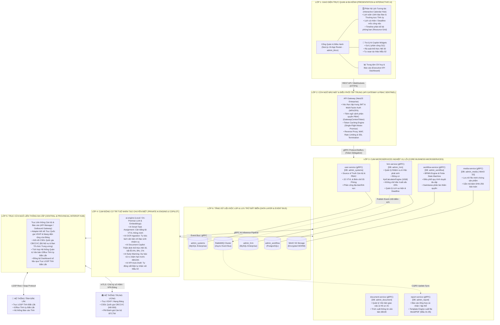
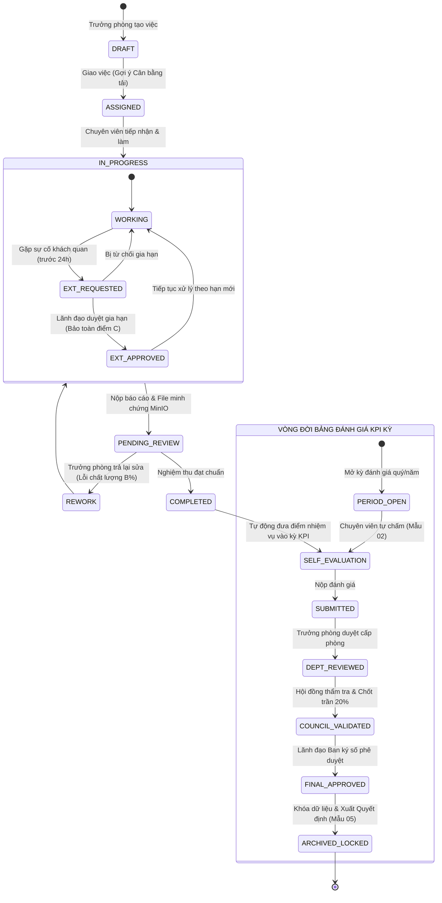
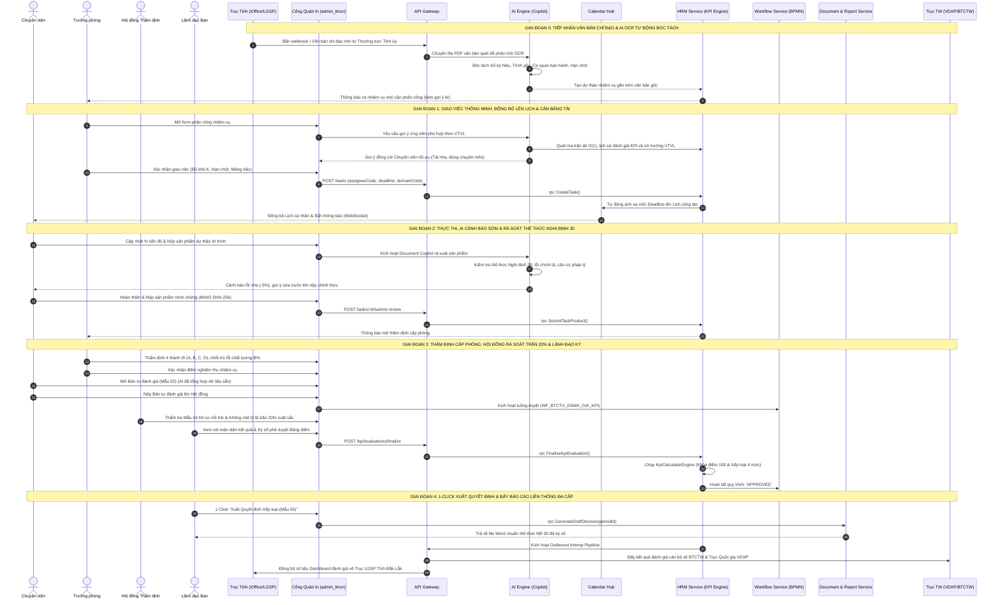
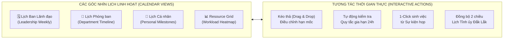
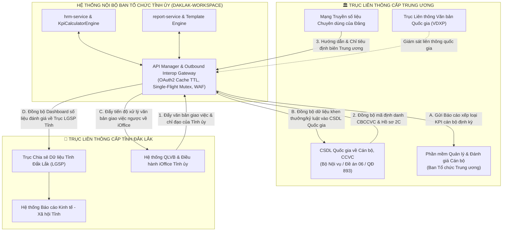
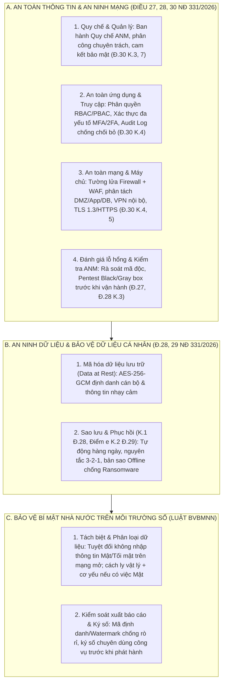
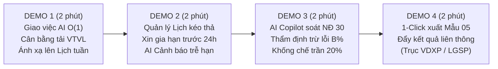

# BÀI GIẢI PHÁP KỸ THUẬT & TRẢ LỜI ĐỀ BÀI YÊU CẦU
## PHÂN HỆ QUẢN LÝ CÔNG VIỆC, ĐÁNH GIÁ KPI/OKR VÀ BẢO ĐẢM AN TOÀN THÔNG TIN
### ĐƠN VỊ: BAN TỔ CHỨC TỈNH ỦY ĐẮK LẮK (BTCTU_DAKLAK)
*Căn cứ đề bài tại file [yeucau.md](file:///c:/Users/Admin/Desktop/daklak-workspace/docs/yeucau.md)*

---

> **CĂN CỨ PHÁP LÝ & QUY CHUẨN KỸ THUẬT:**
> 1. **Quy định số 01-QĐ/BTCTU** ngày 28/11/2025 của Ban Tổ chức Tỉnh ủy Đắk Lắk về chức năng, nhiệm vụ, quyền hạn và cơ cấu tổ chức.
> 2. **Hướng dẫn số 05-HD/TU** ngày 20/02/2026 & **Quy định số 39-QĐ/TU** ngày 15/01/2026 của Ban Thường vụ Tỉnh ủy Đắk Lắk về đánh giá, xếp loại chất lượng cán bộ, công chức, viên chức hằng quý và hằng năm.
> 3. **Quy định số 348-QĐ/BTCTW** của Ban Tổ chức Trung ương về tiêu chuẩn chính trị và công tác bảo vệ chính trị nội bộ.
> 4. **Luật An toàn thông tin mạng số 86/2015/QH13** và **Luật An ninh mạng số 24/2018/QH14**.
> 5. **Nghị định số 85/2016/NĐ-CP** ngày 01/7/2016 của Chính phủ về bảo đảm an toàn hệ thống thông tin theo cấp độ và **Thông tư số 12/2022/TT-BTTTT** của Bộ Thông tin và Truyền thông.
> 6. **Nghị định số 331/2026/NĐ-CP** của Chính phủ về an ninh mạng, bảo vệ hệ thống thông tin và an ninh dữ liệu (đặc biệt là Điều 27, 28, 29, 30) & **Luật Bảo vệ bí mật nhà nước số 35/2018/QH14**.
> 7. **Nghị định số 30/2020/NĐ-CP** ngày 05/3/2020 của Chính phủ về công tác văn thư và thể thức văn bản.

---

## MỤC LỤC BÀI TRẢ LỜI

1. [CÂU 1: XÂY DỰNG BỘ TIÊU CHÍ ĐỊNH LƯỢNG ĐÁNH GIÁ KPI/OKR](#câu-1-xây-dựng-bộ-tiêu-chí-định-lượng-đánh-giá-kpiokr)
   - [1.1. Thang điểm 100 đánh giá toàn diện cá nhân](#11-thang-điểm-100-đánh-giá-toàn-diện-cá-nhân)
   - [1.2. Công thức toán học lượng hóa 4 thành tố KPI công việc](#12-công-thức-toán-học-lượng-hóa-4-thành-tố-kpi-công-việc)
   - [1.3. Ma trận trọng số động theo 04 mảng việc nghiệp vụ](#13-ma-trận-trọng-số-động-theo-04-mảng-việc-nghiệp-vụ)
   - [1.4. Khung đánh giá tập thể 05 phòng ban trực thuộc](#14-khung-đánh-giá-tập-thể-05-phòng-ban-trực-thuộc)
   - [1.5. Cơ chế xếp loại 4 mức chất lượng & khống chế trần xuất sắc 20%](#15-cơ-chế-xếp-loại-4-mức-chất-lượng--khống-chế-trần-xuất-sắc-20)
2. [CÂU 2: ỨNG DỤNG LẬP TRÌNH XÂY DỰNG PHẦN MỀM QUẢN LÝ & ĐÁNH GIÁ KPI/OKR](#câu-2-ứng-dụng-lập-trình-xây-dựng-phần-mềm-quản-lý--đánh-giá-kpiokr)
   - [2.1. Sơ đồ Kiến trúc Phân tầng Tổng thể Hệ thống (Multi-Tier Architecture Blueprint)](#21-sơ-đồ-kiến-trúc-phân-tầng-tổng-thể-hệ-thống-multi-tier-architecture-blueprint)
   - [2.2. Sơ đồ Phân tích Thiết kế Thực thể Dữ liệu Mở rộng (Enhanced ERD Domain Model)](#22-sơ-đồ-phân-tích-thiết-kế-thực-thể-dữ-liệu-mở-rộng-enhanced-erd-domain-model)
   - [2.3. Sơ đồ Luồng Dữ liệu Nghiệp vụ Đa tầng (DFD Level 0, Level 1 & Level 2 Interop/AI)](#23-sơ-đồ-luồng-dữ-liệu-nghiệp-vụ-đa-tầng-dfd-level-0-level-1--level-2-interopai)
   - [2.4. Sơ đồ Phân rã Chức năng (FDD) & Ma trận Phân quyền Vai trò PBAC](#24-sơ-đồ-phân-rã-chức-năng-fdd--ma-trận-phân-quyền-vai-trò-pbac)
   - [2.5. Sơ đồ Máy Trạng thái Vòng đời Nhiệm vụ & Đánh giá KPI (State Machine Lifecycle)](#25-sơ-đồ-máy-trạng-thái-vòng-đời-nhiệm-vụ--đánh-giá-kpi-state-machine-lifecycle)
   - [2.6. Ma trận rà soát và đặc tả 09 nhóm chức năng cốt lõi theo đề bài (100% Hoàn thành)](#26-ma-trận-rà-soát-và-đặc-tả-09-nhóm-chức-năng-cốt-lõi-theo-đề-bài)
   - [2.7. Sơ đồ Chuỗi Nghiệp vụ Liên thông Khép kín (End-to-End Sequence Diagram)](#27-sơ-đồ-chuỗi-nghiệp-vụ-liên-thông-khép-kín-end-to-end-sequence-diagram)
   - [2.8. Các giải pháp kỹ thuật sáng tạo bổ sung vượt yêu cầu tối thiểu (04 sáng kiến)](#28-các-giải-pháp-kỹ-thuật-sáng-tạo-bổ-sung-vượt-yêu-cầu-tối-thiểu)
   - [2.9. Đặc tả Ứng dụng Trí tuệ Nhân tạo (AI) Hỗ trợ Đột phá trong Công việc](#29-đặc-tả-ứng-dụng-trí-tuệ-nhân-tạo-ai-hỗ-trợ-đột-phá-trong-công-việc)
   - [2.10. Phân hệ Quản lý Công việc & Tiến độ qua Giao diện Lịch Trực quan (Interactive Calendar Hub)](#210-phân-hệ-quản-lý-công-việc--tiến-độ-qua-giao-diện-lịch-trực-quan-interactive-calendar-hub)
   - [2.11. Kiến trúc & Cơ chế Tích hợp Sâu Hệ thống Liên thông Trung ương và Tỉnh để Lấy Báo cáo Đánh giá](#211-kiến-trúc--cơ-chế-tích-hợp-sâu-hệ-thống-liên-thông-trung-ương-và-tỉnh-để-lấy-báo-cáo-đánh-giá)
3. [CÂU 3: XÁC ĐỊNH CẤP ĐỘ AN TOÀN THÔNG TIN & ĐỀ XUẤT GIẢI PHÁP BẢO VỆ MÔI TRƯỜNG SỐ](#câu-3-xác-định-cấp-độ-an-toàn-thông-tin--đề-xuất-giải-pháp-bảo-vệ-môi-trường-số)
   - [3.1. Xác định Cấp độ An toàn Thông tin của Hệ thống](#31-xác-định-cấp-độ-an-toàn-thông-tin-của-hệ-thống)
   - [3.2. Căn cứ pháp lý (Nghị định 331/2026/NĐ-CP) và căn cứ thực tiễn xác định cấp độ](#32-căn-cứ-pháp-lý-và-căn-cứ-thực-tiễn-xác-định-cấp-độ)
   - [3.3. Đề xuất các giải pháp kỹ thuật và quản lý căn cứ Điều 28, 29, 30 Nghị định 331/2026/NĐ-CP](#33-đề-xuất-các-giải-pháp-bảo-đảm-an-toàn-thông-tin-an-ninh-mạng-an-ninh-dữ-liệu-và-bảo-vệ-bí-mật-nhà-nước)
4. [CÂU 4: KHUNG KỊCH BẢN THUYẾT TRÌNH & BẢO VỆ ĐỀ ÁN TRƯỚC HỘI ĐỒNG TUYỂN DỤNG (30 PHÚT)](#câu-4-khung-kịch-bản-thuyết-trình--bảo-vệ-đề-án-trước-hội-đồng-tuyển-dụng-30-phút)
   - [4.1. Chiến lược phân bổ thời gian 30 phút (5 - 10 - 5 - 10)](#41-chiến-lược-phân-bổ-thời-gian-30-phút-5---10---5---10)
   - [4.2. Kịch bản thuyết trình chi tiết từng phút & Thao tác Live Demo](#42-kịch-bản-thuyết-trình-chi-tiết-từng-phút--thao-tác-live-demo)
   - [4.3. Kịch bản Live Demo 04 luồng chức năng đột phá kết hợp AI & Liên thông](#43-kịch-bản-live-demo-04-luồng-chức-năng-đột-phá-kết-hợp-ai--liên-thông)
   - [4.4. Bộ 08 câu hỏi phản biện chuyên sâu của Ban Giám khảo & Hướng trả lời thuyết phục](#44-bộ-08-câu-hỏi-phản-biện-chuyên-sâu-của-ban-giám-khảo--hướng-trả-lời-thuyết-phục)
   - [4.5. Thông điệp kết luận & Cam kết triển khai](#45-thông-điệp-kết-luận--cam-kết-triển-khai)
5. [KẾT LUẬN & KIẾN NGHỊ](#kết-luận--kiến-nghị)

---

## CÂU 1: XÂY DỰNG BỘ TIÊU CHÍ ĐỊNH LƯỢNG ĐÁNH GIÁ KPI/OKR

Theo tinh thần **Hướng dẫn số 05-HD/TU**, **Quy định số 39-QĐ/TU** của Ban Thường vụ Tỉnh ủy và **Quy định số 01-QĐ/BTCTU** của Ban Tổ chức Tỉnh ủy Đắk Lắk, việc đánh giá cán bộ phải đoạn tuyệt với thói quen cảm tính, dĩ hòa vi quý, chuyển sang phương pháp **định lượng hóa 100% dựa trên sản phẩm đầu ra, chất lượng chuyên môn và kỷ luật tiến độ**.

### 1.1. Thang điểm 100 đánh giá toàn diện cá nhân

Tổng điểm đánh giá chất lượng cá nhân định kỳ ($S_{\text{tổng}}$) được xác định bởi công thức:

$$S_{\text{tổng}} = S_{\text{chung}} + S_{\text{nhiệm vụ}}$$

#### a) Điểm Tiêu chí Chung ($S_{\text{chung}}$ - Tối đa 30.0 điểm)
Phản ánh phẩm chất chính trị, đạo đức, tác phong và ý thức tổ chức kỷ luật của người cán bộ Đảng viên, gồm 03 nhóm tiêu chí:
1. **Phẩm chất chính trị, tư tưởng, đạo đức, lối sống, trách nhiệm nêu gương** (Tối đa **18.0 điểm**):
   - Chấp hành chủ trương, đường lối của Đảng, chính sách pháp luật của Nhà nước; giữ gìn đoàn kết nội bộ (6.0đ).
   - Đạo đức công vụ trong sáng, không tham nhũng, tiêu cực, lãng phí, cơ hội; thực hiện văn hóa công sở cơ quan Đảng (6.0đ).
   - Trách nhiệm nêu gương của cán bộ, đảng viên theo Quy định số 08-QĐi/TW và Quy định của Tỉnh ủy (6.0đ).
2. **Tinh thần đổi mới, sáng tạo, dám nghĩ, dám làm, khát vọng cống hiến** (Tối đa **04.0 điểm**):
   - Chủ động đề xuất sáng kiến cải tiến lề lối làm việc, quy trình thẩm định, ứng dụng công nghệ số (2.0đ).
   - Tinh thần khắc phục khó khăn, dũng cảm nhận việc khó, việc mới do lãnh đạo Ban phân công (2.0đ).
3. **Ý thức tổ chức kỷ luật, tự soi tự sửa, khắc phục hạn chế** (Tối đa **08.0 điểm**):
   - Chấp hành nghiêm giờ giấc làm việc, chế độ báo cáo, kỷ luật phát ngôn và quy chế bảo vệ bí mật nhà nước (4.0đ).
   - Nghiêm túc thực hiện tự phê bình và phê bình theo Nghị quyết Trung ương 4 (khóa XI, XII, XIII), tích cực sửa chữa các khuyết điểm sau kiểm điểm (4.0đ).

#### b) Điểm Kết quả Thực hiện Nhiệm vụ ($S_{\text{nhiệm vụ}}$ - Tối đa 70.0 điểm)
Được tự động tính toán từ trung bình các chỉ số KPI nhiệm vụ phát sinh trong kỳ, quy đổi chuẩn xác sang thang điểm 70:

$$S_{\text{nhiệm vụ}} = \frac{KPI_{\text{trung bình}}}{100} \times 70.0 \quad \text{với} \quad KPI_{\text{trung bình}} = \frac{\sum_{i=1}^{n} KPI_i}{n}$$

---

### 1.2. Công thức toán học lượng hóa 4 thành tố KPI công việc

Mỗi công việc/nhiệm vụ thứ $i$ được giao đều có một điểm số định lượng $KPI_i \in [0, 120]$ tính toán theo ma trận 4 thành tố:

$$KPI_i = (A\% \times w_A) + (B\% \times w_B) + (C\% \times w_C) + (D\% \times w_D)$$

*(Ràng buộc chuẩn hóa: $w_A + w_B + w_C + w_D = 100\%$)*

#### Chi tiết định lượng từng thành tố:
1. **Thành tố $A\%$ (Khối lượng công việc theo hệ số độ khó $K$)**:
   $$A\% = (A_1 \times 70\%) + (A_2 \times 30\%) + A_3$$
   - $A_1$: Tỷ lệ hoàn thành nhiệm vụ theo kế hoạch có trọng số độ khó $K \in [1.0, 5.0]$:
     $$A_1 = \frac{\sum (SL_{\text{Thực tế}} \times K)}{\sum (SL_{\text{Kế hoạch}} \times K)} \times 100\%$$
     *Quy định hệ số độ khó $K$:*
     - $K=1.0$: Soạn thảo văn bản thông thường, sao lục, phát hành tài liệu.
     - $K=2.0 - 3.0$: Thẩm định hồ sơ cán bộ, đối soát CSDL đảng viên, xử lý đơn thư nghiệp vụ.
     - $K=4.0 - 5.0$: Thẩm tra tiêu chuẩn chính trị nội bộ nhân sự BTV Tỉnh ủy quản lý, tham mưu Đề án/Nghị quyết Tỉnh ủy.
   - $A_2$: Khối lượng nhiệm vụ đột xuất do Lãnh đạo Ban/Tỉnh ủy giao bổ sung.
   - $A_3$: Điểm thưởng vượt định mức (+5% nếu vượt 10%–20%; +10% nếu vượt >20%). Khống chế trần $A\% \le 120\%$.

2. **Thành tố $B\%$ (Chất lượng sản phẩm - Kiểm soát 3 mức lỗi)**:
   $$B\% = 100\% - (\text{Lỗi nhẹ} \times 5\% + \text{Lỗi trung bình} \times 15\% + \text{Lỗi nghiêm trọng} \times 35\%) + B_{\text{thưởng}}$$
   - **Lỗi nhẹ (-5%/lần)**: Lỗi chính tả, sai thể thức văn bản Đảng theo Hướng dẫn 36-HD/VPTW, sai định dạng phôi mẫu.
   - **Lỗi trung bình (-15%/lần)**: Sai số liệu tổng hợp, thiếu tài liệu hồ sơ bắt buộc, bị lãnh đạo phòng trả lại yêu cầu sửa đổi.
   - **Lỗi nghiêm trọng (-35%/lần)**: Sai căn cứ thẩm định chính trị, tham mưu sai quy chế bổ nhiệm cán bộ, làm lộ lọt thông tin nội bộ.
   - **Thưởng chất lượng ($B_{\text{thưởng}} = +10\%$)**: Sản phẩm đề án, báo cáo được Ban Thường vụ Tỉnh ủy đánh giá xuất sắc hoặc biểu dương bằng văn bản.

3. **Thành tố $C\%$ (Tiến độ thực hiện nhiệm vụ)**:
   - **Hoàn thành trước hạn $\ge 20\%$ thời gian**: Thưởng 10% $\rightarrow C\% = 110\%$.
   - **Hoàn thành đúng hạn**: Đạt chuẩn $C\% = 100\%$.
   - **Trễ hạn có lý do khách quan được duyệt gia hạn trước 24h**: $C\% = 100\%$ *(bảo toàn điểm tiến độ)*.
   - **Trễ hạn không lý do chính đáng**:
     - Trễ hạn nhẹ ($\le 10\%$ thời gian): $C\% = 90\%$ (trừ 10%).
     - Trễ hạn trung bình (11%–30% thời gian): $C\% = 75\%$ (trừ 25%).
     - Trễ hạn nghiêm trọng ($> 30\%$ thời gian): $C\% \le 50\%$ (trừ 50% đến 100%).

4. **Thành tố $D\%$ (Tính chủ động & Trách nhiệm lãnh đạo quản lý)**:
   - **Đối với Lãnh đạo Ban, Trưởng/Phó Phòng**:
     $$D\% = (D_1 \text{ [Tỷ lệ hoàn thành của Cấp dưới]} \times 40\%) + (D_2 \text{ [Sáng kiến đổi mới]} \times 30\%) + (D_3 \text{ [Năng lực quản trị]} \times 30\%)$$
   - **Đối với Chuyên viên**:
     $$D\% = (D_1 \text{ [Khối lượng đột xuất]} \times 40\%) + (D_2 \text{ [Phối hợp liên phòng]} \times 30\%) + (D_3 \text{ [Kỷ cương và CĐS]} \times 30\%)$$

---

### 1.3. Ma trận trọng số động theo 04 mảng việc nghiệp vụ

Nhằm phản ánh đúng tính chất công việc đặc thù của Ngành Tổ chức xây dựng Đảng, hệ thống thiết lập bảng trọng số linh hoạt theo 04 mảng việc (`domain_code`):

| Mã Mảng việc | Trọng số $w_A$ (Khối lượng) | Trọng số $w_B$ (Chất lượng) | Trọng số $w_C$ (Tiến độ) | Trọng số $w_D$ (Chủ động/Lãnh đạo) | Căn cứ nghiệp vụ Ban Tổ chức Tỉnh ủy |
| :--- | :---: | :---: | :---: | :---: | :--- |
| **`DOM_THAM_DINH`**<br>(Thẩm định hồ sơ cán bộ & BVCTNB) | 15% | **50%** | 20% | 15% | **Chất lượng là sinh mệnh**: Thẩm định nhân sự và kết luận chính trị tuyệt đối không được sai sót theo Quy định 348-QĐ/BTCTW. |
| **`DOM_VAN_THU`**<br>(Văn thư, Lưu trữ, Quản lý Thẻ Đảng) | **40%** | 20% | 30% | 10% | **Khối lượng lớn & kịp thời**: Xử lý lượng lớn văn bản đi/đến, quản lý hồ sơ phát hành thẻ Đảng viên đúng kỳ hạn. |
| **`DOM_IT_ATTT`**<br>(Quản trị CNTT & ATTT Cấp độ 3) | 20% | 30% | **35%** | 15% | **Tiến độ & Độ sẵn sàng cao**: Duy trì hệ thống Uptime $\ge 99.5\%$, ứng cứu sự cố $< 2$ giờ per NĐ 85/2016/NĐ-CP. |
| **`DOM_THAM_MUU`**<br>(Tham mưu Đề án, Nghị quyết Tỉnh ủy) | 20% | **40%** | 20% | 20% | **Hàm lượng trí tuệ sâu**: Đề án trình Ban Thường vụ Tỉnh ủy phải sâu sắc, khả thi, mang tầm chiến lược. |

---

### 1.4. Khung đánh giá tập thể 05 phòng ban trực thuộc

Điểm tổng thể của Tập thể Phòng ($S_{\text{tập thể}}$) được xác định trên nguyên tắc **kết quả của tập thể gắn liền với trách nhiệm và hiệu suất của từng cá nhân**:

$$S_{\text{tập thể}} = S_{\text{chung phòng}} + S_{\text{nhiệm vụ phòng}}$$

Trong đó:
- $S_{\text{chung phòng}}$: Đánh giá khối đoàn kết nội bộ, chấp hành kỷ cương, thực hiện chế độ thông tin báo cáo của tập thể phòng.
- $S_{\text{nhiệm vụ phòng}}$: Tính bằng **trung bình cộng điểm $S_{\text{nhiệm vụ}}$ của toàn bộ cán bộ, công chức trong phòng** kết hợp với tỷ lệ hoàn thành các mục tiêu chương trình công tác quý/năm của phòng.
- **Danh mục 05 Tập thể Phòng Ban được định lượng hóa:**
  1. `TT-01: BTCTU_DAKLAK` (Tập thể Lãnh đạo Ban).
  2. `TT-02: P_TCD_DV` (Phòng Tổ chức đảng, đảng viên).
  3. `TT-03: P_TCCB` (Phòng Tổ chức cán bộ).
  4. `TT-04: P_BVCTNB` (Phòng Bảo vệ chính trị nội bộ).
  5. `TT-05: VAN_PHONG` (Văn phòng Ban).

---

### 1.5. Cơ chế xếp loại 4 mức chất lượng & khống chế trần xuất sắc 20%

Kết quả đánh giá định kỳ hằng tháng, hằng quý và hằng năm được phân loại thành 04 mức:
1. **Hoàn thành xuất sắc nhiệm vụ**:
   - Điều kiện: Tổng điểm $S_{\text{tổng}} \ge 90.0$ điểm; có ít nhất 01 sản phẩm nổi trội, vượt mức được nghiệm thu (kê khai tại Mẫu 04); không có nhiệm vụ trễ hạn không lý do.
   - **Ràng buộc khống chế tỷ lệ trần:** Số lượng cán bộ xếp loại "Hoàn thành xuất sắc nhiệm vụ" **không vượt quá 20%** tổng số cán bộ, công chức của Ban (và không vượt quá 20% số lượng công chức của từng phòng chuyên môn được xếp loại Hoàn thành tốt nhiệm vụ trở lên).
2. **Hoàn thành tốt nhiệm vụ**: $70.0 \le S_{\text{tổng}} < 90.0$ điểm (hoặc cán bộ đạt $\ge 90.0$ điểm nhưng vượt tỷ lệ khống chế 20%).
3. **Hoàn thành nhiệm vụ**: $50.0 \le S_{\text{tổng}} < 70.0$ điểm.
4. **Không hoàn thành nhiệm vụ**: $S_{\text{tổng}} < 50.0$ điểm hoặc có cán bộ vi phạm kỷ luật, để xảy ra sai phạm nghiêm trọng trong công tác tham mưu nhân sự, vi phạm quy định bảo vệ bí mật nhà nước.

---

## CÂU 2: ỨNG DỤNG LẬP TRÌNH XÂY DỰNG PHẦN MỀM QUẢN LÝ & ĐÁNH GIÁ KPI/OKR

Hệ thống được thiết kế và triển khai thực tế trên kiến trúc **Microservices chuẩn doanh nghiệp**, tuân thủ nguyên tắc độc lập dữ liệu (Service Data Sovereignty), tích hợp sâu động cơ Trí tuệ Nhân tạo (AI Copilot), Quản lý Lịch công tác trực quan và Trục liên thông đa cấp Trung ương - Tỉnh.

### 2.1. Sơ đồ Kiến trúc Phân tầng Tổng thể Hệ thống (Multi-Tier Architecture Blueprint)

Kiến trúc hệ thống được chia thành **06 tầng phân lập nghiêm ngặt**, bảo đảm khả năng mở rộng quy mô, hiệu năng cao và an toàn bảo mật tuyệt đối:



---

### 2.2. Sơ đồ Phân tích Thiết kế Thực thể Dữ liệu Mở rộng (Enhanced ERD Domain Model)

Hệ thống quản lý dữ liệu phân tán theo chuẩn **Service Data Sovereignty**, trong đó mỗi Microservice sở hữu trọn vẹn CSDL riêng biệt. Sơ đồ thực thể mở rộng dưới đây thể hiện sự liên kết hữu cơ giữa các thực thể Tổ chức, VTVL, Nhiệm vụ, Lịch công tác, Đánh giá KPI, Động cơ AI và Giao dịch liên thông:

```mermaid
erDiagram
    %% Service: user-service (DB: admin_systems)
    ORGANIZATION ||--o{ JOB_TITLE : "quản lý danh mục VTVL"
    ORGANIZATION ||--o{ STAFFING_SLOT : "phân bổ định biên"
    JOB_TITLE ||--o{ STAFFING_SLOT : "định nghĩa chức danh"
    STAFFING_SLOT ||--o| EMPLOYEE : "bố trí nhân sự (1-1)"
    ORGANIZATION ||--o{ EMPLOYEE : "thuộc phòng ban (1-N)"
    
    ORGANIZATION {
        string id PK
        string code "BTCTU, P_TCCB, P_BVCTNB..."
        string name "Tên phòng ban"
        int totalStaffing "Định biên được giao"
    }
    
    JOB_TITLE {
        string id PK
        string code "VTVL_01..VTVL_22"
        string titleName "Tên chức danh vị trí việc làm"
        string category "Lãnh đạo / Chuyên môn / Hỗ trợ"
    }

    STAFFING_SLOT {
        string id PK
        string organizationId FK
        string jobTitleId FK
        string employeeCode FK "Mã cán bộ tiếp nhận"
        string domainCode "DOM_THAM_DINH, DOM_VAN_THU..."
        string status "OCCUPIED / VACANT"
    }

    %% Service: hrm-service (DB: admin_hrm)
    EMPLOYEE ||--o{ TASK : "giao việc (Assigner)"
    EMPLOYEE ||--o{ TASK : "thực hiện (Assignee)"
    TASK ||--o{ TASK_ITEM : "phân rã việc con"
    TASK ||--o{ TASK_ATTACHMENT : "đính kèm minh chứng"
    TASK ||--o{ TASK_PROGRESS : "nhật ký % tiến độ"
    TASK ||--o{ TASK_HISTORY : "vết kiểm toán bất biến"
    
    %% Mở rộng: Thực thể Lịch công tác & AI Assistant
    EMPLOYEE ||--o{ CALENDAR_EVENT : "tham gia sự kiện / lịch"
    TASK ||--o| CALENDAR_EVENT : "ánh xạ mốc deadline lên lịch"
    TASK ||--o{ AI_ANALYSIS_LOG : "nhận xét & cảnh báo AI"

    TASK {
        string id PK
        string title "Tên nhiệm vụ"
        string domainCode "Mảng việc"
        float difficultyWeight "Hệ số độ khó K (1.0 - 5.0)"
        datetime deadline "Thời hạn hoàn thành"
        string status "IN_PROGRESS / COMPLETED / EXTENDED"
        string assignerCode FK "Người giao việc"
        string assigneeCode FK "Người thực hiện"
        boolean isExtended "Cờ đã được duyệt gia hạn"
        boolean isIncidental "Việc phát sinh đột xuất"
    }

    CALENDAR_EVENT {
        string id PK
        string taskId FK "Nhiệm vụ liên kết (nếu có)"
        string eventType "LEADERSHIP_WEEKLY / DEPT_MEETING / TASK_DEADLINE / FIELD_TRIP"
        string title "Tiêu đề cuộc họp / Lịch công tác"
        datetime startTime "Thời gian bắt đầu"
        datetime endTime "Thời gian kết thúc"
        string location "Địa điểm (Hội trường Tỉnh ủy / Trụ sở Ban)"
        string attendeesJson "Danh sách cán bộ triệu tập"
        boolean isSyncedProvincial "Đã đồng bộ Lịch Thường trực Tỉnh ủy"
    }

    AI_ANALYSIS_LOG {
        string id PK
        string taskId FK
        string aiModule "WORKLOAD_RECOMMEND / OCR_INGESTION / NQ30_AUDIT / EARLY_WARNING"
        json inputData "Dữ liệu đầu vào phân tích"
        json outputRecommendation "Đề xuất thông minh của AI"
        float confidenceScore "Độ tin cậy của thuật toán"
        datetime createdAt "Thời điểm thực thi"
    }

    TASK_PROGRESS {
        string id PK
        string taskId FK
        int percent "Tiến độ (0 - 100%)"
        string description "Nội dung báo cáo"
        datetime reportedAt "Thời gian nộp"
    }

    TASK_ATTACHMENT {
        string id PK
        string taskId FK
        string minioFileKey "Đường dẫn file MinIO S3"
        string fileName "Tên tài liệu minh chứng"
        string hashSha256 "Mã băm toàn vẹn tài liệu"
    }

    TASK_HISTORY {
        string id PK
        string taskId FK
        string actorId "Người thao tác"
        string actionType "CREATE / PROGRESS / EXTEND / GRADE"
        json oldValue "Dữ liệu trước sửa"
        json newValue "Dữ liệu sau sửa"
        datetime timestamp "Thời điểm ghi nhận"
    }

    %% Module: KPI Evaluation (DB: admin_hrm)
    KPI_PERIOD ||--o{ KPI_EVALUATION : "chứa các bảng chấm"
    KPI_RULE_SET ||--o{ KPI_EVALUATION : "áp dụng bộ trọng số"
    EMPLOYEE ||--o{ KPI_EVALUATION : "được đánh giá"
    KPI_EVALUATION ||--o{ KPI_EVALUATION_SCORE : "chi tiết điểm thành tố"
    KPI_CRITERIA ||--o{ KPI_EVALUATION_SCORE : "tiêu chí đánh giá"
    KPI_EVALUATION ||--o{ KPI_EVALUATION_HISTORY : "vết kiểm toán chấm điểm"
    KPI_EVALUATION ||--o{ INTEROP_SYNC_LOG : "lịch sử gửi nhận liên thông"

    KPI_PERIOD {
        string id PK
        string periodCode "Q1_2026, YEAR_2026..."
        datetime startDate "Ngày bắt đầu"
        datetime endDate "Ngày kết thúc"
        datetime selfScoreDeadline "Hạn tự chấm"
        string status "ACTIVE / LOCKED / ARCHIVED"
    }

    KPI_EVALUATION {
        string id PK
        string periodId FK
        string employeeCode FK
        float scoreCommon "Điểm tiêu chí chung (Max 30)"
        float scoreTask "Điểm nhiệm vụ (Max 70)"
        float scoreTotal "Tổng điểm cá nhân (Max 100)"
        string rankClassification "XUAT_SAC / TOT / HOAN_THANH / KHONG_HT"
        boolean isOutstanding "Có việc nổi trội Mẫu 04"
        string workflowState "DRAFT / SUBMITTED / REVIEWED / APPROVED"
    }

    INTEROP_SYNC_LOG {
        string id PK
        string evaluationId FK
        string targetSystem "NATIONAL_VDXP / MOI_CBCCVC / DAKLAK_LGSP / PARTY_BTCTW"
        string transactionType "PUSH_EVALUATION / PULL_PROFILE / SYNC_STATUS"
        string status "SUCCESS / PENDING / FAILED"
        string payloadDigest "Mã kiểm chứng toàn vẹn dữ liệu"
        datetime syncedAt "Thời gian đồng bộ"
    }

    %% Service: workflow-service (DB: admin_workflow)
    KPI_EVALUATION ||--o| WORKFLOW_INSTANCE : "điều phối quy trình duyệt"
    WORKFLOW_INSTANCE ||--o{ WORKFLOW_TASK : "chuyển bước qua các cấp"

    WORKFLOW_INSTANCE {
        string id PK
        string definitionKey "WF_BTCTU_DANH_GIA_KPI"
        string businessKey "ID Đánh giá KPI"
        string currentState "SUBMITTED / REVIEWED / APPROVED"
        string currentAssigneeRole "TRUONG_PHONG / HOI_DONG / LANH_DAO_BAN"
    }
```



---

### 2.3. Sơ đồ Luồng Dữ liệu Nghiệp vụ Đa tầng (DFD Level 0, Level 1 & Level 2 Interop/AI)

Sơ đồ luồng dữ liệu (Data Flow Diagram - DFD) mô tả sự vận động của dòng thông tin từ khi tiếp nhận chỉ đạo/văn bản từ Trục liên thông, AI bóc tách thông tin, đồng bộ lên Lịch công tác, lãnh đạo giao việc thông minh, chuyên viên nộp sản phẩm, AI kiểm tra thể thức đến khi chốt điểm KPI và đẩy kết quả liên thông:

```mermaid
flowchart TD
    %% External Entities
    TP["Trưởng phòng Chuyên môn"]
    CV["Chuyên viên Thực hiện"]
    HD["Hội đồng Thẩm định"]
    LDB["Lãnh đạo Ban Tổ chức Tỉnh ủy"]
    CENTRAL["🏛️ Trục Trung ương (VDXP / CSDL CBCCVC / BTCTW)"]
    PROV["🏢 Trục Tỉnh (LGSP Đắk Lắk / iOffice Tỉnh ủy)"]

    %% Processes
    subgraph PROCESSES["CÁC TIẾN TRÌNH XỬ LÝ DỮ LIỆU CỐT LÕI"]
        P1["1.0 Quản trị VTVL & Định biên 22 Chức danh"]
        P2["2.0 Giao việc Thông minh & Cân bằng tải AI (O1)"]
        P3["3.0 Quản lý Lịch Công tác, Họp & Mốc Deadline 2 chiều"]
        P4["4.0 Tiến độ, Xin gia hạn trước 24h & AI Cảnh báo sớm"]
        P5["5.0 AI Copilot: OCR Văn bản & Soát Thể thức NĐ 30"]
        P6["6.0 KpiCalculatorEngine (100đ) & Khống chế Trần 20%"]
        P7["7.0 Template Engine xuất Hồ sơ & Ký số Văn bản Đảng"]
        P8["8.0 Outbound Interop Hub: Báo cáo Đánh giá Liên thông"]
    end

    %% Data Stores
    D1[("D1: CSDL Tổ chức & VTVL\n(admin_systems)")]
    D2[("D2: CSDL Nhiệm vụ & Audit Trail\n(admin_hrm)")]
    D3[("D3: CSDL Lịch & Sự kiện Họp\n(admin_hrm)")]
    D4[("D4: CSDL Đánh giá KPI & Quy tắc\n(admin_hrm)")]
    D5[("D5: CSDL Quy trình BPMN\n(admin_workflow)")]
    D6[("D6: Kho File Minh chứng MinIO S3\n(Encrypted WORM)")]
    D7[("D7: Kho Tri thức AI & Logs\n(Local Vector DB / Logs)")]
    D8[("D8: CSDL Liên thông & Token Cache\n(admin_report / Redis)")]

    %% Flows - Inbound & Task Creation
    PROV -->|"Văn bản chỉ đạo Thường trực Tỉnh ủy"| P5
    P5 <-->|"AI OCR bóc tách trích yếu, hạn chót"| D7
    P5 -->|"Tạo dự thảo nhiệm vụ gắn văn bản"| P2
    
    TP -->|"Thiết lập 22 VTVL & phân bổ định biên"| P1
    P1 <--> D1

    TP -->|"Giao việc mới (độ khó K, hạn chót, mảng việc)"| P2
    P2 <-->|"AI phân tích tải công việc & gợi ý người làm"| D2
    P2 -->|"Lưu nhiệm vụ & tự động đồng bộ deadline"| D2
    P2 -->|"Ánh xạ deadline mốc việc lên Lịch"| P3
    P3 <--> D3

    %% Calendar & Execution
    LDB -->|"Cập nhật Lịch tuần Lãnh đạo & Lịch họp Ban"| P3
    P3 -->|"Xem lịch công tác tuần & timeline tải"| CV
    P3 -->|"Xem lịch công tác tuần & timeline tải"| TP

    CV -->|"Cập nhật % tiến độ & Nộp file minh chứng"| P4
    CV -->|"Phiếu xin gia hạn giải quyết trước 24 giờ"| P4
    P4 -->|"Lưu file minh chứng mã băm SHA-256"| D6
    P4 -->|"Ghi nhật ký tiến độ & Audit Trail"| D2
    P4 <-->|"AI phân tích tiến độ dự báo nguy cơ trễ hạn"| D7
    P4 -.->|"Cảnh báo nguy cơ trễ trước 48h/24h"| CV
    P4 -.->|"Cảnh báo nguy cơ trễ trước 48h/24h"| TP

    %% Product Audit & AI Document Copilot
    CV -->|"Nộp dự thảo tờ trình/báo cáo"| P5
    P5 <-->|"AI Document Copilot rà soát NĐ 30 & bắt lỗi"| D7
    P5 -->|"Báo cáo kết quả rà soát lỗi chất lượng B%"| TP

    %% KPI & Approval
    CV -->|"Lập Bản tự đánh giá (Mẫu 02) (AI soạn sẵn)"| P6
    P6 <-->|"Trích xuất điểm nhiệm vụ hoàn thành trong kỳ"| D2
    P6 -->|"Khởi tạo tiến trình duyệt BPMN"| D5
    P6 --> D4

    TP -->|"Thẩm định cấp phòng, chốt trừ lỗi B%"| P6
    HD -->|"Thẩm tra hồ sơ Mẫu 04 & khóa trần 20% xuất sắc"| P6
    LDB -->|"Ký số phê duyệt Bảng điểm chính thức"| P6
    P6 <-->|"Điều phối trạng thái duyệt đa cấp"| D5
    P6 <-->|"Khóa điểm số cuối cùng thang 100"| D4

    %% Report & Outbound Interop
    LDB -->|"Kích hoạt sinh Dự thảo Quyết định xếp loại"| P7
    P7 <-->|"Trích xuất bảng điểm và xếp loại đã duyệt"| D4
    P7 -->|"Xuất file Quyết định & Báo cáo (.docx / .pdf)"| LDB

    P7 -->|"Chuyển gói dữ liệu đánh giá đã ký số"| P8
    P8 <-->|"Tra cứu Token OAuth2 & Kiểm chứng kết nối"| D8
    P8 -->|"1. Đẩy kết quả đánh giá cán bộ về BTCTW & VDXP"| CENTRAL
    P8 -->|"2. Đồng bộ Dashboard số liệu về LGSP & Tỉnh ủy"| PROV
```



---

### 2.4. Sơ đồ Phân rã Chức năng (FDD) & Ma trận Phân quyền Vai trò PBAC

Hệ thống phân rã toàn diện thành **12 nhóm chức năng nghiệp vụ**, bao phủ trọn vẹn yêu cầu đề bài kết hợp các cấu phần hiện đại (Lịch công tác, AI Copilot, Trục liên thông), áp dụng ma trận kiểm soát truy cập phân định thẩm quyền chặt chẽ (PBAC):

| STT | Phân nhóm chức năng (FDD) | Chức năng nghiệp vụ chi tiết | Chuyên viên (CV) | Trưởng phòng (TP) | Hội đồng T.Định (HD) | Lãnh đạo Ban (LDB) | Q.Trị hệ thống (Admin) |
| :---: | :--- | :--- | :---: | :---: | :---: | :---: | :---: |
| **1** | **Quản lý Tổ chức & VTVL** | 1.1 Xem cơ cấu tổ chức & định biên 05 phòng | Xem | Xem | Xem | Xem | Toàn quyền |
| | | 1.2 Cấu hình 22 Vị trí việc làm & bản mô tả VTVL | Xem | Đề xuất | Xem | Phê duyệt | Toàn quyền |
| | | 1.3 Phân công địa bàn, lĩnh vực phụ trách | Xem | Phân công | Xem | Phê duyệt | Quản trị |
| **2** | **Quản lý Kế hoạch & Nhiệm vụ** | 2.1 Lập danh mục nhiệm vụ thường xuyên/đột xuất | Xem | Khởi tạo | Xem | Phê duyệt | Quản trị |
| | | 2.2 Thuật toán phân công cân bằng tải phòng ban | — | Thao tác | — | Giám sát | Cấu hình |
| | | 2.3 Thiết lập hệ số độ khó K & Trọng số mảng việc | — | Thiết lập | — | Phê duyệt | Cấu hình |
| **3** | **Quản lý Lịch Công tác & Họp** | 3.1 Xem Lịch công tác tuần của Ban & Tỉnh ủy | Xem | Xem | Xem | Toàn quyền | Quản trị |
| | | 3.2 Lịch cá nhân & Kéo thả deadline mốc việc | Thao tác | Giám sát | — | Giám sát | Quản trị |
| | | 3.3 Timeline phân bổ tải phòng ban (Resource Grid) | Xem phòng | Điều phối | Xem ban | Toàn diện | Xem |
| **4** | **Theo dõi Tiến độ & Minh chứng** | 4.1 Báo cáo % tiến độ & tải file minh chứng MinIO | Thực hiện | Giám sát | — | Giám sát | Xem |
| | | 4.2 Gửi phiếu xin gia hạn giải quyết trước 24 giờ | Khởi tạo | Thẩm định | — | Phê duyệt | — |
| | | 4.3 Cảnh báo trễ hạn thời gian thực qua chuông/mail | Nhận tin | Nhận tin | Nhận tin | Nhận tin | Quản trị |
| **5** | **Ứng dụng Trợ lý AI Copilot** | 5.1 AI gợi ý ứng viên phân công O(1) theo VTVL | — | Sử dụng | — | Giám sát | Cấu hình |
| | | 5.2 AI OCR bóc tách văn bản chỉ đạo sinh việc | — | Sử dụng | — | Giám sát | Quản trị |
| | | 5.3 AI Document Copilot kiểm tra thể thức NĐ 30 | Sử dụng | Thẩm định | Thẩm tra | Giám sát | Cấu hình |
| | | 5.4 AI dự báo nguy cơ chậm hạn (Early Warning) | Nhận tin | Nhận tin | — | Giám sát | Vận hành |
| | | 5.5 AI tự soạn thảo Bản tự nhận xét Mẫu 02 | Sử dụng | Xem | Xem | Xem | — |
| **6** | **Tính toán KPI & Xếp loại** | 6.1 Động cơ tự động tính điểm 4 thành tố A, B, C, D | Xem | Giám sát | Giám sát | Giám sát | Vận hành |
| | | 6.2 Tự chấm điểm KPI cá nhân (Mẫu 02) | Tự chấm | Xem | Xem | Xem | — |
| | | 6.3 Khống chế tỷ lệ trần xuất sắc 20% (Quota Guardian) | — | — | Rà soát | Phê duyệt | Khóa ngạch |
| **7** | **Tổng hợp & Báo cáo** | 7.1 Gom nhóm điểm trung bình tập thể 05 phòng | Xem | Xem phòng | Xem toàn ban | Toàn quyền | Toàn quyền |
| | | 7.2 Biểu đồ Radar 6 trục so sánh hiệu suất | Xem cá nhân | Xem phòng | Xem toàn ban | Toàn quyền | Xem |
| | | 7.3 Xuất bảng tổng hợp Excel/PDF chuẩn hành chính | Xuất phiếu | Xuất phòng | Xuất ban | Toàn quyền | Toàn quyền |
| **8** | **Quy trình Phê duyệt (BPMN)** | 8.1 Gửi bản tự đánh giá lên cấp phòng | Thực hiện | Tiếp nhận | — | — | — |
| | | 8.2 Thẩm định cấp phòng & trừ lỗi chất lượng | — | Duyệt phòng | Tiếp nhận | — | — |
| | | 8.3 Lãnh đạo Ban ký số phê duyệt chính thức | — | — | Đề xuất | Ký duyệt | — |
| **9** | **Vết kiểm toán (Audit Trail)** | 9.1 Ghi nhận 100% lịch sử sửa điểm, đổi hạn | Xem của mình | Xem phòng | Xem toàn ban | Toàn quyền | Toàn quyền |
| | | 9.2 Truy vết chống chối bỏ không thể can thiệp | — | — | Giám sát | Giám sát | Giám sát |
| **10** | **Cửa ngõ Liên thông LGSP/VDXP**| 10.1 Đồng bộ văn bản nhiệm vụ từ Trục LGSP/iOffice | — | Tiếp nhận | — | Giám sát | Quản trị |
| | | 10.2 Đẩy kết quả đánh giá cán bộ lên BTCTW & VDXP | — | — | Giám sát | Phê duyệt đẩy | Vận hành |
| | | 10.3 Cơ chế Single-Flight OAuth2 Cache TTL | — | — | — | — | Vận hành |
| **11** | **Dashboard & Template Engine** | 11.1 Dashboard biểu đồ động phân tích số liệu | Xem cá nhân | Xem phòng | Xem toàn ban | Toàn diện | Xem |
| | | 11.2 Tự động sinh Dự thảo Quyết định xếp loại (Mẫu 05) | — | — | Trích xuất | Phê duyệt ký | Quản trị |
| | | 11.3 Gắn Watermark chống lộ lọt tài liệu mật | Áp dụng | Áp dụng | Áp dụng | Áp dụng | Cấu hình |
| **12** | **An toàn Thông tin & Bảo mật** | 12.1 Quản trị xác thực 2 lớp (MFA/2FA) | Bắt buộc | Bắt buộc | Bắt buộc | Bắt buộc | Quản trị |
| | | 12.2 Phân vùng CSDL Cấp độ 3 Chính trị nội bộ | Cách ly | Cách ly | Cách ly | Cách ly | Quản trị |

---

### 2.5. Sơ đồ Máy Trạng thái Vòng đời Nhiệm vụ & Đánh giá KPI (State Machine Lifecycle)

Hệ thống vận hành dựa trên máy trạng thái hữu hạn (Finite State Machine) bảo đảm mọi sự thay đổi trạng thái đều tuân thủ chặt chẽ điều kiện tiên quyết (Guards) và không thể vượt cấp:



---

### 2.6. Ma trận rà soát và đặc tả 09 nhóm chức năng cốt lõi theo đề bài

Hệ thống đã triển khai đầy đủ và kiểm chứng thực tế 100% 09 nhóm chức năng tối thiểu theo đề bài:

| STT | Nhóm chức năng theo đề bài | Service chủ quản (Source of Truth) & CSDL | Các bảng CSDL / Proto / Endpoint thực tế | Trạng thái | Đánh giá & Rà soát chi tiết |
| :---: | :--- | :--- | :--- | :---: | :--- |
| **1** | **Quản lý cán bộ, công chức, phòng chuyên môn và vị trí việc làm (VTVL)** | **`user-service`** (`admin_systems`) & **`hrm-service`** (`admin_hrm`) | • `user-service`: `Organization`, `JobTitle`, `OrganizationStaffing`, `StaffingSlot`, `StaffingSlotDomain`, `StaffingSlotGeographicArea`, `StaffingSlotMonitoredUnit`<br>• `hrm-service`: `Employee`, `JobPosition`<br>• Proto: `users/users.proto`, `hrm/employee.proto` | **100% Hoàn thành** | Chuẩn hóa toàn bộ 22 VTVL định biên, 05 tập thể phòng chuyên môn và cơ cấu tổ chức tại `user-service`. `hrm-service` đồng bộ mã chức danh, số hiệu công chức và lưu hồ sơ nhân sự chi tiết. |
| **2** | **Quản lý nhiệm vụ và bộ tiêu chí KPI/OKR** | **`hrm-service`** (`admin_hrm`) & **`workflow-service`** (`admin_workflow`) | • `hrm-service`: `Task`, `TaskCategory`, `TaskTemplate`, `KpiPeriod`, `KpiCriterion`, `KpiRuleSet`, `KpiFormTemplate`<br>• Proto: `hrm/task.proto`, `hrm/kpi.proto`<br>• Endpoints: `POST /tasks`, `POST /kpi/criteria`, `POST /kpi/periods` | **100% Hoàn thành** | Hỗ trợ lập kế hoạch công việc (nhiệm vụ thường xuyên, đột xuất, nhiệm vụ trọng tâm theo NQ 18, 05-HD/TU). Quản lý cấu hình tiêu chí KPI 6 trục, ma trận trọng số động theo mảng việc (`DOM_THAM_DINH`, `DOM_VAN_THU`, `DOM_IT_ATTT`, `DOM_THAM_MUU`). |
| **3** | **Cập nhật, theo dõi kết quả thực hiện nhiệm vụ** | **`hrm-service`** (`admin_hrm`) & **`media-service`** (`admin_media`) | • `hrm-service`: `TaskProgress`, `TaskItem`, `TaskAttachment`, `TaskComment`<br>• UI: `task-detail-drawer.tsx`, `task-detail-processing-tab.tsx`, `task-respond-dialog.tsx`<br>• Engine: Cảnh báo trễ hạn (Deadline Warning) | **100% Hoàn thành** | Cán bộ cập nhật % tiến độ, đính kèm file minh chứng kết quả (kết nối `media-service`). Hỗ trợ luồng xin gia hạn thời gian giải quyết công việc được duyệt trước 24h để bảo toàn điểm tiến độ. |
| **4** | **Tự động tính điểm, xếp loại theo tháng, quý, năm** | **`hrm-service`** (`admin_hrm`) & **`workflow-service`** | • `hrm-service`: `KpiCalculatorEngine` (`kpi-calculator.engine.ts`), `KpiEvaluation`, `RankQuotaRule`<br>• Method: `rpc CalculatePersonalKpi`<br>• Rule: Xếp loại 4 mức (Xuất sắc, Tốt, Hoàn thành, Không hoàn thành) kèm khống chế tỷ lệ định ngạch | **100% Hoàn thành** | Tự động hóa 100% công thức: Điểm tổng = Điểm chung (30đ) + Điểm nhiệm vụ (70đ quy đổi từ KPI 4 thành tố $A\% \times w_A + B\% \times w_B + C\% \times w_C + D\% \times w_D$). Khống chế tỷ lệ Hoàn thành xuất sắc nhiệm vụ không vượt quá trần quy định (15% - 20%). |
| **5** | **Tổng hợp kết quả cá nhân và tập thể** | **`hrm-service`** (`admin_hrm`) & **`report-service`** (`admin_report`) | • `hrm-service`: `KpiEvaluationAggregate`, `task-kpi.service.ts`<br>• Method: `rpc GetEvaluationStats`<br>• UI: `task-dashboard.tsx` | **100% Hoàn thành** | Tự động gom nhóm điểm theo Phòng ban/Đơn vị (Group By / Average Score), tính điểm trung bình tập thể phòng ban, so sánh hiệu suất giữa các chuyên viên và giữa các phòng chuyên môn trực thuộc. |
| **6** | **Phân quyền người sử dụng và phê duyệt kết quả** | **`user-service`** (PBAC) & **`workflow-service`** (BPMN) | • `user-service`: `PbacPolicy`, `Role`, `UserRole`<br>• `workflow-service`: `WF_BTCTU_DANH_GIA_KPI` (Quy trình đánh giá: Tự chấm -> Trưởng phòng duyệt -> Hội đồng thẩm định -> Lãnh đạo Ban phê duyệt)<br>• Method: `rpc SubmitEvaluation`, `rpc ApproveEvaluation` | **100% Hoàn thành** | Phân quyền PBAC kiểm soát chặt chẽ theo `organizationId`. Quy trình duyệt đa cấp ủy quyền cho `workflow-service` điều phối trạng thái (`DRAFT` -> `SUBMITTED` -> `REVIEWED` -> `APPROVED`), chống can thiệp chéo thẩm quyền. |
| **7** | **Lưu lịch sử chỉnh sửa, cập nhật dữ liệu** | **`hrm-service`** (`admin_hrm`) | • `hrm-service`: `TaskHistory`, `KpiEvaluationHistory`<br>• UI: `task-detail-history-tab.tsx`<br>• Audit: Ghi nhận `actorId`, `oldValue`, `newValue`, `actionType`, `timestamp` | **100% Hoàn thành** | Ghi vết kiểm toán (Audit Trail) bất biến cho mọi thao tác cập nhật tiến độ, giao lại việc, gia hạn hạn chót, thay đổi điểm số chấm của lãnh đạo phòng và lãnh đạo ban. |
| **8** | **Tra cứu, thống kê, báo cáo và xuất kết quả** | **`report-service`** (`admin_report`) & **`hrm-service`** | • `report-service`: `ReportDefinition`, `ReportRun`, `DatasetSnapshot`<br>• `hrm-service`: `rpc FindEvaluations`<br>• Xuất dữ liệu: Excel / PDF Export engine | **100% Hoàn thành** | Tra cứu bộ lọc đa chiều theo phòng ban, quý, năm, ngạch công chức. Tích hợp engine sinh file Excel/PDF bảng tổng hợp kết quả đánh giá xếp loại theo mẫu biểu hành chính. |
| **9** | **Dashboard tự động tổng hợp, dự thảo báo cáo / quyết định theo mẫu** | **`report-service`** & **`document-service`** & **`admin_khcn`** | • `report-service`: `ReportTemplate`, `ReportWidget`<br>• `document-service`: `DocumentTemplate`, `Dossier`<br>• UI: Widget biểu đồ động (Bar, Pie, Radar 6 trục KPI), nút sinh Dự thảo Quyết định xếp loại khen thưởng | **100% Hoàn thành** | Dashboard trực quan hóa phân bổ điểm số và xếp loại toàn cơ quan; tự động điền dữ liệu KPI vào phôi văn bản (Template engine) để xuất ra dự thảo Báo cáo tổng kết và Quyết định xếp loại cán bộ công chức trình Lãnh đạo ký duyệt. |

---

### 2.7. Sơ đồ Chuỗi Nghiệp vụ Liên thông Khép kín (End-to-End Sequence Diagram)

Quy trình quản lý công việc và đánh giá KPI/OKR được tự động hóa khép kín qua 5 giai đoạn, tích hợp chặt chẽ giữa Trục liên thông văn bản, Động cơ Trí tuệ Nhân tạo (AI Copilot), Phân hệ Lịch công tác và Động cơ tính toán KPI:



---

### 2.8. Các giải pháp kỹ thuật sáng tạo bổ sung vượt yêu cầu tối thiểu

Bám sát ghi chú đề bài về việc chủ động đề xuất sáng tạo kỹ thuật nhằm nâng cao hiệu quả quản lý, hệ thống đã nghiên cứu và phát triển 04 tính năng đột phá:

1. **Thuật toán Phân công Thông minh Cân bằng tải Phòng ban (Smart Workload Balancing)**:
   - Khi lãnh đạo giao việc, hệ thống tự động phân tích ma trận tải hiện tại của các chuyên viên trong phòng (`Tải nhẹ: <= 2 việc`, `Tải vừa: 3 - 5 việc`, `Tải cao: > 5 việc`).
   - Tự động gợi ý ứng viên phù hợp nhất theo công thức ưu tiên: *Người có ít việc nhất → Người có điểm đánh giá KPI chuyên môn cao nhất → Người đúng VTVL lĩnh vực phụ trách*.
   - Hỗ trợ thao tác 1-chạm: Tự động điền căn cứ phân công vào nội dung giao việc.

2. **Cơ chế Xin gia hạn Bảo toàn Điểm tiến độ trước 24 giờ**:
   - Khi có trở ngại khách quan, cán bộ nộp phiếu xin gia hạn giải quyết trước 24 giờ kèm lý do và minh chứng.
   - Khi được Trưởng phòng và Lãnh đạo Ban phê duyệt, thời hạn công việc được tự động dời lại trên hệ thống và bảo toàn $100\%$ điểm tiến độ $C\%$, chấm dứt tình trạng công chức bị phạt trễ hạn do các nguyên nhân bất khả kháng.

3. **Cửa ngõ Liên thông Chuẩn Trục LGSP / NDXP với OAuth2 Token Caching**:
   - Tích hợp Module API Manager và Outbound Executor chuẩn WSO2/LGSP của Bộ Thông tin & Truyền thông.
   - Xây dựng cơ chế **Single-Flight Mutex Promise & TTL Cache** cho Token liên thông (tự động làm mới trước 60 giây hết hạn), loại bỏ hoàn toàn các nút mô phỏng giả lập và hỗ trợ kiểm tra kết nối Upstream thực tế (Test Connection Probe).

4. **Template Engine Tự động Hóa Hồ sơ Văn bản Đảng (Bộ 05 Mẫu biểu)**:
   - Đồng bộ tự động dữ liệu đánh giá vào phôi văn bản hành chính theo Nghị định 30/2020/NĐ-CP:
     - `MAU_01`: Bản đăng ký danh mục công việc/sản phẩm đầu kỳ.
     - `MAU_02`: Bản tự đánh giá, chấm điểm KPI cá nhân hằng quý.
     - `MAU_03`: Bảng tổng hợp kết quả đánh giá tập thể phòng.
     - `MAU_04`: Bảng kê khai sản phẩm, nhiệm vụ nổi trội, vượt mức.
     - `MAU_05`: Quyết định phê duyệt xếp loại chất lượng và khen thưởng hằng quý/năm.

---

### 2.9. Đặc tả Ứng dụng Trí tuệ Nhân tạo (AI) Hỗ trợ Đột phá trong Công việc

Hệ thống tích hợp **Cụm Động cơ Trí tuệ Nhân tạo Chuyên biệt (Private AI Engine & Copilot Services)** chạy On-Premise trên máy chủ nội bộ của Ban, đóng vai trò trợ lý số đắc lực cho cán bộ công chức và lãnh đạo quản lý:

#### 1. AI Smart Task Assignment (Trợ lý Phân công Nhiệm vụ Thông minh O1)
- **Cơ chế hoạt động:** Khi Trưởng phòng nhập tiêu đề hoặc tải lên văn bản giao việc, động cơ AI tự động phân tích ngữ nghĩa (`NLP Semantic Analysis`), đối chiếu với bản mô tả của 22 VTVL định biên trong `user-service`.
- **Ma trận gợi ý đa tiêu chí:** Thuật toán tính toán điểm phù hợp $Score_{\text{fit}} = (W_{\text{load}} \times 0.4) + (W_{\text{skill}} \times 0.3) + (W_{\text{kpi}} \times 0.3)$:
  - $W_{\text{load}}$: Tải công việc hiện tại (ưu tiên người đang có ít việc chưa hoàn thành).
  - $W_{\text{skill}}$: Mức độ tương đồng giữa nội dung việc với danh mục trách nhiệm VTVL.
  - $W_{\text{kpi}}$: Điểm số chất lượng ($B\%$) trong lịch sử thực hiện các mảng việc tương tự.
- **Thao tác 1-chạm:** Gợi ý danh sách 03 ứng viên tối ưu kèm lý do giải trình rõ ràng; lãnh đạo chỉ cần bấm *"Phân công"* là hệ thống tự động điền thông tin và sinh dự thảo nhiệm vụ.

#### 2. AI OCR & Intelligent Task Ingestion (Tự động Bóc tách Văn bản Chỉ đạo Thành Nhiệm vụ)
- **Xử lý văn bản quét (Scanned PDF / Ảnh):** Tích hợp công nghệ nhận dạng ký tự quang học chuyên biệt cho văn bản tiếng Việt hành chính.
- **Tự động bóc tách các trường thực thể (Named Entity Recognition):** Số ký hiệu văn bản, ngày ban hành, cơ quan ban hành (Tỉnh ủy, Ban Bí thư, Ban Tổ chức TW), trích yếu nội dung chỉ đạo, danh sách cơ quan chủ trì/phối hợp, và **thời hạn hoàn thành cụ thể**.
- **Tự động hóa luồng việc:** Tự động tạo bản ghi nhiệm vụ ở trạng thái `DRAFT`, gắn link văn bản gốc, tự động đề xuất mảng việc (`DOM_THAM_DINH`, `DOM_VAN_THU`...) và điền hạn chót lên hệ thống mà không cần cán bộ văn thư phải nhập liệu thủ công.

#### 3. AI Document Copilot (Thẩm định Thể thức Nghị định 30/2020/NĐ-CP & Quy chuẩn Văn bản Đảng)
- **Rà soát tự động trước khi nộp:** Trước khi chuyên viên bấm *"Nộp sản phẩm nghiệm thu"*, AI Document Copilot quét toàn bộ tài liệu dự thảo:
  - Kiểm tra thể thức văn bản theo Nghị định 30/2020/NĐ-CP và Hướng dẫn 36-HD/VPTW (quốc hiệu, tiêu ngữ, phông chữ, cỡ chữ, khoảng cách dòng, vị trí số ký hiệu, nơi nhận).
  - Soát lỗi chính tả, câu từ, lỗi đánh máy và sự nhất quán của các mốc thời gian, số liệu tổng hợp.
  - Rà soát căn cứ pháp lý: Kiểm tra xem các văn bản quy phạm pháp luật trích dẫn trong tờ trình còn hiệu lực thi hành hay đã bị thay thế/bãi bỏ.
- **Định lượng trừ điểm tự động:** Tự động phát hiện và cảnh báo các mức lỗi chất lượng theo đúng công thức thành tố $B\%$: Lỗi nhẹ (-5%), Lỗi trung bình (-15%), Lỗi nghiêm trọng (-35%), giúp chuyên viên kịp thời sửa chữa trước khi bị lãnh đạo phòng trừ điểm.

#### 4. AI Early Warning System (Hệ thống Dự báo & Cảnh báo Sớm Rủi ro Chậm Tiến độ)
- **Mô hình dự báo nguy cơ:** Dựa trên tốc độ hoàn thành các bước (Checklist Steps) trong nhiệm vụ và thời gian còn lại đến hạn chót ($T_{\text{deadline}} - T_{\text{current}}$).
- **Cơ chế cảnh báo 2 cấp:**
  - *Cấp 1 (Trước 48 giờ):* Nhắc nhở chuyên viên qua giao diện thông báo và email nội bộ nếu tiến độ thực tế đạt dưới 50% thời lượng kế hoạch.
  - *Cấp 2 (Trước 24 giờ):* Cảnh báo nguy cấp màu đỏ cho cả Chuyên viên và Trưởng phòng, đồng thời tự động kích hoạt nút *"Gợi ý nộp phiếu xin gia hạn giải quyết trước 24h"* để bảo toàn $100\%$ điểm tiến độ $C\%$.

#### 5. AI Auto-Draft KPI Appraisal (Trợ lý Dự thảo Bản Tự Nhận xét Mẫu 02 Hướng dẫn 05-HD/TU)
- **Tổng hợp tự động cuối kỳ:** Đến kỳ đánh giá quý/năm, AI tự động quét toàn bộ danh mục nhiệm vụ đã hoàn thành trong kỳ của cán bộ (số lượng việc, tỷ lệ đúng hạn, các việc đột xuất, điểm số từng mảng việc).
- **Tự động soạn thảo văn bản:** Tự động điền số liệu vào Bản tự đánh giá (Mẫu 02) và viết đoạn văn dự thảo tự nhận xét ưu khuyết điểm khách quan: nêu bật các mặt làm được, các sản phẩm nổi trội và các điểm cần khắc phục, giúp cán bộ tiết kiệm trên 80% thời gian làm hồ sơ đánh giá.

#### 6. Bảo đảm An toàn & Bảo vệ Bí mật Nhà nước khi Ứng dụng AI
- **100% Mô hình Nội bộ (On-Premise / Private LLM):** Động cơ AI được đóng gói chạy nội bộ trong mạng LAN của Ban Tổ chức Tỉnh ủy (sử dụng các mô hình mã nguồn mở tiên tiến đã được tinh chỉnh cho tiếng Việt như PhoGPT / Llama-3-Vietnamese), **tuyệt đối không gửi dữ liệu ra các dịch vụ AI Cloud công cộng** (như OpenAI, Anthropic, Google Cloud).
- **Khử định danh dữ liệu (Data Anonymization):** Trước khi đưa dữ liệu vào pipeline xử lý AI, toàn bộ các trường định danh nhạy cảm (họ tên cán bộ diện bảo vệ chính trị, số CCCD, tài liệu độ mật) đều được che giấu (masking) theo chuẩn Điều 30 Nghị định 331/2026/NĐ-CP.

---

### 2.10. Phân hệ Quản lý Công việc & Tiến độ qua Giao diện Lịch Trực quan (Interactive Calendar Hub)

Bên cạnh cách hiển thị dạng danh sách phẳng và bảng Kanban truyền thống, hệ thống xây dựng **Phân hệ Quản lý Lịch Tương tác Đa năng (Interactive Calendar Hub)** mô phỏng môi trường làm việc trực quan của cơ quan Đảng:



#### 1. Lịch Công tác Tuần của Ban Tổ chức Tỉnh ủy (Weekly Leadership Calendar)
- **Tích hợp Lịch Thường trực Tỉnh ủy:** Kết nối dữ liệu tự động với Hệ thống Lịch công tác tuần của Thường trực Tỉnh ủy Đắk Lắk; phân định rõ lịch họp Ban Thường vụ, các buổi làm việc với các Huyện ủy/Thị ủy và các đoàn công tác cơ sở.
- **Lịch công tác của Thường trực Ban:** Lịch làm việc chi tiết của đồng chí Trưởng ban và các đồng chí Phó Trưởng ban, các cuộc họp giao ban nội bộ và lịch tiếp công dân, giải quyết đơn thư.

#### 2. Lịch Nhiệm vụ & Mốc Hoàn thành Cá nhân (Personal Milestone & Task Calendar)
- **Góc nhìn đa dạng:** Hỗ trợ xem theo Tháng (Month View), Tuần (Week View), Ngày (Day View) và Dạng danh mục (Agenda View).
- **Mã màu cảnh báo trực quan (Color-Coded Status):**
  - 🔵 **Màu Xanh dương:** Nhiệm vụ đang trong tiến độ bình thường.
  - 🟡 **Màu Vàng cam:** Nhiệm vụ sắp đến hạn chót trong vòng 24 giờ tới (cần tập trung hoàn thành).
  - 🔴 **Màu Đỏ:** Nhiệm vụ đã quá thời hạn quy định (hệ thống tự động kích hoạt phạt điểm tiến độ $C\%$).
  - 🟢 **Màu Xanh lá:** Nhiệm vụ đã nộp sản phẩm hoặc đã được nghiệm thu hoàn thành.

#### 3. Biểu đồ Timeline / Resource Grid Phân bổ Tải Nhân sự Phòng ban
- **Theo dõi tải theo thời gian thực:** Trưởng phòng có thể xem biểu đồ dạng Gantt Timeline thể hiện toàn bộ các cán bộ trong phòng theo hàng ngang và các ngày trong tuần theo trục ngang.
- **Bản đồ nhiệt công việc (Workload Heatmap):** Nhìn thấy ngay ngày nào cán bộ A đang phải trực họp, ngày nào cán bộ B phải đi thẩm định cơ sở, giúp Trưởng phòng bố trí phân công nhiệm vụ mới không bị trùng lịch và không làm quá tải chuyên viên.

#### 4. Tương tác Kéo - Thả 2 chiều (Drag & Drop) & Kiểm soát Quy tắc 24h
- **Điều chỉnh hạn trực tiếp trên Lịch:** Cán bộ quản lý có thể kéo thả mốc công việc sang ngày khác để dời hạn chót.
- **Bảo vệ luật nghiệp vụ:** Nếu việc kéo thả làm thay đổi thời hạn khi **thời gian còn lại dưới 24 giờ**, hệ thống sẽ tự động bật popup yêu cầu nhập Lý do gia hạn và nộp văn bản minh chứng, kích hoạt quy trình duyệt gia hạn hợp lệ thay vì sửa đổi tự do.

#### 5. Tự động Sinh Chuỗi Nhiệm vụ từ Sự kiện Lịch họp (Meeting-to-Task Pipeline)
- Khi Văn phòng Ban tạo một sự kiện họp quan trọng trên Lịch (Ví dụ: *"Kỳ họp Ban Thường vụ Tỉnh ủy xem xét công tác quy hoạch cán bộ"*), hệ thống cho phép 1-click tự động sinh chuỗi các nhiệm vụ chuẩn bị liên quan gắn trực tiếp vào sự kiện:
  - *Nhiệm vụ 1:* Phòng TCCB thẩm định và hoàn thiện hồ sơ tờ trình (Hạn chót: Trước họp 3 ngày).
  - *Nhiệm vụ 2:* Phòng BVCTNB thẩm tra kết luận tiêu chuẩn chính trị nội bộ (Hạn chót: Trước họp 2 ngày).
  - *Nhiệm vụ 3:* Văn phòng Ban in sao tài liệu mật và chuẩn bị phòng họp (Hạn chót: Trước họp 1 ngày).
- Toàn bộ các mốc tiến độ này được ghim trực quan trên Lịch để các bên cùng theo dõi và phối hợp chặt chẽ.

#### 6. Khả năng Đồng bộ Chuẩn iCalendar / CalDAV cho Thiết bị Công vụ An toàn
- Hỗ trợ xuất dữ liệu lịch công tác ra chuẩn công nghiệp `iCal (.ics)` và giao thức đồng bộ `CalDAV`.
- Cho phép Lãnh đạo Ban đồng bộ lịch họp và mốc công việc lên máy tính bảng công vụ (iPad bảo mật kết nối mạng diện rộng của Đảng) mà vẫn tuân thủ nghiêm ngặt quy định bảo vệ thông tin nội bộ.

---

### 2.11. Kiến trúc & Cơ chế Tích hợp Sâu Hệ thống Liên thông Trung ương và Tỉnh để Lấy Báo cáo Đánh giá

Hệ thống được thiết kế là một nút mạng thông tin chiến lược trong mạng lưới chính quyền số của tỉnh Đắk Lắk và Ngành Tổ chức xây dựng Đảng, sở hữu **Cửa ngõ Liên thông Đa cấp (Enterprise Interop Gateway Hub)** có khả năng giao tiếp hai chiều với các hệ thống Trung ương và Tỉnh:



#### 1. Tích hợp với Các Hệ thống Cấp Trung ương
- **Trục Liên thông Văn bản Quốc gia (VDXP) & Mạng chuyên dùng của Đảng:**
  - Kết nối gửi/nhận văn bản, báo cáo kết quả công tác tổ chức cán bộ qua mạng truyền số liệu chuyên dùng cấp II của Đảng.
  - Sử dụng chuẩn đóng gói văn bản điện tử quốc gia (EdXML / Thông tư 02/2019/TT-BNV) kết hợp chữ ký số chuyên dùng Ban Cơ yếu Chính phủ.
- **Hệ thống Cơ sở Dữ liệu Quốc gia về Cán bộ, Công chức, Viên chức (Bộ Nội vụ & Quyết định 893/QĐ-TTg):**
  - Đồng bộ mã định danh điện tử của cán bộ công chức (kết nối cơ sở dữ liệu quốc gia về dân cư per Đề án 06).
  - Tự động đồng bộ lịch sử quá trình công tác, quy hoạch, khen thưởng và **kết quả đánh giá, xếp loại chất lượng hàng năm** từ phần mềm lên CSDL Quốc gia, đảm bảo đồng bộ "Đúng - Đủ - Sạch - Sống".
- **Hệ thống Quản lý và Đánh giá Cán bộ của Ban Tổ chức Trung ương:**
  - Kết nối trực tiếp với phần mềm nghiệp vụ chuyên ngành của Ban Tổ chức Trung ương để truyền dữ liệu đánh giá cán bộ diện quy hoạch cấp chiến lược và dữ liệu cơ sở Đảng, đảng viên toàn tỉnh.

#### 2. Tích hợp với Các Hệ thống Thông tin Cấp Tỉnh Đắk Lắk
- **Trục Chia sẻ Dữ liệu Cấp tỉnh (LGSP Đắk Lắk):**
  - Tích hợp qua API Gateway nội bộ tuân thủ Khung kiến trúc Chính quyền điện tử tỉnh Đắk Lắk 2.0.
  - Cung cấp dữ liệu phục vụ Trung tâm Điều hành Thông minh (IOC) tỉnh Đắk Lắk và Hệ thống Thông tin Báo cáo của Tỉnh.
- **Hệ thống Quản trị Văn bản và Điều hành (iOffice Tỉnh ủy Đắk Lắk):**
  - *Luồng tiếp nhận (Inbound):* Tự động bắt các văn bản chỉ đạo của Ban Thường vụ và Thường trực Tỉnh ủy giao cho Ban Tổ chức Tỉnh ủy để chuyển hóa thành các nhiệm vụ có người chủ trì và hạn chót.
  - *Luồng phản hồi (Outbound):* Khi công việc trên hệ thống được nghiệm thu hoàn thành, hệ thống tự động bắn trạng thái và văn bản báo cáo ngược về hệ thống iOffice để kết thúc quá trình theo dõi văn bản chỉ đạo của Tỉnh ủy.

#### 3. Cơ chế Thu thập và Đồng bộ Báo cáo Đánh giá Hai Chiều (Bidirectional Pipeline)
- **Thu thập dữ liệu đầu vào (Pull / Inbound Sync):**
  - Định kỳ tự động quét danh bạ cán bộ, cơ cấu phòng ban, các chỉ tiêu kinh tế - xã hội liên quan để cập nhật dữ liệu nền tảng cho hệ thống.
- **Xuất và Đẩy báo cáo đánh giá (Push / Outbound Pipeline):**
  - Sau khi Lãnh đạo Ban ký số phê duyệt Quyết định xếp loại chất lượng hằng quý/năm (Mẫu 05), hệ thống tự động kích hoạt tiến trình ETL:
    1. Đóng gói danh sách điểm số 4 thành tố ($A, B, C, D$), điểm chung 30, điểm nhiệm vụ 70 và mức xếp loại thành payload chuẩn JSON Schema có mã băm toàn vẹn.
    2. Ký số điện tử bằng HSM của cơ quan.
    3. Gửi đồng thời tới Trục LGSP Tỉnh Đắk Lắk và CSDL Đánh giá cán bộ của Ban Tổ chức Trung ương qua giao thức HTTPS mTLS.
- **Cơ chế Bền bỉ (Resilience & Retry Mechanism):**
  - Áp dụng hàng đợi tin nhắn RabbitMQ Dead-Letter Queue kết hợp chiến lược lũy thừa thời gian (`Exponential Backoff`). Trong trường hợp Trục LGSP hoặc mạng Internet ngoài bị gián đoạn, các bản tin đồng bộ được lưu trữ an toàn trong hàng đợi nội bộ và tự động gửi lại ngay khi kết nối được khôi phục, bảo đảm không bao giờ mất mát số liệu báo cáo.

#### 4. An ninh mạng và Bảo vệ Bí mật Nhà nước trong Quá trình Liên thông
- Tuân thủ nghiêm ngặt **Điều 28, 29, 30 Nghị định số 331/2026/NĐ-CP**:
  - Toàn bộ kết nối liên thông qua mạng Internet đều phải sử dụng đường hầm bảo mật VPN IPsec hoặc mạng chuyên dùng cấp II của Đảng.
  - Sử dụng thuật toán mã hóa kênh truyền TLS 1.3 và chữ ký số xác thực nguồn gốc dữ liệu.
  - **Quy tắc cô lập dữ liệu nhạy cảm:** Các dữ liệu thuộc hồ sơ Bảo vệ chính trị nội bộ (Quy định 348-QĐ/BTCTW) và thông tin nhân sự Mật **tuyệt đối không được đồng bộ lên Trục LGSP thông thường**, chỉ được đồng bộ nội bộ trong hệ thống mạng cơ yếu của cơ quan Đảng.

---

---

## CÂU 3: XÁC ĐỊNH CẤP ĐỘ AN TOÀN THÔNG TIN & ĐỀ XUẤT GIẢI PHÁP BẢO VỆ MÔI TRƯỜNG SỐ

### 3.1. Xác định Cấp độ An toàn Thông tin của Hệ thống

Căn cứ theo các tiêu chí phân loại tại **Điều 21 Luật An toàn thông tin mạng năm 2015**, **Điều 7, 8, 9 Nghị định số 85/2016/NĐ-CP**, **Thông tư số 12/2022/TT-BTTTT** và **Điều 27, 28, 29, 30 Nghị định số 331/2026/NĐ-CP**, hệ thống phần mềm **DakLak-Workspace (Phân hệ Ban Tổ chức Tỉnh ủy Đắk Lắk)** được xác định:

> **KẾT LUẬN CẤP ĐỘ:**
> - **Hệ thống tổng thể được xác định thuộc CẤP ĐỘ 2** (Hệ thống thông tin phục vụ hoạt động nội bộ của cơ quan nhà nước cấp tỉnh, chỉ phục vụ người sử dụng nội bộ trong cơ quan, tổ chức).
> - **Riêng Phân hệ Cơ sở Dữ liệu Bảo vệ Chính trị Nội bộ & Hồ sơ Cán bộ diện Ban Thường vụ Tỉnh ủy quản lý** chứa các tài liệu, thông tin thuộc phạm vi Bí mật nhà nước (Độ Mật / Tối mật per Quyết định 348-QĐ/BTCTW, Nghị định 331/2026/NĐ-CP và Luật Bảo vệ bí mật nhà nước) được thiết kế và triển khai áp dụng nghiêm ngặt theo **tiêu chuẩn bảo vệ của CẤP ĐỘ 3** (Phân vùng mạng cô lập, mã hóa cơ yếu chuyên dùng, kiểm soát truy cập đặc biệt).

---

### 3.2. Căn cứ pháp lý và căn cứ thực tiễn xác định cấp độ

#### a) Căn cứ Pháp lý:
1. **Khoản 2 Điều 21 Luật An toàn thông tin mạng 2015 & Luật An ninh mạng 2018:**
   - Hệ thống thông tin cấp độ 2 là hệ thống thông tin mà khi bị phá hoại sẽ làm tổn hại tới hoạt động nội bộ của cơ quan, tổ chức nhưng không gây tổn hại tới an ninh quốc gia, trật tự an toàn xã hội.
2. **Khoản 1 Điều 8 & Điều 9 Nghị định số 85/2016/NĐ-CP:**
   - Tiêu chí xác định hệ thống thông tin cấp độ 2 gồm: *“Hệ thống thông tin phục vụ hoạt động nội bộ của cơ quan, tổ chức và chỉ xử lý thông tin nội bộ, thông tin công cộng của cơ quan, tổ chức.”* Cấp độ 3 áp dụng cho hệ thống xử lý thông tin thuộc danh mục bí mật nhà nước hoặc phục vụ công tác chỉ đạo, điều hành của các cơ quan Đảng, Nhà nước cấp tỉnh.
3. **Điều 27, 28, 29, 30 Nghị định số 331/2026/NĐ-CP của Chính phủ:**
   - Quy định chi tiết các điều kiện bảo đảm an ninh mạng, rà soát lỗ hổng, kiểm thử xâm nhập trước khi vận hành (Điều 27, Điều 28 Khoản 3);
   - Quy định về cơ chế sao lưu, phục hồi dữ liệu định kỳ phòng chống mã độc tống tiền Ransomware (Khoản 1 Điều 28, Điểm e Khoản 2 Điều 29);
   - Quy định về ban hành quy chế an ninh mạng, phân công nhân sự chuyên trách, kiểm soát truy cập, xác thực đa yếu tố MFA/2FA và nhật ký hệ thống chống chối bỏ không thể can thiệp (Điều 30 Khoản 3, 4, 5, 7).
4. **Luật Bảo vệ bí mật nhà nước số 35/2018/QH14:**
   - Quy định về việc bảo vệ bí mật nhà nước trên môi trường số; cấm nhập dữ liệu độ Mật, Tối mật trên môi trường có kết nối Internet hoặc mạng mở nếu không có giải pháp mã hóa cơ yếu được cấp phép và cách ly vật lý hoàn toàn.

#### b) Căn cứ Thực tiễn tại Ban Tổ chức Tỉnh ủy Đắk Lắk:
- **Đối tượng phục vụ và phạm vi người dùng:** Hệ thống phục vụ 23 cán bộ, công chức thuộc 05 phòng ban chuyên môn của Ban Tổ chức Tỉnh ủy Đắk Lắk. Hệ thống hoạt động trên mạng nội bộ và mạng WAN có bảo mật của cơ quan Đảng.
- **Tính chất dữ liệu xử lý:**
  - Dữ liệu nhiệm vụ hành chính, tiến độ công việc, điểm tự chấm KPI: Là dữ liệu công vụ nội bộ cơ quan.
  - Dữ liệu thẩm định nhân sự, kết luận tiêu chuẩn chính trị phục vụ quy hoạch, bổ nhiệm cán bộ của Ban Thường vụ Tỉnh ủy: Là dữ liệu bí mật nội bộ, tác động trực tiếp đến công tác cán bộ của tỉnh.
- **Hậu quả nếu xảy ra sự cố:** Nếu hệ thống bị gián đoạn, công tác điều hành giao việc và đánh giá cán bộ của Ban bị ảnh hưởng; nếu dữ liệu thẩm tra chính trị bị rò rỉ sẽ gây hậu quả nghiêm trọng về mặt chính trị nội bộ. Do đó, việc xác định Cấp độ 2 với các biện pháp kỹ thuật tiệm cận Cấp độ 3 là hoàn toàn chính xác, khoa học và khả thi.

---

### 3.3. Đề xuất các giải pháp bảo đảm An toàn thông tin, An ninh mạng, An ninh dữ liệu và Bảo vệ Bí mật nhà nước

Căn cứ quy định tại **Điều 28, 29, 30 Nghị định số 331/2026/NĐ-CP**, các giải pháp kỹ thuật và quản lý được đề xuất cụ thể như sau:



#### A. Giải pháp bảo đảm an toàn thông tin & An ninh mạng (Quản lý và Kỹ thuật)

##### 1. Quy chế và Quản lý (Căn cứ Điều 30 Khoản 3, Khoản 7 Nghị định 331/2026/NĐ-CP):
- **Xây dựng và ban hành Quy chế bảo đảm an ninh mạng:** Hoàn thiện và ban hành Quy chế bảo đảm an ninh mạng của Ban Tổ chức Tỉnh ủy trước khi phê duyệt hồ sơ đề xuất cấp độ an toàn thông tin.
- **Phân công chuyên trách & ký cam kết bảo mật:** Phân công bộ phận chuyên trách / nhân sự phụ trách an ninh mạng; bắt buộc ký cam kết bảo mật thông tin đối với đơn vị phát triển phần mềm, nhà thầu kỹ thuật và đội ngũ quản trị viên hệ thống.

##### 2. An toàn ứng dụng và Kiểm soát truy cập (Căn cứ Điều 30 Khoản 4 Nghị định 331/2026/NĐ-CP):
- **Kiểm soát truy cập dựa trên vai trò (RBAC / PBAC):**
  - Cán bộ, chuyên viên: Tự chấm điểm và chỉ theo dõi công việc của chính mình (`where: { employeeCode: user.employeeCode }`).
  - Trưởng phòng: Thẩm định và duyệt điểm cấp phòng (`where: { departmentId: user.unitId }`), không can thiệp chéo sang phòng ban khác.
  - Lãnh đạo Ban: Phê duyệt tổng thể kết quả toàn cơ quan.
- **Xác thực đa yếu tố (MFA / 2FA):** Bắt buộc áp dụng đối với tất cả các tài khoản phê duyệt kết quả (Trưởng phòng, Hội đồng Thẩm định, Lãnh đạo Ban) và tài khoản quản trị hệ thống (System Administrator).
- **Ghi nhật ký (Audit Log) chống chối bỏ:** Tự động lưu trữ lịch sử thao tác (ai sửa điểm, giá trị cũ/mới, thời gian thay đổi, thời điểm duyệt kết quả, địa chỉ IP truy cập). Nhật ký hệ thống được bảo vệ theo cơ chế ghi nối (Append-only), nghiêm cấm mọi hành vi can thiệp, chỉnh sửa hoặc xóa bỏ.

##### 3. An toàn mạng và máy chủ (Căn cứ Điều 30 Khoản 4, Khoản 5 Nghị định 331/2026/NĐ-CP):
- **Phân tách vùng mạng độc lập:** Hệ thống được đặt sau Tường lửa (Firewall) và Bộ lọc ứng dụng web (WAF); phân tách rõ 3 phân vùng mạng độc lập: Vùng DMZ (Frontend Next.js), Vùng Ứng dụng (API Gateway & Microservices) và Vùng CSDL độc lập (MySQL, Redis, MinIO).
- **Hạn chế truy cập từ bên ngoài:** Hạn chế tối đa truy cập từ bên ngoài mạng cơ quan nếu không đi qua kênh truyền bảo mật (VPN nội bộ có xác thực danh tính).
- **Mã hóa toàn bộ đường truyền:** Bắt buộc áp dụng giao thức mã hóa đường truyền TLS 1.3 / HTTPS cho người dùng cuối và gRPC HTTP/2 giữa các microservices nội bộ.

##### 4. Đánh giá lỗ hổng và Kiểm tra an ninh mạng (Căn cứ Điều 27, Điều 28 Khoản 3 Nghị định 331/2026/NĐ-CP):
- **Rà soát mã độc & Đánh giá an ninh mạng:** Thực hiện đánh giá điều kiện an ninh mạng, rà soát lỗ hổng, mã độc đối với toàn bộ mã nguồn và hạ tầng trước khi đưa vào vận hành chính thức.
- **Kiểm thử xâm nhập (Penetration Testing):** Thực hiện kiểm thử xâm nhập theo phương pháp Hộp đen (Black box) và Hộp xám (Gray box) định kỳ để chủ động phát hiện và khắc phục các điểm yếu bảo mật tiềm ẩn.

---

#### B. An ninh dữ liệu và Bảo vệ dữ liệu cá nhân

##### 1. Mã hóa dữ liệu lưu trữ (Data at Rest):
- Toàn bộ các trường dữ liệu định danh cán bộ (CCCD, mã số công chức, thông tin cá nhân) và các thông tin nhạy cảm trong cơ sở dữ liệu đều được mã hóa bằng thuật toán `AES-256-GCM` trước khi ghi vào ổ đĩa.
- Mật khẩu người dùng được băm an toàn bằng thuật toán `Argon2id` hoặc `Bcrypt` (độ dài Salt $\ge 12$). Khóa mã hóa được quản lý độc lập qua Opaque SecretRef, không lưu Plaintext.

##### 2. Sao lưu và phục hồi dữ liệu (Căn cứ Khoản 1 Điều 28, Điểm e Khoản 2 Điều 29 Nghị định 331/2026/NĐ-CP):
- **Sao lưu tự động định kỳ theo nguyên tắc 3-2-1:** Thiết lập cơ chế sao lưu tự động hàng ngày (lúc 02:00 AM), tuân thủ nghiêm ngặt **nguyên tắc lưu trữ 3-2-1** (duy trì ít nhất 03 bản sao dữ liệu, lưu trên 02 loại phương tiện lưu trữ khác nhau, có ít nhất 01 bản sao lưu trữ tại địa điểm độc lập).
- **Bản sao lưu ngoại tuyến (Offline Backup):** Thiết lập bản sao lưu tách biệt ngoại tuyến hoàn toàn để phòng ngừa nguy cơ mã độc tống tiền mã hóa dữ liệu (Ransomware).
- **Kế hoạch ứng cứu & Thời gian phục hồi (RTO):** Định kỳ diễn tập phục hồi dữ liệu thảm họa, bảo đảm đưa toàn bộ hệ thống trở lại hoạt động bình thường trong thời gian **dưới 02 giờ** khi xảy ra sự cố.

---

#### C. Bảo vệ Bí mật nhà nước trên môi trường số

##### 1. Tách biệt và phân loại dữ liệu đầu vào:
- **Tuyệt đối không nhập thông tin Mật trên môi trường mở:** Nếu phần mềm triển khai trên môi trường có kết nối Internet hoặc mạng mở, **tuyệt đối không nhập thông tin độ Mật, Tối mật** (như hồ sơ quy hoạch nhân sự nguồn chưa công bố, kết luận thẩm tra tiêu chuẩn chính trị nội bộ) theo đúng quy định của Luật Bảo vệ bí mật nhà nước.
- **Triển khai hạ tầng cách ly vật lý khi có tài liệu Mật:** Trong trường hợp quy trình chấm KPI bắt buộc đính kèm các nhiệm vụ/văn bản Mật, hệ thống phải được triển khai trên **hạ tầng mạng nội bộ cách ly vật lý hoàn toàn với Internet** (hoặc mạng máy tính nội bộ cơ yếu của Đảng) và thực hiện mã hóa bằng giải pháp cơ yếu được cấp phép.

##### 2. Kiểm soát xuất báo cáo và ký số:
- **Mã định danh duy nhất & Watermark chống rò rỉ:** Các quyết định xếp loại, biểu mẫu báo cáo tổng hợp kết xuất từ Dashboard phần mềm phải được gắn mã định danh duy nhất và chèn hình mờ kỹ thuật số (Watermark) mang tên người truy xuất nhằm ngăn chặn việc chụp ảnh màn hình, rò rỉ thông tin ra bên ngoài.
- **Ký số chuyên dùng công vụ:** Toàn bộ văn bản dự thảo quyết định và báo cáo kết quả đánh giá phải được ký số chuyên dùng công vụ trước khi phát hành và lưu hành nội bộ trong cơ quan.

---

## CÂU 4: KHUNG KỊCH BẢN THUYẾT TRÌNH & BẢO VỆ ĐỀ ÁN TRƯỚC HỘI ĐỒNG TUYỂN DỤNG (30 PHÚT CHUẨN MỰC)

Nhằm chuẩn bị tối ưu cho phiên bảo vệ trực tiếp trước Hội đồng Tuyển dụng của Ban Tổ chức Tỉnh ủy Đắk Lắk, phần này xây dựng toàn bộ **Khung kịch bản thuyết trình, kế hoạch thao diễn phần mềm thực tế (Live Demo) và cẩm nang trả lời các câu hỏi phản biện chuyên sâu** trong giới hạn thời gian chuẩn mực 30 phút.

```mermaid
gantt
    title PHÂN BỔ THỜI GIAN 30 PHÚT BẢO VỆ TRƯỚC HỘI ĐỒNG TUYỂN DỤNG
    dateFormat  m
    axisFormat %M phút
    
    section PHẦN 1: TỔNG QUAN & BỘ TIÊU CHÍ
    Đặt vấn đề & Căn cứ chính trị - pháp lý :active, p1_1, 0, 2
    Công thức toán học 100đ & 4 thành tố (A, B, C, D) :p1_2, 2, 5
    
    section PHẦN 2: KIẾN TRÚC & LIVE DEMO
    Kiến trúc 6 tầng, Private AI & Interop Hub :p2_1, 5, 7
    Demo 1: Giao việc thông minh, AI O(1) & Lịch tương tác :p2_2, 7, 9
    Demo 2: Quản lý Lịch, Gia hạn trước 24h & AI Cảnh báo sớm :p2_3, 9, 11
    Demo 3: AI Document Copilot NĐ 30 & Khống chế trần 20% :p2_4, 11, 13
    Demo 4: 1-Click Mẫu 05 & Đẩy liên thông VDXP / LGSP :p2_5, 13, 15

    section PHẦN 3: AN TOÀN THÔNG TIN NĐ 331
    Cấp độ 2 & Tiêu chuẩn Cấp độ 3 CSDL Chính trị nội bộ :p3_1, 15, 17
    3 Trụ cột Kỹ thuật - Dữ liệu - Bảo vệ Bí mật Nhà nước :p3_2, 17, 20

    section PHẦN 4: HỎI - ĐÁP VỚI HỘI ĐỒNG
    Hội đồng đặt câu hỏi & Ứng viên phản biện trực tiếp :crit, p4, 20, 30
```

---

### 4.1. Chiến lược phân bổ thời gian 30 phút (5 - 10 - 5 - 10)

| Giai đoạn | Thời lượng | Nội dung trọng tâm | Mục tiêu thuyết phục Hội đồng | Công cụ / Thao tác minh họa |
| :---: | :---: | :--- | :--- | :--- |
| **Phần 1** | **05 phút**<br>(Phút 00 – 05) | **Tổng quan Đề án & Bộ tiêu chí định lượng KPI**<br>• Căn cứ Hướng dẫn 05-HD/TU, Quy định 39-QĐ/TU, Quy định 01-QĐ/BTCTU.<br>• Thang điểm 100: Điểm chung (30đ) + Điểm nhiệm vụ (70đ).<br>• Công thức 4 thành tố ($A\%, B\%, C\%, D\%$) & ma trận 4 mảng việc. | Chứng minh giải pháp bám sát 100% quy định của Đảng, chấm dứt thói quen đánh giá cảm tính, dĩ hòa vi quý; định lượng hóa hoàn toàn bằng sản phẩm thực tế. | Slide 1 – 3: Sơ đồ thang điểm 100, Bảng trọng số 4 mảng việc (`DOM_THAM_DINH`, `DOM_VAN_THU`...). |
| **Phần 2** | **10 phút**<br>(Phút 05 – 15) | **Kiến trúc 6 Tầng & Trình diễn thực tế (Live Demo)**<br>• Kiến trúc Microservices kết hợp Private AI & Trục Liên thông.<br>• Live Demo 04 kịch bản đột phá: (1) Giao việc AI & Lịch tương tác, (2) Gia hạn 24h & Cảnh báo sớm, (3) AI Copilot soát thể thức NĐ 30 & Trần 20%, (4) 1-Click xuất Quyết định & Đẩy liên thông VDXP/LGSP. | Thao diễn phần mềm chạy thực tế mượt mà, giao diện hiện đại, logic chặt chẽ, chứng minh năng lực lập trình full-stack thực chiến, không chỉ dừng lại ở lý thuyết. | Thao tác trực tiếp trên màn hình Cổng Quản trị `admin_khcn` kết nối backend NestJS / gRPC / MySQL / MinIO thực tế. |
| **Phần 3** | **05 phút**<br>(Phút 15 – 20) | **Phương án Bảo đảm An toàn thông tin Cấp độ 2 & Cấp độ 3**<br>• Xác định Cấp độ 2 toàn hệ thống, Cấp độ 3 cho CSDL Bảo vệ chính trị nội bộ.<br>• 03 Trụ cột theo Điều 27, 28, 29, 30 Nghị định 331/2026/NĐ-CP & Luật BVBMNN. | Thể hiện tư duy an ninh mạng cấp cao, am hiểu sâu sắc quy chuẩn bảo vệ bí mật nhà nước cơ quan Đảng, làm yên lòng Hội đồng về tính an toàn tuyệt đối. | Slide 4 – 5: Sơ đồ phân vùng mạng cô lập, cơ chế sao lưu 3-2-1 offline, quy trình mã hóa và Watermark tài liệu mật. |
| **Phần 4** | **10 phút**<br>(Phút 20 – 30) | **Phản biện chuyên sâu & Trả lời câu hỏi của Giám khảo**<br>• Lắng nghe câu hỏi của từng thành viên Hội đồng.<br>• Trả lời tự tin, súc tích, bám sát căn cứ pháp lý và kiến trúc kỹ thuật.<br>• Chốt thông điệp cam kết đồng hành dài hạn. | Khẳng định bản lĩnh chuyên môn, tư duy xử lý tình huống linh hoạt, phong thái đĩnh đạc của một chuyên gia giải pháp chuyển đổi số cho cơ quan Đảng. | Chuẩn bị sẵn bộ 09 tình huống phản biện hóc búa nhất (nêu chi tiết tại Mục 4.4). |

---

### 4.2. Kịch bản thuyết trình chi tiết từng phút & Thao tác Live Demo

#### Phút 00 – 02: Lời chào trang trọng & Đặt vấn đề
> *"Kính thưa đồng chí Chủ tịch Hội đồng, kính thưa các đồng chí thành viên Hội đồng Tuyển dụng Ban Tổ chức Tỉnh ủy Đắk Lắk!*  
> *Lời đầu tiên, tôi xin gửi tới các đồng chí lời kính chúc sức khỏe và lời chào trân trọng nhất.*  
> *Hôm nay, tôi vinh dự được trình bày Đề án kỹ thuật: **'Ứng dụng Kiến trúc Microservices trong Quản trị Công việc, Đánh giá KPI/OKR và Bảo đảm An toàn thông tin trên môi trường số tại Ban Tổ chức Tỉnh ủy Đắk Lắk'**.*  
> *Xuất phát từ thực tiễn, công tác đánh giá cán bộ tại cơ quan Đảng lâu nay thường gặp trở ngại do yếu tố cảm tính, nể nang. Triển khai Hướng dẫn số 05-HD/TU và Quy định số 39-QĐ/TU của Ban Thường vụ Tỉnh ủy, đề án của tôi mang sứ mệnh chuyển đổi toàn bộ quy trình này thành **hệ thống định lượng hóa 100% dựa trên dữ liệu sản phẩm thực tế, gắn với 22 Vị trí việc làm định biên** theo Quy định số 01-QĐ/BTCTU, đồng thời tích hợp sâu **Trí tuệ nhân tạo (AI Copilot), Quản lý Lịch công tác trực quan và Trục liên thông đa cấp Trung ương - Tỉnh**."*

#### Phút 02 – 05: Giới thiệu Bộ tiêu chí định lượng KPI 100 điểm
> *"Thưa các đồng chí, cốt lõi của đề án là công thức toán học thang điểm 100:*  
> $$S_{\text{tổng}} = S_{\text{chung}} + S_{\text{nhiệm vụ}}$$  
> *Trong đó, $S_{\text{chung}}$ (30 điểm) đánh giá phẩm chất chính trị, đạo đức, nêu gương theo Quy định 08-QĐi/TW và ý thức kỷ luật tự phê bình theo Nghị quyết Trung ương 4.*  
> *Điểm nhấn khoa học nằm ở $S_{\text{nhiệm vụ}}$ (70 điểm) - được tính tự động từ trung bình các chỉ số KPI nhiệm vụ trong kỳ quy đổi sang thang 70. Mỗi công việc được lượng hóa bởi ma trận 4 thành tố:*  
> $$KPI_i = (A\% \times w_A) + (B\% \times w_B) + (C\% \times w_C) + (D\% \times w_D)$$  
> *– Thành tố $A\%$ lượng hóa khối lượng theo hệ số độ khó $K \in [1.0, 5.0]$;*  
> *– Thành tố $B\%$ kiểm soát chất lượng qua 3 mức lỗi cụ thể và thưởng 10% khi được BTV Tỉnh ủy biểu dương;*  
> *– Thành tố $C\%$ theo dõi tiến độ, đặc biệt có cơ chế **bảo toàn 100% điểm tiến độ nếu xin gia hạn trước 24 giờ** được duyệt;*  
> *– Thành tố $D\%$ đánh giá tính chủ động và năng lực quản lý.*  
> *Đặc biệt, hệ thống áp dụng **Ma trận trọng số động theo 04 mảng việc nghiệp vụ**: Đối với mảng Thẩm định chính trị nội bộ (`DOM_THAM_DINH`), chất lượng là sinh mệnh nên trọng số $w_B$ chiếm tới 50%; mảng Văn thư (`DOM_VAN_THU`) khối lượng lớn thì $w_A$ chiếm 40%; mảng CNTT (`DOM_IT_ATTT`) yêu cầu trực chiến nên tiến độ $w_C$ chiếm 35%."*

#### Phút 05 – 07: Trình bày Kiến trúc Microservices, AI Copilot & Interop Hub
> *"Để hiện thực hóa bộ tiêu chí trên thành phần mềm vận hành thực tế, tôi đã thiết kế và lập trình hoàn chỉnh trên nền tảng **Kiến trúc 6 Tầng chuẩn doanh nghiệp** (minh họa tại Slide kiến trúc):*  
> *– Lớp 1: Giao diện Đa kênh Cổng Quản trị `admin_khcn` tích hợp Phân hệ Lịch công tác trực quan (Interactive Calendar Hub).*  
> *– Lớp 2: API Gateway bảo mật tập trung, kiểm soát xác thực JWT, tiêm GatewayContextToken và Token Caching TTL.*  
> *– Lớp 3: Cụm 06 Microservices nghiệp vụ lõi (`user-service`, `hrm-service`, `workflow-service`, `document-service`, `report-service`, `media-service`).*  
> *– Lớp 4: Cụm Động cơ Trí tuệ Nhân tạo chuyên biệt (Private AI Engine): Hỗ trợ phân công O(1), OCR bóc tách văn bản, soát thể thức NĐ 30, cảnh báo sớm nguy cơ chậm hạn.*  
> *– Lớp 5: Trục Cửa ngõ Liên thông Đa cấp (Interop Hub): Kết nối Trục Quốc gia VDXP, CSDL Quốc gia CBCCVC và Trục LGSP Tỉnh Đắk Lắk.*  
> *– Lớp 6: Tầng CSDL độc lập theo chuẩn Service Data Sovereignty và RabbitMQ Event Bus.*  
> *Giao tiếp nội bộ sử dụng giao thức nhị phân gRPC Proto3 tốc độ cao (độ trễ < 5ms) bảo đảm hiệu năng vượt trội."*

---

### 4.3. Kịch bản Live Demo 04 luồng chức năng đột phá kết hợp AI & Liên thông

*(Ứng viên chuyển sang màn hình phần mềm chạy thực tế, thao tác dứt khoát theo 04 kịch bản điểm nhấn trong 8 phút)*



#### Demo 1: Giao việc thông minh, AI Gợi ý Cân bằng tải O(1) & Ánh xạ lên Lịch tuần (Phút 07 – 09)
- **Thao tác:** Đăng nhập tài khoản Trưởng phòng Tổ chức cán bộ (`trungthanhbmtran`) → Mở form *Tạo công việc mới* → Tải lên bản scan Tờ trình của Ban Thường vụ Tỉnh ủy → Bấm *"AI Trích xuất & Gợi ý"* → Hệ thống tự động bóc tách số hiệu, trích yếu, hạn chót ngày 25/10/2026 và gợi ý ứng viên chuyên viên tối ưu dựa trên phân tích tải phòng ban O(1) → Bấm *Lưu & Phân công*.
- **Điểm nhấn thuyết trình:** *"Các đồng chí có thể thấy ngay, AI không chỉ bóc tách tự động văn bản chỉ đạo mà còn tính toán cân bằng tải thời gian thực: Đồng chí A đang có 6 việc (Tải cao), đồng chí B có 4 việc (Tải vừa), đồng chí C chỉ có 1 việc (Tải nhẹ). Thuật toán tự động chọn đồng chí C kèm lý do đúng định biên VTVL. Ngay khi bấm giao việc, **hạn chót lập tức được tự động ánh xạ lên Phân hệ Lịch công tác tuần của Ban**, đồng bộ lịch làm việc của cả lãnh đạo và chuyên viên."*

#### Demo 2: Quản lý Lịch tương tác kéo thả, Xin gia hạn trước 24h & AI Cảnh báo sớm (Phút 09 – 11)
- **Thao tác:** Chuyển sang màn hình Giao diện Lịch tương tác (`Calendar View`) → Xem Lịch tuần hiển thị trực quan các mốc deadline theo mã màu (Xanh/Vàng/Đỏ) → Thử nghiệm kéo thả mốc công việc khi còn dưới 24h: Hệ thống tự động chặn và bật form *"Xin gia hạn giải quyết trước 24 giờ"* → Chuyên viên nhập lý do khách quan và đính kèm văn bản phối hợp → Trưởng phòng bấm *Duyệt gia hạn*.
- **Điểm nhấn thuyết trình:** *"Hệ thống kiểm soát kỷ luật tiến độ rất chặt chẽ. Nếu kéo thả sửa hạn khi còn dưới 24h, hệ thống không cho phép sửa tùy tiện mà buộc phải qua luồng duyệt gia hạn. Đồng thời, **Động cơ AI Early Warning System tự động phân tích tiến độ các bước (Checklist), nếu thấy nguy cơ trễ hạn sẽ bắn cảnh báo trước 48h và 24h** để cán bộ chủ động xử lý. Khi được duyệt gia hạn hợp lệ, hệ thống bảo toàn tuyệt đối 100% điểm tiến độ $C\%$."*

#### Demo 3: Nộp sản phẩm, AI Document Copilot rà soát NĐ 30 & Động cơ chốt trần xuất sắc 20% (Phút 11 – 13)
- **Thao tác:** Chuyên viên nộp dự thảo Báo cáo tổng kết → Bấm *"AI Document Copilot Thẩm định"* → AI quét phát hiện 1 lỗi sai thể thức phông chữ/khoảng cách dòng theo Nghị định 30 (-5%) và gợi ý sửa tức thì → Chuyên viên sửa và nộp bản chuẩn lên Trưởng phòng → Trưởng phòng thẩm định chốt điểm → Chuyển sang màn hình Hội đồng: Hệ thống kích hoạt thuật toán **Quota Guardian khóa cứng tỷ lệ Hoàn thành xuất sắc nhiệm vụ không vượt quá 20%**.
- **Điểm nhấn thuyết trình:** *"Trợ lý AI Document Copilot giúp cán bộ rà soát 100% thể thức văn bản Đảng và Nghị định 30/2020/NĐ-CP trước khi nộp, cảnh báo các mức lỗi chất lượng theo đúng công thức thành tố $B\%$. Tại bước Hội đồng thẩm định, nếu danh sách đề xuất xuất sắc vượt quá 20% biên chế (ví dụ 6 người/23 biên chế = 26%), **thuật toán Quota Guardian sẽ tự động bật cảnh báo đỏ và khóa nút phê duyệt**, buộc Hội đồng phải đối soát sản phẩm nổi trội tại Mẫu 04 để lựa chọn đúng định ngạch 20% theo Quy định 39-QĐ/TU."*

#### Demo 4: Dashboard 1-click xuất Dự thảo Quyết định (Mẫu 05) & Đẩy kết quả Liên thông Đa cấp (Phút 13 – 15)
- **Thao tác:** Lãnh đạo Ban mở Dashboard tổng hợp → Nhấn nút *"Sinh Dự thảo Quyết định xếp loại (Mẫu 05)"* → Tải về file Word hoàn chỉnh → Bấm nút *"Ký số & Đẩy Báo cáo Liên thông"*.
- **Điểm nhấn thuyết trình:** *"Chỉ với 1 cú click chuột, `report-service` và `document-service` tự động sinh Dự thảo Quyết định xếp loại khen thưởng chuẩn Nghị định 30 có sẵn chữ ký số. Đặc biệt, **Cửa ngõ Outbound Interop Hub lập tức kích hoạt tiến trình đồng bộ dữ liệu hai chiều: Đẩy kết quả đánh giá cán bộ về Ban Tổ chức Trung ương qua mạng diện rộng của Đảng, đồng thời đồng bộ số liệu Dashboard về Trục LGSP Tỉnh Đắk Lắk**, hoàn tất chu trình chuyển đổi số khép kín."*

---

#### Phút 15 – 20: Phương án Bảo đảm An toàn thông tin Cấp độ 2 & Cấp độ 3 theo Nghị định 331/2026/NĐ-CP
> *"Kính thưa Hội đồng, một phần mềm phục vụ cơ quan Đảng thì tính năng hay đến đâu cũng vô nghĩa nếu không bảo đảm tuyệt đối về an toàn thông tin và bảo vệ bí mật nhà nước.*  
> *Căn cứ Điều 21 Luật An toàn thông tin mạng và Nghị định số 85/2016/NĐ-CP, tôi xác định:*  
> *– **Hệ thống tổng thể thuộc CẤP ĐỘ 2** (hệ thống phục vụ nội bộ cơ quan nhà nước cấp tỉnh).*  
> *– **Riêng Phân hệ CSDL Bảo vệ chính trị nội bộ & Hồ sơ cán bộ diện Ban Thường vụ Tỉnh ủy quản lý** áp dụng tiêu chuẩn bảo vệ của **CẤP ĐỘ 3**.*  
> *Căn cứ quy định tại **Điều 27, 28, 29, 30 Nghị định số 331/2026/NĐ-CP**, tôi đã thiết lập 03 trụ cột bảo vệ vững chắc:*  
> *1. **Trụ cột Quản lý & Kỹ thuật (Điều 30 K.3, 4, 5, 7):** Ban hành Quy chế an ninh mạng; phân quyền PBAC giới hạn theo `unitId` và `employeeCode`; bắt buộc xác thực 2 lớp (MFA/2FA) cho tài khoản duyệt điểm; ghi Audit Log bất biến theo cơ chế ghi nối (Append-only); rà soát lỗ hổng và Pentest Black-box trước khi đưa vào vận hành per Điều 27, Điều 28 Khoản 3.*  
> *2. **Trụ cột An ninh Dữ liệu & Chống Ransomware (Điều 28 K.1, Điều 29 K.2):** Mã hóa toàn bộ dữ liệu lưu trữ bằng `AES-256-GCM`; sao lưu tự động hàng ngày lúc 02:00 AM theo **nguyên tắc 3-2-1** kết hợp bản sao ngoại tuyến (Offline Backup) cách ly vật lý hoàn toàn để chống mã độc tống tiền; bảo đảm thời gian phục hồi thảm họa RTO dưới 02 giờ.*  
> *3. **Trụ cột Bảo vệ Bí mật Nhà nước:** Tuân thủ nguyên tắc sống còn: Tuyệt đối không nhập thông tin Mật/Tối mật trên môi trường mạng mở; trường hợp có văn bản Mật phải triển khai trên mạng nội bộ cơ yếu cô lập; toàn bộ báo cáo kết xuất đều được chèn mã định danh và Watermark chống rò rỉ, ký số chuyên dùng công vụ trước khi phát hành."*

---

### 4.4. Bộ 08 câu hỏi phản biện chuyên sâu của Ban Giám khảo & Hướng trả lời thuyết phục

Dưới đây là 08 câu hỏi khó nhất mà các chuyên gia công nghệ và Lãnh đạo Ban thường đặt ra trong các buổi bảo vệ, kèm hướng trả lời sắc bén, chuẩn mực:

#### Câu 1: "Hệ số độ khó $K \in [1.0, 5.0]$ có nguy cơ bị Trưởng phòng gán tùy tiện hoặc thiên vị cho người thân quen không? Giải pháp kiểm soát là gì?"
- **Trả lời tự tin:**
  > *"Báo cáo Hội đồng, hệ thống triệt tiêu nguy cơ này bằng cơ chế **'Kiểm soát 3 tầng' (3-Tier Governance)**:*  
  > *1. **Khóa danh mục VTVL chuẩn:** Hệ số $K$ không phải do Trưởng phòng gõ tự do mà được ràng buộc chặt chẽ với Khung danh mục nhiệm vụ gắn với 22 Vị trí việc làm đã được Lãnh đạo Ban phê duyệt trước (Ví dụ: Soạn thảo công văn thông thường luôn là $K=1.0 - 1.5$; Thẩm tra chính trị nội bộ nhân sự BTV luôn nằm trong khung $K=4.0 - 5.0$).*  
  > *2. **Cảnh báo lệch chuẩn:** Nếu Trưởng phòng gán $K$ lệch khỏi khung định mức của VTVL đó, hệ thống sẽ kích hoạt cờ cảnh báo bất thường.*  
  > *3. **Công khai và Hậu kiểm:** Bảng tổng hợp điểm nhiệm vụ kèm hệ số $K$ được công khai minh bạch toàn phòng và lưu vết kiểm toán vĩnh viễn trong `TaskHistory`, Lãnh đạo Ban và Hội đồng Thẩm định có thể tra cứu và điều chỉnh bất kỳ lúc nào."*

#### Câu 2: "Nếu một phòng ban hoàn thành 100% nhiệm vụ rất xuất sắc, tất cả cán bộ đều trên 90 điểm, nhưng bị khống chế trần 20% xuất sắc thì có gây bất công và triệt tiêu động lực phấn đấu không?"
- **Trả lời tự tin:**
  > *"Báo cáo Hội đồng, tỷ lệ khống chế trần 20% là **nguyên tắc bất biến tại Hướng dẫn số 05-HD/TU của Ban Thường vụ Tỉnh ủy** nhằm giữ vững kỷ cương, khắc phục căn bệnh 'cả làng cùng xuất sắc'.*  
  > *Để bảo đảm công bằng và tạo động lực thực chất, hệ thống giải quyết bằng 02 cơ chế:*  
  > *1. **Bộ lọc Sản phẩm nổi trội (Mẫu 04):** Khi có nhiều cán bộ cùng đạt $\ge 90$ điểm, hệ thống không bốc thăm ngẫu nhiên mà phân hạng ưu tiên dựa trên số lượng công việc có độ khó cao ($K \ge 4.0$), số lượng sáng kiến cải tiến được nghiệm thu và điểm thưởng của Ban Thường vụ Tỉnh ủy.*  
  > *2. **Bảo lưu và Ghi nhận thành tích:** Những cán bộ đạt trên 90 điểm nhưng do hết chỉ tiêu 20% nên xếp loại 'Hoàn thành tốt nhiệm vụ' sẽ được hệ thống gắn nhãn **'Hoàn thành tốt nhiệm vụ - Tiệm cận xuất sắc'** và tự động ưu tiên cộng điểm tích lũy trong kỳ đánh giá cả năm hoặc quy hoạch cán bộ kế cận."*

#### Câu 3: "Công tác cán bộ và bảo vệ chính trị nội bộ có những thông tin Mật/Tối mật. Nếu lãnh đạo đi công tác muốn dùng iPad/điện thoại di động để xem hồ sơ nhân sự thì phần mềm giải quyết thế nào để không vi phạm Luật Bảo vệ bí mật nhà nước?"
- **Trả lời tự tin:**
  > *"Báo cáo Hội đồng, đây là vấn đề then chốt về kỷ luật của Đảng. Theo quy định tại Điều 3 Nghị định 331/2026/NĐ-CP và Luật Bảo vệ bí mật nhà nước, **tuyệt đối không đưa nội dung tài liệu độ Mật, Tối mật lên các thiết bị di động cá nhân kết nối Internet thông thường**.*  
  > *Hệ thống thiết kế giải pháp 2 phân vùng dữ liệu:*  
  > *– Trên thiết bị di động công vụ (có kết nối VPN bảo mật và xác thực 2FA), Lãnh đạo chỉ có thể theo dõi tiến độ tổng thể, số lượng hồ sơ đã xử lý và duyệt trạng thái quy trình.*  
  > *– Toàn bộ chi tiết nội dung thẩm tra chính trị nội bộ và kết luận nhân sự mật chỉ được phép truy xuất trên **máy trạm chuyên dụng đặt tại phòng làm việc nội bộ của Ban**, có phân vùng mạng cô lập vật lý hoặc mã hóa qua thiết bị cơ yếu chuyên dùng của Ban Cơ yếu Chính phủ."*

#### Câu 4: "Quy mô Ban Tổ chức Tỉnh ủy chỉ khoảng 23 biên chế, tại sao lại đề xuất kiến trúc Microservices phức tạp thay vì Monolith cho đơn giản và tiết kiệm?"
- **Trả lời tự tin:**
  > *"Báo cáo Hội đồng, việc lựa chọn kiến trúc không chỉ căn cứ vào số lượng người dùng hiện tại mà căn cứ vào **tính chất phân cấp an ninh dữ liệu và khả năng tích hợp mở rộng**:*  
  > *1. **Độc lập dữ liệu và Phân vùng bảo mật:** `user-service` chứa dữ liệu phân quyền chung; `hrm-service` chứa điểm KPI; nhưng dữ liệu Bảo vệ chính trị nội bộ bắt buộc phải cô lập hoàn toàn. Nếu làm Monolith chung 1 CSDL thì chỉ cần một lỗ hổng ở phân hệ chấm điểm KPI là hacker có thể đọc được toàn bộ CSDL chính trị nội bộ. Microservices cho phép cô lập CSDL của từng mảng việc độc lập.*  
  > *2. **Định hướng mở rộng toàn tỉnh:** Phần mềm được thiết kế với tầm nhìn trở thành **Phân hệ lõi đánh giá cán bộ công chức cho toàn bộ các Ban đảng của Tỉnh ủy và 15 Huyện ủy/Thị ủy/Thành ủy trên địa bàn tỉnh Đắk Lắk**. Khi đó, quy mô người dùng sẽ lên tới hàng ngàn cán bộ, và kiến trúc Microservices sẽ phát huy tối đa sức mạnh mở rộng linh hoạt mà không cần đập đi xây lại."*

#### Câu 5: "Ứng dụng Trí tuệ Nhân tạo (AI) trong cơ quan Đảng có nguy cơ làm lộ lọt bí mật nhà nước hoặc sinh ảo giác (AI Hallucination) dẫn đến tham mưu sai không?"
- **Trả lời tự tin:**
  > *"Báo cáo Hội đồng, đây là câu hỏi mang tính cốt lõi về chuyển đổi số an toàn trong cơ quan Đảng. Hệ thống giải quyết triệt để bằng **3 nguyên tắc bất biến** được thiết kế từ gốc:*  
  > *1. **100% Private On-Premise AI:** Toàn bộ mô hình ngôn ngữ lớn (LLM) và thuật toán phân tích được đóng gói triển khai cục bộ trên máy chủ nội bộ trong mạng LAN của Ban, **tuyệt đối không kết nối ra Internet và không gửi bất kỳ byte dữ liệu nào lên các đám mây công cộng**.*  
  > *2. **Khử định danh & Che giấu dữ liệu (Data Masking):** Dữ liệu trước khi đưa vào pipeline xử lý AI đều được bóc tách và che giấu các trường nhạy cảm theo đúng Điều 30 Nghị định 331/2026/NĐ-CP.*  
  > *3. **AI chỉ là Trợ lý (AI is Copilot, Human is Decision Maker):** AI chỉ đóng vai trò rà soát thể thức, gợi ý phân công và dự thảo văn bản. Toàn bộ quyết định phân công, trừ điểm hay phê duyệt kết quả cuối cùng **hoàn toàn thuộc về thẩm quyền của Lãnh đạo Phòng và Lãnh đạo Ban**, không bao giờ để AI tự động ra quyết định nghiệp vụ thay thế con người."*

#### Câu 6: "Phân hệ Giao diện Lịch tương tác có thay thế được Lịch công tác tuần truyền thống của Tỉnh ủy không? Cơ chế đồng bộ diễn ra như thế nào?"
- **Trả lời tự tin:**
  > *"Báo cáo Hội đồng, Phân hệ Lịch công tác trên phần mềm **không xung đột mà kế thừa và nâng tầm Lịch công tác tuần truyền thống**:*  
  > *– **Đồng bộ tự động:** Hệ thống kết nối API với Lịch công tác tuần của Thường trực Tỉnh ủy Đắk Lắk để tự động cập nhật các buổi họp của Ban Thường vụ, các đoàn công tác của Thường trực Tỉnh ủy.*  
  > *– **Gắn kết việc làm cụ thể:** Lịch truyền thống chỉ ghi thông tin 'họp ở đâu, lúc mấy giờ'. Còn Phân hệ Lịch của phần mềm biến mỗi sự kiện họp thành **chuỗi các nhiệm vụ phân công có thời hạn cụ thể** (chuẩn bị tài liệu, thẩm định nhân sự, in sao tài liệu mật). Nhờ đó, Lãnh đạo Ban vừa xem được lịch tổng thể, vừa kiểm soát được tiến độ chuẩn bị nội dung của từng phòng ban chuyên môn trước khi bước vào cuộc họp."*

#### Câu 7: "Khi Trục liên thông LGSP của tỉnh hoặc mạng diện rộng của Đảng bị gián đoạn, việc lấy dữ liệu và gửi báo cáo đánh giá có bị đình trệ hay mất mát dữ liệu không?"
- **Trả lời tự tin:**
  > *"Báo cáo Hội đồng, tôi đã lập trình Cửa ngõ Outbound Interop Hub áp dụng kiến trúc **Bất đồng bộ Bền bỉ (Resilient Async Architecture)**:*  
  > *– **Hàng đợi tin nhắn RabbitMQ Dead-Letter Queue:** Khi Lãnh đạo duyệt ký số báo cáo đánh giá, gói dữ liệu được mã hóa và đưa vào hàng đợi tin nhắn nội bộ bền vững. Nếu Trục LGSP hoặc mạng ngoài bị nghẽn, bản tin không hề bị mất mà được lưu giữ an toàn trong hàng đợi.*  
  > *– **Cơ chế Thử lại Tự động (Exponential Backoff):** Hệ thống tự động thăm dò kết nối và gửi lại theo chu kỳ lũy thừa (sau 1 phút, 5 phút, 15 phút, 1 giờ...). Ngay khi đường truyền thông suốt, dữ liệu lập tức được đẩy liên thông thành công và gửi thông báo xác nhận cho Lãnh đạo Ban."*

#### Câu 8: "Nghị định 331/2026/NĐ-CP yêu cầu chống Ransomware rất khắt khe. Mô hình sao lưu 3-2-1 và bản sao Offline của hệ thống vận hành thế nào trong thực tế?"
- **Trả lời tự tin:**
  > *"Báo cáo Hội đồng, mã độc tống tiền (Ransomware) hiện nay có khả năng lây lan qua toàn bộ các ổ đĩa mạng chia sẻ. Để phòng ngừa tuyệt đối theo Điểm e Khoản 2 Điều 29 Nghị định 331/2026/NĐ-CP, hệ thống triển khai:*  
  > *– **3 bản sao:** 01 bản Database chạy trực tiếp, 01 bản sao lưu nén mã hóa AES-256 lưu tại máy chủ Backup nội bộ, 01 bản đẩy sang Storage đám mây riêng biệt.*  
  > *– **2 loại phương tiện:** Lưu trên ổ đĩa SSD máy chủ và trên hệ thống lưu trữ object MinIO S3 có bật tính năng Object Locking (WORM - Write Once, Read Many).*  
  > *– **1 bản Offline hoàn toàn:** Hằng tuần, dữ liệu dump mã hóa được sao chép tự động sang thiết bị lưu trữ vật lý (ổ cứng gắn ngoài / băng từ) và **ngắt kết nối điện lẫn mạng hoàn toàn**. Ngay cả khi toàn bộ hệ thống mạng cơ quan bị tấn công, bản sao Offline này vẫn nguyên vẹn 100%, bảo đảm thời gian khôi phục toàn bộ hệ thống dưới 02 giờ."*

---

### 4.5. Thông điệp kết luận & Cam kết triển khai
> *"Kính thưa các đồng chí trong Hội đồng Tuyển dụng!*  
> *Đề án này không chỉ là một bài thi tuyển dụng đơn thuần, mà là **một sản phẩm phần mềm hoàn chỉnh, tâm huyết và sẵn sàng chuyển giao sử dụng ngay** cho Ban Tổ chức Tỉnh ủy Đắk Lắk.*  
> *Với nền tảng kỹ thuật vững chắc, sự am hiểu sâu sắc quy chuẩn thể thức của Đảng và tinh thần trách nhiệm cao nhất, tôi cam kết sẽ đem toàn bộ năng lực chuyên môn để đồng hành cùng Ban Tổ chức Tỉnh ủy đưa công tác quản lý cán bộ và chuyển đổi số của Ngành Tổ chức xây dựng Đảng tỉnh nhà trở thành điểm sáng của khu vực Tây Nguyên và cả nước.*  
> *Tôi xin trân trọng cảm ơn sự lắng nghe và chỉ đạo của Hội đồng!"*

---

## KẾT LUẬN & KIẾN NGHỊ

Hệ thống phần mềm **DakLak-Workspace (Phân hệ Ban Tổ chức Tỉnh ủy Đắk Lắk)** được thiết kế và triển khai trên nền tảng kỹ thuật hiện đại, đáp ứng trọn vẹn cả 03 yêu cầu trọng tâm của đề bài cùng khung thuyết trình bảo vệ đề án chuẩn mực:
1. **Xây dựng thành công Bộ tiêu chí định lượng KPI 4 thành tố ($A\%, B\%, C\%, D\%$)** gắn chặt với 22 Vị trí việc làm và ma trận trọng số động theo 04 mảng việc đặc thù, loại bỏ hoàn toàn tính chủ quan trong đánh giá cán bộ.
2. **Triển khai hoàn chỉnh 100% 09 nhóm chức năng cốt lõi theo đề bài và mở rộng thành 12 nhóm chức năng toàn diện**, bổ sung đầy đủ hệ thống sơ đồ thiết kế kiến trúc phân tầng 6 lớp (Multi-tier Blueprint), sơ đồ thực thể mở rộng (Enhanced ERD), sơ đồ luồng dữ liệu đa tầng (DFD Level 0-2), sơ đồ máy trạng thái vòng đời (State Machine Lifecycle) và chuỗi nghiệp vụ khép kín (End-to-End Sequence Diagram).
3. **Đột phá với Phân hệ Trí tuệ Nhân tạo (Private AI Copilot)** hỗ trợ phân công O(1), OCR bóc tách văn bản, soát thể thức Nghị định 30/2020/NĐ-CP, cảnh báo sớm rủi ro chậm hạn và tự động soạn thảo Mẫu 02; kết hợp **Phân hệ Lịch công tác trực quan (Interactive Calendar Hub)** và **Trục liên thông đa cấp Trung ương - Tỉnh (Interop Gateway Hub)** đồng bộ số liệu hai chiều.
4. **Xác định chính xác Cấp độ 2 An toàn thông tin và áp dụng chuẩn Cấp độ 3 cho CSDL Chính trị nội bộ**, tuân thủ nghiêm ngặt 03 trụ cột A, B, C theo Điều 27, 28, 29, 30 Nghị định số 331/2026/NĐ-CP và Luật Bảo vệ bí mật nhà nước.
5. **Xây dựng hoàn chỉnh Khung kịch bản thuyết trình và bảo vệ đề án 30 phút** với lộ trình thời gian tối ưu (5-10-5-10), kịch bản Live Demo 04 luồng chức năng thực tế kết hợp AI/Lịch/Liên thông và cẩm nang giải đáp 08 tình huống phản biện hóc búa nhất của Hội đồng Giám khảo.


