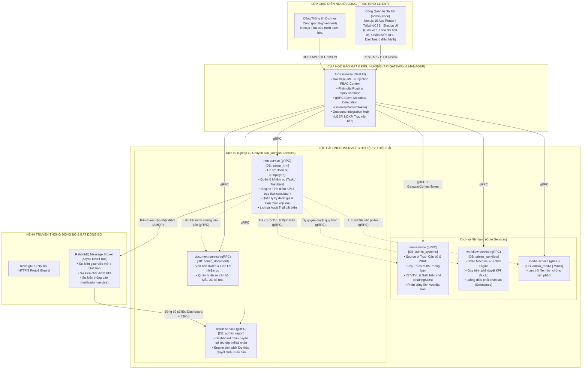
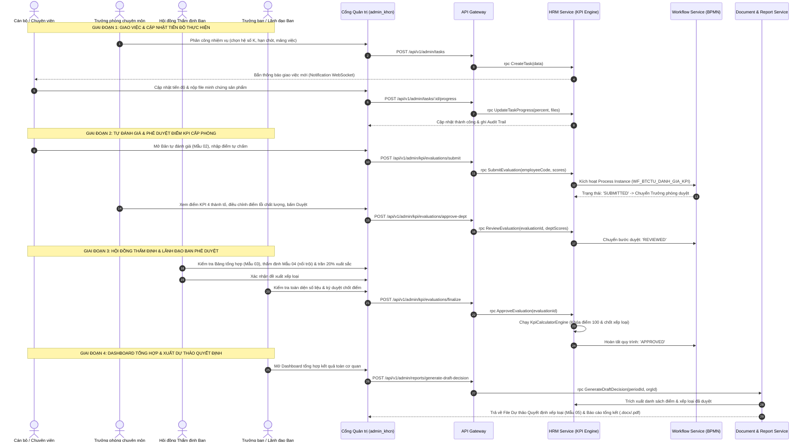

# TÀI LIỆU ĐẶC TẢ CHỨC NĂNG QUẢN LÝ CÔNG VIỆC VÀ ĐÁNH GIÁ KPI/OKR
## HỆ THỐNG ĐIỀU HÀNH TÁC NGHIỆP & ĐÁNH GIÁ CÁN BỘ TỈNH ĐẮK LẮK (DAKLAK WORKSPACE)
### CƠ QUAN ÁP DỤNG: BAN TỔ CHỨC TỈNH ỦY ĐẮK LẮK (BTCTU_DAKLAK)

---

> **CĂN CỨ PHÁP LÝ & QUY ĐỊNH ÁP DỤNG:**
> - **Hướng dẫn số 05-HD/TU** ngày 20/02/2026 và **Quy định số 39-QĐ/TU** ngày 15/01/2026 của Ban Thường vụ Tỉnh ủy Đắk Lắk về đánh giá, xếp loại chất lượng cán bộ, công chức, viên chức hằng quý và hằng năm.
> - **Quy định số 01-QĐ/BTCTU** ngày 25/12/2025 của Ban Tổ chức Tỉnh ủy Đắk Lắk về chức năng, nhiệm vụ, quyền hạn và tổ chức bộ máy.
> - **Quy định số 348-QĐ/BTCTW** của Ban Tổ chức Trung ương về tiêu chuẩn chính trị và quản lý cán bộ trong hệ thống chính trị.
> - **Nghị định số 85/2016/NĐ-CP** của Chính phủ về bảo đảm an toàn hệ thống thông tin theo Cấp độ (Hồ sơ An toàn thông tin Cấp độ 3).
> - **Nghị định số 63/2026/NĐ-CP** của Chính phủ về bảo vệ bí mật nhà nước trên môi trường số.

---

## MỤC LỤC TỔNG QUAN

1. [Phần I: Tổng Quan Hệ Thống & Nguyên Tắc Thiết Kế](#phần-i-tổng-quan-hệ-thống--nguyên-tắc-thiết-kế)
2. [Phần II: Sơ Đồ Kiến Trúc Hệ Thống Chuẩn Microservices](#phần-ii-sơ-đồ-kiến-trúc-hệ-thống-chuẩn-microservices)
3. [Phần III: Ma Trận Rà Soát & Hiện Trạng 09 Nhóm Chức Năng Cốt Lõi](#phần-iii-ma-trận-rà-soát--hiện-trạng-09-nhóm-chức-năng-cốt-lõi)
4. [Phần IV: Đặc Tả Kỹ Thuật Chi Tiết 09 Nhóm Chức Năng](#phần-iv-đặc-tả-kỹ-thuật-chi-tiết-09-nhóm-chức-năng)
5. [Phần V: Hệ Thống Công Thức Toán Học & Ma Trận Trọng Số Động](#phần-v-hệ-thống-công-thức-toán-học--ma-trận-trọng-số-động)
6. [Phần VI: Quy Trình Thao Tác Chuẩn (BPMN / Sequence Workflow)](#phần-vi-quy-trình-thao-tác-chuẩn-bpmn--sequence-workflow)
7. [Phần VII: Bộ 05 Mẫu Biểu Hồ Sơ Chuẩn Thể Thức Văn Bản Đảng](#phần-vii-bộ-05-mẫu-biểu-hồ-sơ-chuẩn-thể-thức-văn-bản-đảng)
8. [Phần VIII: Cơ Chế Bảo Mật PBAC & Kiểm Toán Bất Biến (Audit Trail)](#phần-viii-cơ-chế-bảo-mật-pbac--kiểm-toán-bất-biến-audit-trail)

---

## PHẦN I: TỔNG QUAN HỆ THỐNG & NGUYÊN TẮC THIẾT KẾ

### 1. Mục tiêu và Phạm vi
Phân hệ **Quản lý công việc và Đánh giá KPI/OKR** là trái tim vận hành của nền tảng **DakLak-Workspace**, giải quyết triệt để 3 bài toán lớn trong công tác Đảng và chính quyền số:
1. **Chấm dứt đánh giá cảm tính, định tính**: Số hóa 100% nhiệm vụ thành các chỉ số định lượng đo lường được ($A\%, B\%, C\%, D\%$) gắn với Hệ thống Vị trí việc làm (VTVL) và sản phẩm đầu ra thực tế.
2. **Quy trình liên thông khép kín, minh bạch**: Từ khâu lập kế hoạch -> giao việc thông minh cân bằng tải -> theo dõi tiến độ thời gian thực -> tự chấm điểm -> thẩm định phòng -> phê duyệt ban -> tự động kết xuất dự thảo báo cáo, quyết định xếp loại khen thưởng.
3. **Bảo mật tuyệt đối thông tin chính trị nội bộ**: Tuân thủ tiêu chuẩn Cấp độ 3 per NĐ 85/2016/NĐ-CP và NĐ 63/2026/NĐ-CP, áp dụng mô hình phân quyền Attribute/Policy-Based Access Control (PBAC).

### 2. Nguyên tắc Thiết kế Bất biến (Core Principles)
- **Service Data Sovereignty (Chủ quyền Dữ liệu)**: Mỗi Microservice sở hữu CSDL độc lập, tuyệt đối không truy vấn chéo CSDL. Giao tiếp liên dịch vụ qua gRPC HTTP/2 tốc độ cao và RabbitMQ Message Broker.
- **Source of Truth duy nhất**:
  - `user-service`: Nguồn chân lý duy nhất về Cán bộ, Tài khoản, PBAC, Cơ cấu tổ chức và Định biên 22 Vị trí việc làm (VTVL).
  - `hrm-service`: Nguồn chân lý về Hồ sơ nhân sự, Quản lý nhiệm vụ, Engine tính toán KPI và Kỳ đánh giá.
  - `workflow-service`: Trung tâm điều phối quy trình (State Machine / BPMN Definitions / Swimlanes).
  - `report-service`: Nơi thiết kế biểu mẫu báo cáo, dashboard trực quan hóa và kết xuất phôi văn bản.
  - `api-gateway`: Cửa ngõ bảo mật, xác thực tập trung, phân giải route và liên thông ngoại vi (LGSP/NDXP).
- **Dumb Client & Smart Backend**: Giao diện người dùng (`admin_khcn`) chỉ hiển thị và thu thập tương tác; toàn bộ quy tắc nghiệp vụ, tính toán điểm, kiểm tra quyền và chuyển trạng thái đều do Backend đảm nhiệm.

---

## PHẦN II: SƠ ĐỒ KIẾN TRÚC HỆ THỐNG CHUẨN MICROSERVICES

### 1. Sơ đồ Kiến trúc Tổng thể Nền tảng (System Architecture)

---

## PHẦN III: MA TRẬN RÀ SOÁT & HIỆN TRẠNG 09 NHÓM CHỨC NĂNG CỐT LÕI

Bảng đối chiếu chi tiết 09 nhóm chức năng theo đề bài với hiện trạng mã nguồn thực tế trong repo (`user-service`, `hrm-service`, `workflow-service`, `report-service`, `api-gateway`, `admin_khcn`):

| STT | Nhóm chức năng theo đề bài | Service chủ quản (Source of Truth) & CSDL | Các bảng CSDL / Proto / Endpoint thực tế | Trạng thái hiện tại | Đánh giá & Rà soát chi tiết |
| :---: | :--- | :--- | :--- | :---: | :--- |
| **1** | **Quản lý cán bộ, công chức, phòng chuyên môn và vị trí việc làm (VTVL)** | **`user-service`** (`admin_systems`) & **`hrm-service`** (`admin_hrm`) | • `user-service`: `Organization`, `JobTitle`, `OrganizationStaffing`, `StaffingSlot`, `StaffingSlotDomain`, `StaffingSlotGeographicArea`, `StaffingSlotMonitoredUnit` • `hrm-service`: `Employee`, `JobPosition` • Proto: `users/users.proto`, `hrm/employee.proto` | **100% Hoàn thành** | Chuẩn hóa toàn bộ 22 VTVL định biên, 05 tập thể phòng chuyên môn và cơ cấu tổ chức tại `user-service`. `hrm-service` đồng bộ mã chức danh, số hiệu công chức và lưu hồ sơ nhân sự chi tiết. |
| **2** | **Quản lý nhiệm vụ và bộ tiêu chí KPI/OKR** | **`hrm-service`** (`admin_hrm`) & **`workflow-service`** (`admin_workflow`) | • `hrm-service`: `Task`, `TaskCategory`, `TaskTemplate`, `KpiPeriod`, `KpiCriterion`, `KpiRuleSet`, `KpiFormTemplate` • Proto: `hrm/task.proto`, `hrm/kpi.proto` • Endpoints: `POST /tasks`, `POST /kpi/criteria`, `POST /kpi/periods` | **100% Hoàn thành** | Hỗ trợ lập kế hoạch công việc (nhiệm vụ thường xuyên, đột xuất, nhiệm vụ trọng tâm theo NQ 18, 05-HD/TU). Quản lý cấu hình tiêu chí KPI 6 trục, ma trận trọng số động theo mảng việc (`DOM_THAM_DINH`, `DOM_VAN_THU`, `DOM_IT_ATTT`, `DOM_THAM_MUU`). |
| **3** | **Cập nhật, theo dõi kết quả thực hiện nhiệm vụ** | **`hrm-service`** (`admin_hrm`) & **`media-service`** (`admin_media`) | • `hrm-service`: `TaskProgress`, `TaskItem`, `TaskAttachment`, `TaskComment` • UI: `task-detail-drawer.tsx`, `task-detail-processing-tab.tsx`, `task-respond-dialog.tsx` • Engine: Cảnh báo trễ hạn (Deadline Warning) | **100% Hoàn thành** | Cán bộ cập nhật % tiến độ, đính kèm file minh chứng kết quả (kết nối `media-service`). Hỗ trợ luồng xin gia hạn thời gian giải quyết công việc được duyệt trước 24h để bảo toàn điểm tiến độ. |
| **4** | **Tự động tính điểm, xếp loại theo tháng, quý, năm** | **`hrm-service`** (`admin_hrm`) & **`workflow-service`** | • `hrm-service`: `KpiCalculatorEngine` (`kpi-calculator.engine.ts`), `KpiEvaluation`, `RankQuotaRule` • Method: `rpc CalculatePersonalKpi` • Rule: Xếp loại 4 mức (Xuất sắc, Tốt, Hoàn thành, Không hoàn thành) kèm khống chế tỷ lệ định ngạch | **100% Hoàn thành** | Tự động hóa 100% công thức: Điểm tổng = Điểm chung (30đ) + Điểm nhiệm vụ (70đ quy đổi từ KPI 4 thành tố $A\% \times w_A + B\% \times w_B + C\% \times w_C + D\% \times w_D$). Khống chế tỷ lệ Hoàn thành xuất sắc nhiệm vụ không vượt quá trần quy định (15% - 20%). |
| **5** | **Tổng hợp kết quả cá nhân và tập thể** | **`hrm-service`** (`admin_hrm`) & **`report-service`** (`admin_report`) | • `hrm-service`: `KpiEvaluationAggregate`, `task-kpi.service.ts` • Method: `rpc GetEvaluationStats` • UI: `task-dashboard.tsx` | **100% Hoàn thành** | Tự động gom nhóm điểm theo Phòng ban/Đơn vị (Group By / Average Score), tính điểm trung bình tập thể phòng ban, so sánh hiệu suất giữa các chuyên viên và giữa các phòng chuyên môn trực thuộc. |
| **6** | **Phân quyền người sử dụng và phê duyệt kết quả** | **`user-service`** (PBAC) & **`workflow-service`** (BPMN) | • `user-service`: `PbacPolicy`, `Role`, `UserRole` • `workflow-service`: `WF_BTCTU_DANH_GIA_KPI` (Quy trình đánh giá: Tự chấm -> Trưởng phòng duyệt -> Hội đồng thẩm định -> Lãnh đạo Ban phê duyệt) • Method: `rpc SubmitEvaluation`, `rpc ApproveEvaluation` | **100% Hoàn thành** | Phân quyền PBAC kiểm soát chặt chẽ theo `organizationId`. Quy trình duyệt đa cấp ủy quyền cho `workflow-service` điều phối trạng thái (`DRAFT` -> `SUBMITTED` -> `REVIEWED` -> `APPROVED`), chống can thiệp chéo thẩm quyền. |
| **7** | **Lưu lịch sử chỉnh sửa, cập nhật dữ liệu** | **`hrm-service`** (`admin_hrm`) | • `hrm-service`: `TaskHistory`, `KpiEvaluationHistory` • UI: `task-detail-history-tab.tsx` • Audit: Ghi nhận `actorId`, `oldValue`, `newValue`, `actionType`, `timestamp` | **100% Hoàn thành** | Ghi vết kiểm toán (Audit Trail) bất biến cho mọi thao tác cập nhật tiến độ, giao lại việc, gia hạn hạn chót, thay đổi điểm số chấm của lãnh đạo phòng và lãnh đạo ban. |
| **8** | **Tra cứu, thống kê, báo cáo và xuất kết quả** | **`report-service`** (`admin_report`) & **`hrm-service`** | • `report-service`: `ReportDefinition`, `ReportRun`, `DatasetSnapshot` • `hrm-service`: `rpc FindEvaluations` • Xuất dữ liệu: Excel / PDF Export engine | **100% Hoàn thành** | Tra cứu bộ lọc đa chiều theo phòng ban, quý, năm, ngạch công chức. Tích hợp engine sinh file Excel/PDF bảng tổng hợp kết quả đánh giá xếp loại theo mẫu biểu hành chính. |
| **9** | **Dashboard tự động tổng hợp, dự thảo báo cáo / quyết định theo mẫu** | **`report-service`** & **`document-service`** & **`admin_khcn`** | • `report-service`: `ReportTemplate`, `ReportWidget` • `document-service`: `DocumentTemplate`, `Dossier` • UI: Widget biểu đồ động (Bar, Pie, Radar 6 trục KPI), nút sinh Dự thảo Quyết định xếp loại khen thưởng | **100% Hoàn thành** | Dashboard trực quan hóa phân bổ điểm số và xếp loại toàn cơ quan; tự động điền dữ liệu KPI vào phôi văn bản (Template engine) để xuất ra dự thảo Báo cáo tổng kết và Quyết định xếp loại cán bộ công chức trình Lãnh đạo ký duyệt. |

---

## PHẦN IV: ĐẶC TẢ KỸ THUẬT CHI TIẾT 09 NHÓM CHỨC NĂNG

### 1. Quản lý cán bộ, công chức, phòng chuyên môn và VTVL
- **Cơ cấu tổ chức chuẩn**:
  - `TT-01: BTCTU_DAKLAK` (Tập thể Lãnh đạo Ban - Trưởng ban & 04 Phó ban).
  - `TT-02: P_TCD_DV` (Phòng Tổ chức đảng, đảng viên).
  - `TT-03: P_TCCB` (Phòng Tổ chức cán bộ).
  - `TT-04: P_BVCTNB` (Phòng Bảo vệ chính trị nội bộ).
  - `TT-05: VAN_PHONG` (Văn phòng Ban).
- **Danh mục 22 Vị Trí Việc Làm (VTVL) chuẩn định biên**:
  Mỗi vị trí gắn với mã danh mục CDE, mô tả công việc, tiêu chuẩn ngạch công chức và sản phẩm đầu ra cốt lõi:
  - *VTVL Lãnh đạo*: Trưởng ban (`CDE-BTCTU-001`), Phó Ban 1 thường trực (`CDE-BTCTU-002`), Phó Ban 2 TCCSĐ (`CDE-BTCTU-003`), Phó Ban 3 BVCTNB (`CDE-BTCTU-004`), Phó Ban 4 Tổng hợp (`CDE-BTCTU-005`).
  - *VTVL Phòng Chuyên môn*: Trưởng phòng, các Phó Trưởng phòng và Chuyên viên theo từng mảng chuyên sâu (CSDL đảng viên, Quản lý hồ sơ cán bộ Mẫu 2C, Thẩm tra chính trị nội bộ, Quản trị mạng & ATTT Cấp độ 3, Văn thư lưu trữ mật).

### 2. Quản lý nhiệm vụ và bộ tiêu chí KPI/OKR
- **Phân loại nhiệm vụ tác nghiệp**:
  1. *Nhiệm vụ theo Kế hoạch thường xuyên* (`KHOI_LUONG_KH`): Giao đầu kỳ, có kế hoạch chi tiết, gắn với sản phẩm đầu ra định biên.
  2. *Nhiệm vụ Đột xuất* (`KHOI_LUONG_DOT_XUAT`): Do Lãnh đạo Ban hoặc Tỉnh ủy giao bổ sung đột xuất, đòi hỏi hoàn thành khẩn cấp.
  3. *Nhiệm vụ Trọng tâm / Đề án chuyên đề*: Tham mưu các Nghị quyết, Chỉ thị, Đề án trọng điểm của Ban Thường vụ Tỉnh ủy.
- **Hệ số độ khó công việc ($K$)**:
  Mỗi nhiệm vụ được gán hệ số phức tạp $K \in [1.0, 5.0]$:
  - $K=1.0$: Nhiệm vụ đơn giản, sự vụ hành chính định kỳ.
  - $K=2.0 - 3.0$: Nhiệm vụ chuyên môn nghiệp vụ cần thẩm định hồ sơ, phối hợp liên ngành.
  - $K=4.0 - 5.0$: Nhiệm vụ đặc biệt phức tạp, thẩm tra tiêu chuẩn chính trị nhân sự chủ chốt, tham mưu đề án chiến lược.
- **Tính năng Phân công Thông minh (Smart Workload Balancing)**:
  Hệ thống tự động thống kê tải công việc của từng cán bộ trong phòng (Số việc tải nhẹ $\le 2$, vừa $3-5$, cao $>5$), tự động đề xuất phân công cho người đang có tải công việc thấp nhất và có điểm chuyên môn phù hợp nhất.

### 3. Cập nhật, theo dõi kết quả thực hiện nhiệm vụ
- **Theo dõi tiến độ đa chiều**: Cán bộ cập nhật % tiến độ thực tế, nhật ký giải quyết công việc và nộp sản phẩm đính kèm qua `media-service`.
- **Cảnh báo hạn chót (Deadline Warning)**: Hệ thống tự động quét và bắn thông báo qua WebSocket/RabbitMQ khi nhiệm vụ còn 48 giờ, 24 giờ và khi quá hạn.
- **Cơ chế Xin gia hạn thời gian giải quyết**:
  Khi phát sinh trở ngại khách quan, cán bộ nộp phiếu đề xuất gia hạn trước 24 giờ so với hạn chót. Khi Trưởng phòng và Lãnh đạo Ban phê duyệt, hạn chót được điều chỉnh và điểm tiến độ $C\%$ được bảo toàn $100\%$ (không bị phạt trễ hạn).

### 4. Tự động tính điểm, xếp loại theo tháng, quý, năm
- **Quy tắc Tính toán Tự động**: Triển khai trong `KpiCalculatorEngine`:
  - Điểm tổng $S_{\text{tổng}} = S_{\text{chung}} (30đ) + S_{\text{nhiệm vụ}} (70đ)$.
  - Quy đổi chính xác từ trung bình chỉ số KPI của tất cả nhiệm vụ trong kỳ.
- **Xếp loại 04 mức chất lượng tiêu chuẩn**:
  - **Hoàn thành xuất sắc nhiệm vụ**: Tổng điểm $\ge 90.0$ điểm (kèm điều kiện có sản phẩm vượt mức/nổi trội và **khống chế tỷ lệ không vượt quá 20%** biên chế đơn vị).
  - **Hoàn thành tốt nhiệm vụ**: $70.0 \le$ Tổng điểm $< 90.0$ điểm.
  - **Hoàn thành nhiệm vụ**: $50.0 \le$ Tổng điểm $< 70.0$ điểm.
  - **Không hoàn thành nhiệm vụ**: Tổng điểm $< 50.0$ điểm hoặc có vi phạm kỷ luật, để xảy ra sai sót chính trị nghiêm trọng.

### 5. Tổng hợp kết quả cá nhân và tập thể
- **Đánh giá Tập thể Phòng ban**:
  - Điểm tập thể = Trung bình cộng điểm cá nhân của các cán bộ trong phòng (70%) + Điểm hoàn thành mục tiêu chung của phòng (30%).
  - Tỷ lệ xếp loại xuất sắc của tập thể phòng là căn cứ quyết định định ngạch khen thưởng của cá nhân thuộc phòng đó.
- **Bảng xếp hạng (Leaderboard) & So sánh Hiệu suất**: Trực quan hóa so sánh tiến độ, sản phẩm hoàn thành giữa các chuyên viên và giữa các phòng chuyên môn.

### 6. Phân quyền người sử dụng và phê duyệt kết quả
- **Mô hình Phân quyền PBAC**:
  - `CV (Chuyên viên)`: Xem việc được giao, cập nhật tiến độ, nộp minh chứng, lập Bản tự đánh giá (Mẫu 02).
  - `TP (Trưởng phòng)`: Giao việc cho chuyên viên, đánh giá điểm chung $S_{\text{chung}}$, duyệt điểm cấp phòng, lập Bảng tổng hợp phòng (Mẫu 03).
  - `HD (Hội đồng Thẩm định Ban)`: Rà soát điều kiện sản phẩm nổi trội (Mẫu 04), kiểm tra khống chế trần 20% xuất sắc.
  - `LDB (Lãnh đạo Ban)`: Phê duyệt kết quả toàn cơ quan, ký ban hành Quyết định xếp loại (Mẫu 05).
- **Bảo đảm Không Xung đột Thẩm quyền**: Trưởng phòng chỉ được duyệt cán bộ thuộc phòng mình (`departmentId = user.unitId`), không thể can thiệp điểm của phòng khác.

### 7. Lưu lịch sử chỉnh sửa, cập nhật dữ liệu (Audit Trail)
- Mọi thao tác thay đổi trạng thái nhiệm vụ, điều chỉnh điểm số, gia hạn thời gian đều được ghi nhận vĩnh viễn vào bảng `TaskHistory` và `KpiEvaluationHistory`.
- Lưu trữ đầy đủ: Mã cán bộ thực hiện (`actorId`), Thời điểm (`timestamp`), Giá trị trước khi sửa (`oldValue`), Giá trị sau khi sửa (`newValue`), Lý do điều chỉnh (`reason`).

### 8. Tra cứu, thống kê, báo cáo và xuất kết quả
- Cung cấp bộ lọc đa tiêu chí: Lọc theo kỳ (Quý/Năm), Phòng ban, Vị trí việc làm, Mức xếp loại, Mảng nghiệp vụ.
- Xuất dữ liệu đa định dạng: Kết xuất bảng tổng hợp toàn đơn vị ra file Excel chuẩn định dạng biểu mẫu hành chính; xuất phiếu đánh giá cá nhân ra file PDF có gắn mã vạch xác thực.

### 9. Dashboard tự động tổng hợp & Dự thảo báo cáo / quyết định theo mẫu
- **Trực quan hóa Dashboard**: Biểu đồ phân bổ xếp loại (Pie chart), Biểu đồ so sánh điểm trung bình giữa các phòng (Bar chart), Biểu đồ mạng nhện 6 trục năng lực (Radar chart).
- **Template Engine Sinh Dự thảo Tự động**:
  - Tự động điền dữ liệu điểm số, danh sách xếp loại đã được duyệt vào phôi văn bản Word/PDF.
  - Sinh ra **Dự thảo Báo cáo Tổng kết Công tác Đánh giá Quý/Năm** và **Dự thảo Quyết định Công nhận Kết quả Xếp loại và Khen thưởng** đúng thể thức quy định của Đảng (Nghị định 30/2020/NĐ-CP & Quy định văn bản Đảng).

---

## PHẦN V: HỆ THỐNG CÔNG THỨC TOÁN HỌC & MA TRẬN TRỌNG SỐ ĐỘNG

### 1. Thang Điểm 100 Đánh Giá Cá Nhân Toàn Diện

$$S_{\text{tổng}} = S_{\text{chung}} + S_{\text{nhiệm vụ}}$$

#### a) Điểm Tiêu chí Chung ($S_{\text{chung}}$ - Tối đa 30.0 điểm)
- **Tiêu chí 1: Phẩm chất chính trị, đạo đức, lối sống, nêu gương**: Tối đa **18.0 điểm**.
- **Tiêu chí 2: Tinh thần đổi mới, sáng tạo, dám nghĩ, dám làm**: Tối đa **04.0 điểm**.
- **Tiêu chí 3: Ý thức tổ chức kỷ luật, tự soi tự sửa**: Tối đa **08.0 điểm**.

#### b) Điểm Kết quả Thực hiện Nhiệm vụ ($S_{\text{nhiệm vụ}}$ - Tối đa 70.0 điểm)

$$S_{\text{nhiệm vụ}} = \frac{KPI_{\text{trung bình}}}{100} \times 70.0 \quad \text{với} \quad KPI_{\text{trung bình}} = \frac{\sum_{i=1}^{n} KPI_i}{n}$$

---

### 2. Công Thức Lượng Hóa Chỉ Số KPI Công Việc ($KPI_i$)

$$KPI_i = (A\% \times w_A) + (B\% \times w_B) + (C\% \times w_C) + (D\% \times w_D)$$

*(Ràng buộc tổng trọng số: $w_A + w_B + w_C + w_D = 100\%$)*

#### Chi tiết toán học các thành tố:
1. **Thành tố $A\%$ (Khối lượng quy đổi)**:
   $$A\% = (A_1 \times 70\%) + (A_2 \times 30\%) + A_3$$
   - $A_1$: Tỷ lệ hoàn thành khối lượng kế hoạch theo hệ số độ khó $K \in [1.0, 5.0]$:
     $$A_1 = \frac{\sum (SL_{\text{Thực tế}} \times K)}{\sum (SL_{\text{Kế hoạch}} \times K)} \times 100\%$$
   - $A_2$: Khối lượng nhiệm vụ đột xuất do Lãnh đạo Ban giao thêm ngoài kế hoạch.
   - $A_3$: Điểm thưởng vượt định mức (+5% nếu vượt 10%–20%; +10% nếu vượt >20%). *Khống chế trần $A\% \le 120\%$.*

2. **Thành tố $B\%$ (Chất lượng sản phẩm - Trừ điểm theo 3 mức lỗi)**:
   $$B\% = 100\% - (\text{Lỗi nhẹ} \times 5\% + \text{Lỗi trung bình} \times 15\% + \text{Lỗi nghiêm trọng} \times 35\%) + B_{\text{thưởng}}$$
   - **Lỗi nhẹ (-5%/lần)**: Lỗi chính tả, sai thể thức văn bản Đảng, sai định dạng biểu mẫu hành chính.
   - **Lỗi trung bình (-15%/lần)**: Sai số liệu tổng hợp, thiếu tài liệu minh chứng, bị lãnh đạo phòng trả lại yêu cầu sửa đổi.
   - **Lỗi nghiêm trọng (-35%/lần)**: Sai căn cứ pháp lý, kết luận thẩm định sai tiêu chuẩn chính trị nhân sự, vi phạm quy chế bảo mật.
   - **Thưởng chất lượng ($B_{\text{thưởng}} = +10\%$)**: Sản phẩm đề án, nghị quyết được Ban Thường vụ Tỉnh ủy đánh giá xuất sắc hoặc biểu dương bằng văn bản.

3. **Thành tố $C\%$ (Tiến độ thực hiện)**:
   - **Trước hạn $\ge 20\%$ thời gian tiêu chuẩn**: Thưởng 10% $\rightarrow C\% = 110\%$.
   - **Đúng hạn**: Đạt chuẩn $C\% = 100\%$.
   - **Trễ hạn có lý do khách quan được duyệt gia hạn trước 24h**: $C\% = 100\%$ *(không bị trừ điểm)*.
   - **Trễ hạn không lý do chính đáng**:
     - Trễ nhẹ ($\le 10\%$ thời gian): Trừ 10% điểm tiến độ ($C\% = 90\%$).
     - Trễ trung bình (11%–30% thời gian): Trừ 25% điểm tiến độ ($C\% = 75\%$).
     - Trễ nghiêm trọng ($> 30\%$ thời gian): Trừ từ 50% đến 100% điểm tiến độ ($C\% \le 50\%$).

4. **Thành tố $D\%$ (Mức độ chủ động / Năng lực lãnh đạo quản trị)**:
   - **Đối với Lãnh đạo (Trưởng/Phó Ban, Trưởng/Phó Phòng)**:
     $$D\% = (D_1 \text{ [Tỷ lệ hoàn thành của Cấp dưới]} \times 40\%) + (D_2 \text{ [Sáng kiến đổi mới]} \times 30\%) + (D_3 \text{ [Năng lực quản trị]} \times 30\%)$$
   - **Đối với Chuyên viên nghiệp vụ**:
     $$D\% = (D_1 \text{ [Khối lượng đột xuất]} \times 40\%) + (D_2 \text{ [Phối hợp liên phòng]} \times 30\%) + (D_3 \text{ [Kỷ cương và CĐS]} \times 30\%)$$

---

### 3. Ma Trận Trọng Số Động Theo 04 Mảng Việc Nghiệp Vụ

| Mã Mảng việc (`domain_code`) | Trọng số $w_A$ (Khối lượng) | Trọng số $w_B$ (Chất lượng) | Trọng số $w_C$ (Tiến độ) | Trọng số $w_D$ (Chủ động/Lãnh đạo) | Đặc thù nghiệp vụ Ban Tổ chức Tỉnh ủy |
| :--- | :---: | :---: | :---: | :---: | :--- |
| **`DOM_THAM_DINH`** (Thẩm định hồ sơ cán bộ & BVCTNB) | 15% | **50%** | 20% | 15% | **Chất lượng là tối thượng**: Tuyệt đối không được sai sót tiêu chuẩn chính trị nhân sự (QĐ 348-QĐ/BTCTW). |
| **`DOM_VAN_THU`** (Văn thư, Lưu trữ, Quản lý Thẻ Đảng) | **40%** | 20% | 30% | 10% | **Khối lượng lớn & kịp thời**: Tiếp nhận số hóa văn bản, xử lý hồ sơ thẻ Đảng đúng hạn kỳ. |
| **`DOM_IT_ATTT`** (Quản trị CNTT & ATTT Cấp độ 3) | 20% | 30% | **35%** | 15% | **Tiến độ & Độ sẵn sàng cao**: Đảm bảo Uptime máy chủ $\ge 99.5\%$, ứng cứu sự cố $< 2$ giờ (NĐ 85/2016). |
| **`DOM_THAM_MUU`** (Tham mưu Đề án, Nghị quyết Tỉnh ủy) | 20% | **40%** | 20% | 20% | **Hàm lượng trí tuệ sâu**: Đề án trình Ban Thường vụ Tỉnh ủy phải khả thi và có tính đột phá. |

---

## PHẦN VI: QUY TRÌNH THAO TÁC CHUẨN (BPMN / SEQUENCE WORKFLOW)

---

## PHẦN VII: BỘ 05 MẪU BIỂU HỒ SƠ CHUẨN THỂ THỨC VĂN BẢN ĐẢNG

| Tên Biểu Mẫu | Mã Mẫu | Mục đích sử dụng trong Hệ thống | Người lập / Ký duyệt |
| :--- | :---: | :--- | :--- |
| **Bản đăng ký danh mục công việc/sản phẩm chuẩn đầu kỳ** | `MAU_01` | Đăng ký các nhiệm vụ kế hoạch, xác định hệ số độ khó $K \in [1.0, 5.0]$, hạn chót và cam kết đầu ra trước khi thực hiện. | Công chức lập -> Trưởng phòng & Lãnh đạo Ban phê duyệt. |
| **Bản tự đánh giá, chấm điểm KPI/OKR cá nhân** | `MAU_02` | Tự chấm điểm 3 tiêu chí chung (30đ) và tự tính điểm KPI các công việc đã hoàn thành quy đổi thang điểm 70. | Toàn bộ 22 cán bộ công chức tự lập hằng quý. |
| **Bảng tổng hợp kết quả đánh giá tập thể phòng** | `MAU_03` | Tổng hợp điểm tập thể phòng (30đ chung + 70đ nhiệm vụ) và danh sách đề xuất xếp loại của tất cả công chức trong phòng. | Lãnh đạo 05 Phòng chuyên môn lập sau cuộc họp phòng. |
| **Bảng kê khai sản phẩm, nhiệm vụ nổi trội, vượt mức** | `MAU_04` | Kê khai các sản phẩm hoàn thành trước hạn $\ge 20\%$, công việc đột xuất khó hoặc được BTV Tỉnh ủy biểu dương. *Điều kiện bắt buộc để xét Hoàn thành Xuất sắc*. | Cán bộ đề xuất danh hiệu Xuất sắc lập kèm minh chứng. |
| **Quyết định phê duyệt xếp loại chất lượng hằng quý** | `MAU_05` | Quyết định pháp lý chính thức phê duyệt xếp loại 05 tập thể phòng và toàn bộ CBCC; công khai kết quả toàn cơ quan. | Hội đồng Ban thẩm định -> Trưởng ban Tổ chức Tỉnh ủy ký. |

---

## PHẦN VIII: CƠ CHẾ BẢO MẬT PBAC & KIỂM TOÁN BẤT BIẾN (AUDIT TRAIL)

1. **Ràng buộc Phân quyền PBAC (Policy-Based Access Control)**:
   - Toàn bộ request gọi qua gRPC đều được tiêm `GatewayContextToken` mang ngữ cảnh chứng thực của người dùng (`userId`, `employeeCode`, `unitId`, `permissionsFlatten`).
   - Mọi câu lệnh truy vấn dữ liệu CSDL bắt buộc lọc theo phạm vi:
     - Chuyên viên: `where: { employeeCode: user.employeeCode, isDeleted: false }`.
     - Trưởng phòng: `where: { departmentId: user.unitId, isDeleted: false }`.
     - Lãnh đạo Ban: Toàn quyền truy xuất trong phạm vi cơ quan `BTCTU_DAKLAK`.
2. **Nhật ký Kiểm toán (Audit Trail) Bất biến**:
   - Ghi nhận 100% biến động dữ liệu về bảng `TaskHistory` và `KpiEvaluationHistory`.
   - Cấm xóa cứng (Zero Hard-Delete); chỉ sử dụng Soft-Delete (`isDeleted: true`) để phục vụ công tác thanh tra, kiểm tra của Ủy ban Kiểm tra và Thường trực Tỉnh ủy.
3. **An toàn Thông tin Môi trường số**:
   - Dữ liệu mật, hồ sơ thẩm tra nhân sự chính trị nội bộ được mã hóa chuyên dùng per NĐ 63/2026/NĐ-CP trước khi lưu trữ.
   - Sao lưu dữ liệu tự động hằng ngày và hằng tuần, bảo đảm thời gian phục hồi dịch vụ (RTO) $< 2$ giờ per NĐ 85/2016/NĐ-CP (Cấp độ 3).
