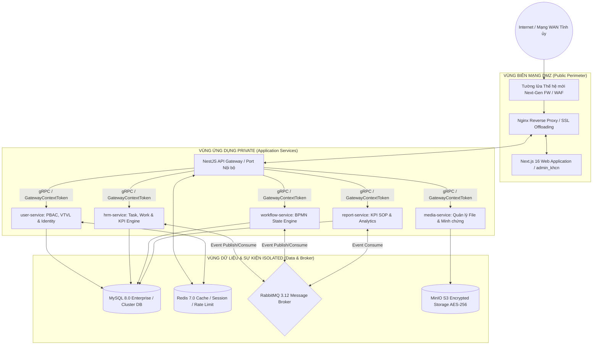
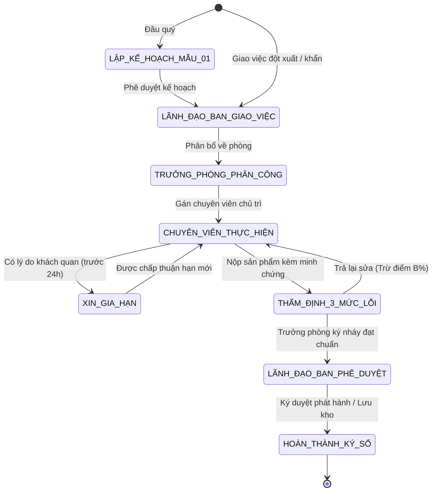
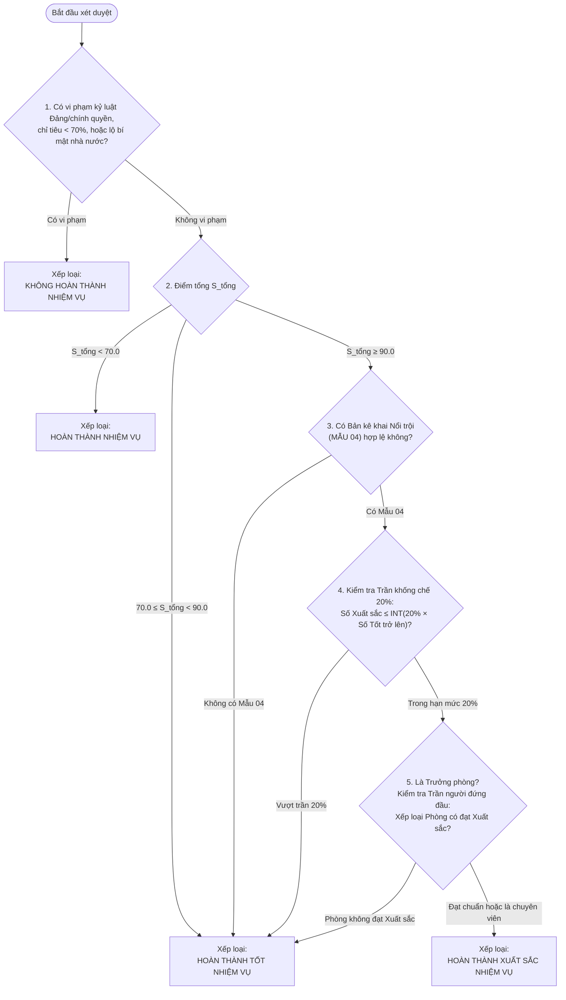

# TÀI LIỆU MÔ TẢ HỆ THỐNG DAKLAK-WORKSPACE
## PHÂN HỆ ĐIỀU HÀNH TÁC NGHIỆP, QUẢN TRỊ CÔNG VIỆC & ĐÁNH GIÁ CÁN BỘ
### CƠ QUAN CHỦ QUẢN: BAN TỔ CHỨC TỈNH ỦY ĐẮK LẮK (BTCTU_DAKLAK)

---

> **Căn cứ Pháp lý & Thể thức Áp dụng:**
> - *Quy định số 01-QĐ/BTCTU ngày 25/12/2025 của Ban Tổ chức Tỉnh ủy Đắk Lắk về chức năng, nhiệm vụ, quyền hạn và cơ cấu tổ chức.*
> - *Hướng dẫn số 05-HD/TU ngày 20/02/2026 & Quy định số 39-QĐ/TU ngày 15/01/2026 của Ban Thường vụ Tỉnh ủy Đắk Lắk về đánh giá, xếp loại chất lượng cán bộ, công chức, viên chức hằng quý và hằng năm.*
> - *Quy định số 348-QĐ/BTCTW của Ban Tổ chức Trung ương & Công văn số 1638-CV/TU của Tỉnh ủy Đắk Lắk về bảo vệ chính trị nội bộ và chia sẻ dữ liệu Ngành Tổ chức xây dựng Đảng.*
> - *Nghị định số 85/2016/NĐ-CP của Chính phủ về bảo đảm an toàn hệ thống thông tin theo Cấp độ (Hồ sơ ATTT Cấp độ 3).*
> - *Nghị định số 63/2026/NĐ-CP của Chính phủ về quản lý, bảo vệ bí mật nhà nước trên môi trường số.*
> - *Nghị quyết số 11-NQ/TU ngày 10/09/2026 của Tỉnh ủy Đắk Lắk về nâng cao chất lượng tổ chức cơ sở đảng và đảng viên.*

---

## MỤC LỤC TỔNG QUAN

1. [Chương I: Tổng Quan Hệ Thống và Phạm Vi Ứng Dụng](#chương-i-tổng-quan-hệ-thống-và-phạm-vi-ứng-dụng)
2. [Chương II: Cơ Cấu Tổ Chức, Định Biên và 22 Vị Trí Việc Làm (VTVL)](#chương-ii-cơ-cấu-tổ-chức-định-biên-và-22-vị-trí-việc-làm-vtvl)
3. [Chương III: Kiến Trúc Kỹ Thuật Microservices & An Toàn Thông Tin Cấp Độ 3](#chương-iii-kiến-trúc-kỹ-thuật-microservices--an-toàn-thông-tin-cấp-độ-3)
4. [Chương IV: Hệ Thống 09 Quy Trình Nghiệp Vụ Chuyên Biệt (Workflows)](#chương-iv-hệ-thống-09-quy-trình-nghiệp-vụ-chuyên-biệt-workflows)
5. [Chương V: Quy Trình Thao Tác Chuẩn (SOP 4 Bước) & Bộ 05 Mẫu Biểu Hồ Sơ](#chương-v-quy-trình-thao-tác-chuẩn-sop-4-bước--bộ-05-mẫu-biểu-hồ-sơ)
6. [Chương VI: Hệ Thống Công Thức Toán Học & Ma Trận Trọng Số Động](#chương-vi-hệ-thống-công-thức-toán-học--ma-trận-trọng-số-động)
7. [Chương VII: Ma Trận Ánh Xạ 08 Nguồn Ghi Nhận Dữ Liệu Tự Động](#chương-vii-ma-trận-ánh-xạ-08-nguồn-ghi-nhận-dữ-liệu-tự-động)
8. [Chương VIII: Chính Sách Bảo Mật PBAC & Quản Lý Bí Mật Nhà Nước](#chương-viii-chính-sách-bảo-mật-pbac--quản-lý-bí-mật-nhà-nước)
9. [Chương IX: Hướng Dẫn Vận Hành Theo Từng Nhóm Đối Tượng Cán Bộ](#chương-ix-hướng-dẫn-vận-hành-theo-từng-nhóm-đối-tượng-cán-bộ)
10. [Chương X: Kết Luận và Định Hướng Phát Triển](#chương-x-kết-luận-và-định-hướng-phát-triển)

---

## CHƯƠNG I: TỔNG QUAN HỆ THỐNG VÀ PHẠM VI ỨNG DỤNG

### 1. Giới thiệu Nền tảng DakLak-Workspace
**DakLak-Workspace** là Nền tảng Quản trị & Điều hành Công việc Chính quyền điện tử và Cơ quan Đảng tỉnh Đắk Lắk. Trong đó, phân hệ dành riêng cho **Ban Tổ chức Tỉnh ủy Đắk Lắk (mã đơn vị: `BTCTU_DAKLAK`)** được thiết kế, cấu hình và tinh chỉnh đặc thù nhằm đáp ứng trọn vẹn yêu cầu công tác Đảng, bảo đảm sự chỉ đạo trực tiếp, toàn diện của Thường trực Tỉnh ủy, Ban Thường vụ Tỉnh ủy đối với công tác Tổ chức xây dựng Đảng.

### 2. Sứ mệnh và Mục tiêu Cốt lõi
- **Chuyển đổi số toàn diện công tác Đảng**: Số hóa 100% hồ sơ nghiệp vụ, quy trình giao việc, kiểm soát tiến độ, thẩm định chất lượng và đánh giá cán bộ tại Ban Tổ chức Tỉnh ủy.
- **Minh bạch hóa & Định lượng hóa công tác cán bộ**: Thay thế phương thức đánh giá cảm tính, định tính bằng ma trận định lượng 4 thành tố ($A\%, B\%, C\%, D\%$) gắn với Hệ thống Vị trí việc làm (VTVL) và sản phẩm đầu ra thực tế.
- **Liên thông quy trình khép kín**: Kết nối tự động giữa giao việc tác nghiệp, thẩm định lỗi sản phẩm, gia hạn thời gian, xác minh chính trị đến tổng hợp kết quả đánh giá xếp loại quý/năm.
- **Bảo mật tuyệt đối thông tin chính trị nội bộ**: Tuân thủ tiêu chuẩn An toàn thông tin Cấp độ 3 (Nghị định 85/2016/NĐ-CP) và bảo vệ bí mật nhà nước trên môi trường số (Nghị định 63/2026/NĐ-CP).

---

## CHƯƠNG II: CƠ CẤU TỔ CHỨC, ĐỊNH BIÊN VÀ 22 VỊ TRÍ VIỆC LÀM (VTVL)

### 1. Sơ đồ Cơ cấu Tổ chức Khối Đảng
Toàn bộ cây tổ chức của Ban Tổ chức Tỉnh ủy được định nghĩa là **Source of Truth** duy nhất tại `user-service`:

```
TỈNH ỦY ĐẮK LẮK (TU_DAKLAK)
  └── BAN TỔ CHỨC TỈNH ỦY ĐẮK LẮK (BTCTU_DAKLAK)
        ├── TT-01: Tập thể Lãnh đạo Ban (Trưởng ban & 04 Phó ban)
        ├── TT-02: Phòng Tổ chức đảng, đảng viên (P_TCD_DV)
        ├── TT-03: Phòng Tổ chức cán bộ (P_TCCB)
        ├── TT-04: Phòng Bảo vệ chính trị nội bộ (P_BVCTNB)
        └── TT-05: Văn phòng Ban (VAN_PHONG)
```

### 2. Danh mục 05 Tập thể Phòng Ban (`collective_groups`)
| Mã Tập thể | Tên Đơn vị / Tập thể | Mã Đơn vị CSDL | Thẩm quyền / Trách nhiệm chính |
| :--- | :--- | :--- | :--- |
| **TT-01** | **Tập thể Lãnh đạo Ban** | `BTCTU_DAKLAK` | Lãnh đạo, điều hành toàn diện; ban hành Quyết định xếp loại; thẩm định nhân sự BTV Tỉnh ủy quản lý. |
| **TT-02** | **Phòng Tổ chức đảng, đảng viên** | `P_TCD_DV` | Nghiệp vụ đảng viên, CSDL Đảng viên, LGSP, Sổ tay Đảng viên điện tử, Huy hiệu Đảng, xếp loại TCCSĐ. |
| **TT-03** | **Phòng Tổ chức cán bộ** | `P_TCCB` | Quy trình 5 bước bổ nhiệm/luân chuyển, CSDL Cán bộ Mẫu 2C số hóa, quản lý biên chế & VTVL khối Đảng, tiền lương. |
| **TT-04** | **Phòng Bảo vệ chính trị nội bộ** | `P_BVCTNB` | Thẩm tra, xác minh tiêu chuẩn chính trị, quản lý CSDL BVCTNB Mức 3 mật, xử lý đơn thư tố cáo chính trị. |
| **TT-05** | **Văn phòng Ban** | `VAN_PHONG` | Lịch công tác, văn thư lưu trữ Mật per NĐ 63/2026, tài chính ngân sách, quản trị hạ tầng CNTT & ATTT Cấp độ 3. |

### 3. Danh mục 22 Vị Trí Việc Làm Cá Nhân Định Biên Chuẩn (`individual_vtvl_positions`)
Hệ thống cấu hình đầy đủ 22 VTVL với mã danh mục CDE chuẩn, số lượng định biên biên chế và sản phẩm đầu ra bắt buộc:

| STT | Mã VTVL | Mã CDE | Tên Vị trí việc làm | Phòng ban trực thuộc | Biên chế | Sản phẩm đầu ra chuẩn cốt lõi |
| :-: | :--- | :--- | :--- | :--- | :-: | :--- |
| **1** | `VTVL-01` | `CDE-BTCTU-001` | **Trưởng ban Tổ chức Tỉnh ủy** (Ủy viên BTVTU) | Lãnh đạo Ban | 1 | Đề án/Nghị quyết Tỉnh ủy; Kết luận chính trị nhân sự; Quyết định xếp loại (Mẫu 05). |
| **2** | `VTVL-02a` | `CDE-BTCTU-002` | **Phó Trưởng ban Thường trực (Phó Ban 1)** | Lãnh đạo Ban | 1 | Thẩm định hồ sơ bổ nhiệm chủ chốt; Kiểm tra biên chế/VTVL; Duyệt quyết toán tài chính. |
| **3** | `VTVL-02b` | `CDE-BTCTU-003` | **Phó Trưởng ban (Phó Ban 2)** | Lãnh đạo Ban | 1 | Thẩm định xếp loại TCCSĐ; Đôn đốc kết nạp đảng viên mới; Giám sát CSDL Đảng viên & LGSP. |
| **4** | `VTVL-02c` | `CDE-BTCTU-004` | **Phó Trưởng ban (Phó Ban 3)** | Lãnh đạo Ban | 1 | Ký kết luận tiêu chuẩn chính trị nhân sự; Xử lý đơn thư tố cáo; Quản lý CSDL Mức 3. |
| **5** | `VTVL-02d` | `CDE-BTCTU-005` | **Phó Trưởng ban (Phó Ban 4)** | Lãnh đạo Ban | 1 | Kế hoạch đào tạo/bồi dưỡng; Nâng lương cán bộ; Duy trì hạ tầng CNTT & CĐS; Sức khỏe cán bộ. |
| **6** | `VTVL-03` | `CDE-BTCTU-006` | **Trưởng phòng TCĐ, ĐV** | Phòng TCĐ-ĐV | 1 | Văn bản hướng dẫn TCCSĐ; Báo cáo thẩm định xếp loại TCCSĐ quý; Điều hành chỉ tiêu phòng. |
| **7** | `VTVL-04a` | `CDE-BTCTU-007` | **Phó Trưởng phòng 1 (TCCSĐ & Đánh giá)** | Phòng TCĐ-ĐV | 1 | Hồ sơ thẩm định kiểm điểm 05 đảng bộ trực thuộc; Theo dõi mô hình "Chi bộ 4 tốt". |
| **8** | `VTVL-04b` | `CDE-BTCTU-008` | **Phó Trưởng phòng 2 (Đảng viên & CSDL)** | Phòng TCĐ-ĐV | 1 | Thẩm định hồ sơ Huy hiệu Đảng; Đối soát CSDL đảng viên sạch $\ge 98\%$; Sổ tay đảng viên. |
| **9** | `VTVL-05` | `CDE-BTCTU-009` | **Chuyên viên CSDL & CĐS Đảng viên** | Phòng TCĐ-ĐV | 1 | Chuẩn hóa 300–500 hồ sơ đảng viên/quý; Đối soát LGSP định kỳ; Hỗ trợ kỹ thuật Sổ tay ĐV. |
| **10** | `VTVL-06` | `CDE-BTCTU-010` | **Trưởng phòng Tổ chức cán bộ** | Phòng TCCB | 1 | Báo cáo quy trình 5 bước bổ nhiệm cán bộ; Quản lý biên chế & VTVL khối Đảng toàn tỉnh. |
| **11** | `VTVL-07a` | `CDE-BTCTU-011` | **Phó Trưởng phòng 1 (Quy hoạch, Bổ nhiệm)**| Phòng TCCB | 1 | Báo cáo thẩm định nhân sự bổ nhiệm; Trích xuất Sơ yếu lý lịch Mẫu 2C số hóa trình BTVTU. |
| **12** | `VTVL-07b` | `CDE-BTCTU-012` | **Phó Trưởng phòng 2 (Biên chế, Đào tạo, Lương)**| Phòng TCCB | 1 | Danh sách cử đào tạo/bồi dưỡng; Quyết định nâng lương đúng kỳ hạn; Báo cáo biên chế. |
| **13** | `VTVL-08` | `CDE-BTCTU-013` | **Chuyên viên Quản lý Cán bộ & Mẫu 2C** | Phòng TCCB | 1 | Số hóa 100% hồ sơ cán bộ Mẫu 2C; Đồng bộ CSDL Quốc gia; Phục vụ tra cứu trong 02 giờ. |
| **14** | `VTVL-09` | `CDE-BTCTU-014` | **Trưởng phòng BVCTNB** | Phòng BVCTNB | 1 | Kết luận tiêu chuẩn chính trị nhân sự; Phân loại xử lý 100% đơn thư; Quản trị CSDL Mức 3. |
| **15** | `VTVL-10a` | `CDE-BTCTU-015` | **Phó Trưởng phòng 1 (Thẩm tra chính trị)** | Phòng BVCTNB | 1 | Thẩm tra xác minh vụ việc lịch sử/hiện nay; Báo cáo kết quả xác minh ($\le 30$ ngày). |
| **16** | `VTVL-10b` | `CDE-BTCTU-016` | **Phó Trưởng phòng 2 (Yếu tố nước ngoài & Đơn thư)**| Phòng BVCTNB | 1 | Thẩm định hồ sơ cán bộ đi nước ngoài; Sổ theo dõi đơn thư tố cáo chính trị. |
| **17** | `VTVL-11` | `CDE-BTCTU-017` | **Chuyên viên / Biệt phái BVCTNB** | Phòng BVCTNB | 1 | Thẩm tra thực địa; Cập nhật CSDL mã hóa chuyên dùng Ban Cơ yếu; Báo cáo an ninh nội bộ. |
| **18** | `VTVL-12` | `CDE-BTCTU-018` | **Chánh Văn phòng Ban** | Văn phòng Ban | 1 | Lịch công tác tuần/tháng/quý; Quản lý tài chính ngân sách cơ quan; Điều hành hoạt động chung. |
| **19** | `VTVL-13a` | `CDE-BTCTU-019` | **Phó Chánh Văn phòng 1 (Sức khỏe & Tang lễ)**| Văn phòng Ban | 1 | Kế hoạch khám sức khỏe định kỳ ($\ge 95\%$ CB); Cập nhật CSDL Sức khỏe; Chế độ thăm hỏi. |
| **20** | `VTVL-13b` | `CDE-BTCTU-020` | **Phó Chánh Văn phòng 2 (Văn thư Mật, CNTT)**| Văn phòng Ban | 1 | Quản lý Sổ văn bản Mật per NĐ 63/2026; Đảm bảo ATTT Cấp độ 3; Phê duyệt chứng từ chi. |
| **21** | `VTVL-14` | `CDE-BTCTU-021` | **Chuyên viên Hạ tầng CNTT & ATTT** | Văn phòng Ban | 2 | Duy trì Uptime máy chủ $\ge 99.5\%$; Sao lưu dữ liệu hằng tuần; Khắc phục sự cố $< 2$ giờ. |
| **22** | `VTVL-15` | `CDE-BTCTU-022` | **Nhân viên Văn thư - Lưu trữ - Kế toán** | Văn phòng Ban | 1 | Số hóa 100% văn bản đi/đến; Đóng dấu văn bản Mật; Chi trả lương phụ cấp đúng hạn 01-05. |

### 4. Bảng Định danh Cán bộ Thực tế và Tài khoản Hệ thống
Hệ thống nạp sẵn danh sách 23 cán bộ công chức thuộc biên chế Ban Tổ chức Tỉnh ủy Đắk Lắk cùng 01 Quản trị viên Kỹ thuật:
- **Lãnh đạo Ban**:
  - `BTCTU_001`: Đ/c Nguyễn Thượng Hải (Trưởng ban - `truongban@daklak.gov.vn`)
  - `BTCTU_002`: Đ/c Lưu Vĩnh Hưng (Phó ban Thường trực - `phoban1@daklak.gov.vn`)
  - `BTCTU_003`: Đ/c Nguyễn Hữu Toàn (Phó ban 2 - `phoban2@daklak.gov.vn`)
  - `BTCTU_004`: Đ/c Trần Tuấn Anh (Phó ban 3 - `phoban3@daklak.gov.vn`)
  - `BTCTU_005`: Đ/c Y Nhuân Byă (Phó ban 4 - `phoban4@daklak.gov.vn`)
- **Phòng Tổ chức đảng, đảng viên**:
  - `BTCTU_006` (Trưởng phòng), `BTCTU_007` (Phó phòng 1), `BTCTU_008` (Phó phòng 2), `BTCTU_009` (Chuyên viên CSDL).
- **Phòng Tổ chức cán bộ**:
  - `BTCTU_010` (Trưởng phòng), `BTCTU_011` (Phó phòng 1), `BTCTU_012` (Phó phòng 2), `BTCTU_013` (Chuyên viên Mẫu 2C).
- **Phòng Bảo vệ chính trị nội bộ**:
  - `BTCTU_014` (Trưởng phòng), `BTCTU_015` (Phó phòng 1), `BTCTU_016` (Phó phòng 2), `BTCTU_017` (Chuyên viên BVCTNB).
- **Văn phòng Ban**:
  - `BTCTU_018` (Chánh VP), `BTCTU_019` (Phó CVP 1), `BTCTU_020` (Phó CVP 2), `BTCTU_021` & `BTCTU_022` (Chuyên viên CNTT & ATTT), `BTCTU_023` (Nhân viên Văn thư - Kế toán).
- **Quản trị Kỹ thuật**:
  - `BTCTU_ADMIN` (Quản trị viên Hệ thống Ban Tổ chức - `admin_btc@daklak.gov.vn`).

---

## CHƯƠNG III: KIẾN TRÚC KỸ THUẬT MICROSERVICES & AN TOÀN THÔNG TIN CẤP ĐỘ 3

### 1. Mô hình Phân tầng Mạng & Vùng Cách ly (3-Zone Isolation Architecture)
Đáp ứng các tiêu chuẩn kỹ thuật khắt khe của **Nghị định số 85/2016/NĐ-CP** về An toàn thông tin Cấp độ 3:



### 2. Thông số Kỹ thuật Chi tiết các Thành phần Hệ thống
| STT | Dịch vụ (Component) | Công nghệ / Phiên bản | Port Nội bộ | Vai trò và Trách nhiệm Nghiệp vụ Ban Tổ chức |
| :-: | :--- | :--- | :-: | :--- |
| **1** | **Web Frontend** (`admin_khcn`) | Next.js 16 (App Router), React 19, Tailwind CSS, React Flow, Shadcn UI | `3000` / `80` / `443` | Giao diện cán bộ Ban Tổ chức: Bàn làm việc số, Quản lý công việc, Vẽ sơ đồ quy trình, Báo cáo SOP #5, Xem & In Quyết định Mẫu 05. |
| **2** | **API Gateway** (`api-gateway`) | NestJS, TypeScript, Passport JWT, Axios, gRPC Client | `4000` | Điểm vào duy nhất; Kiểm tra JWT token; Gắn `GatewayContextToken` chứa phân quyền PBAC; Giới hạn tần suất gọi; Ghi vết kiểm toán (Audit Trail). |
| **3** | **User & PBAC Service** (`user-service`) | NestJS, Prisma ORM, MySQL | gRPC (`50051`) | **Source of Truth** của Ban Tổ chức Tỉnh ủy: Quản lý 05 tập thể phòng, 22 VTVL cá nhân, phân công 7 lĩnh vực Đảng, xác thực tài khoản CBCC. |
| **4** | **HRM & Task Service** (`hrm-service`) | NestJS, Prisma ORM, MariaDB Adapter | gRPC (`50052`) | Quản lý vòng đời công việc; Phân rã nhiệm vụ; Kiểm soát 3 mức lỗi; Thực thi thuật toán tính điểm KPI 4 thành tố ($A\%, B\%, C\%, D\%$). |
| **5** | **Workflow Service** (`workflow-service`) | NestJS, BPMN State Machine, React Flow Schema | gRPC (`50053`) | Động cơ điều phối trạng thái (Workflow Engine) thực thi 09 quy trình nghiệp vụ và quy trình ATTT của Ban Tổ chức Tỉnh ủy. |
| **6** | **Report Service** (`report-service`) | NestJS, Prisma ORM, Canvas Chart, PDF Renderer | gRPC (`50054`) | Trung tâm Báo cáo & Phân tích; Xử lý Báo cáo #5 (`REP_BTCTU_SOP_KPI`); Tiện ích in Dự thảo Quyết định Phê duyệt Xếp loại Mẫu 05 chuẩn thể thức Đảng. |
| **7** | **Media Service** (`media-service`) | NestJS, Multer, AWS SDK S3 | gRPC (`50055`) | Quản lý lưu trữ tài liệu minh chứng, văn bản Mật/Tối mật được phân vùng riêng và mã hóa AES-256. |
| **8** | **Cơ sở Dữ liệu Quan hệ** | MySQL 8.0 | `3306` | Lưu trữ dữ liệu nghiệp vụ, ràng buộc khóa ngoại, additive migrations, chỉ mục tối ưu, cô lập giữa các service. |
| **9** | **Bộ đệm & Phiên** | Redis 7.0 Alpine | `6379` | Cache dữ liệu PBAC, danh mục VTVL, quản lý Blacklist Token, tối ưu truy vấn thời gian thực dưới 5ms. |
| **10**| **Message Broker** | RabbitMQ 3 Management | `5672` / `15672` | Điều phối bất đồng bộ các sự kiện: `task.created`, `task.submitted`, `task.returned`, `task.completed`, `kpi.evaluated`. |
| **11**| **Object Storage** | MinIO Storage | `9000` / `9001` | Lưu trữ file đính kèm, minh chứng sản phẩm, hồ sơ cán bộ Mẫu 2C scan, văn bản đóng dấu đỏ. |

---

## CHƯƠNG IV: HỆ THỐNG 09 QUY TRÌNH NGHIỆP VỤ CHUYÊN BIỆT (WORKFLOWS)

Toàn bộ 09 quy trình được số hóa và nạp sẵn trong `workflow-service`, gán trực tiếp cho đơn vị Ban Tổ chức Tỉnh ủy (`BTCTU_DAKLAK`):

### 1. Quy trình Quản lý & Phê duyệt Công việc (`WF_BTCTU_QUAN_LY_CONG_VIEC`)
- **Mã quy trình**: `WF_BTCTU_QUAN_LY_CONG_VIEC`
- **Các bước thực thi**:
  1. *Lập Kế hoạch khung đầu kỳ* (`start_btctu` -> `step_lap_ke_hoach_mau_01`).
  2. *Lãnh đạo Ban giao việc chính thức* (`step_lanh_dao_giao_viec`).
  3. *Trưởng phòng phân công Chuyên viên* (`step_truong_phong_phan_cong`).
  4. *Chuyên viên thực thi nhiệm vụ* (`step_chuyen_vien_thuc_hien`).
  5. *Đề xuất gia hạn khi có trở ngại khách quan* (`step_xin_gia_han` -> liên thông tự động `WF_BTCTU_XIN_GIA_HAN_VIEC`).
  6. *Nộp sản phẩm & minh chứng* (`step_nop_san_pham`).
  7. *Thẩm định 3 mức lỗi* (`step_tham_dinh_chat_luong`): Nếu sai sót -> Trả lại sửa (`step_tra_lai_sua`); Nếu đạt -> Trình duyệt.
  8. *Lãnh đạo Ban phê duyệt & Ký số phát hành* (`step_lanh_dao_ban_duyet` -> `step_hoan_thanh_nhiem_vu`).



### 2. Quy trình Đánh giá Xếp loại KPI/OKR Chuẩn SOP 4 Bước (`WF_BTCTU_DANH_GIA_KPI`)
- **Mã quy trình**: `WF_BTCTU_DANH_GIA_KPI`
- **Mô tả**: Tự động hóa chu trình họp kiểm điểm, đối soát 08 nguồn dữ liệu, tính toán ma trận trọng số, áp trần khống chế 20% Xuất sắc và ban hành Quyết định Mẫu 05.

### 3. Quy trình Xin Gia hạn Công việc (`WF_BTCTU_XIN_GIA_HAN_VIEC`)
- **Mã quy trình**: `WF_BTCTU_XIN_GIA_HAN_VIEC`
- **Quy tắc chặn nghiêm ngặt**:
  - Chuyên viên gửi đề xuất gia hạn trước hạn chót tối thiểu **24 giờ**.
  - Trưởng phòng thẩm tra lý do khách quan -> Lãnh đạo Ban phê duyệt.
  - Sau khi phê duyệt, thời hạn nhiệm vụ trong `hrm-service` tự động cập nhật, bảo đảm **giữ nguyên 100% điểm Tiến độ ($C\% = 100\%$)**, không bị phạt trễ hạn.

### 4. Quy trình Thẩm tra, Xác minh Tiêu chuẩn Chính trị Nhân sự (`WF_BTCTU_BVCTNB_XAC_MINH`)
- **Mã quy trình**: `WF_BTCTU_BVCTNB_XAC_MINH`
- **Căn cứ**: Quy định số 348-QĐ/BTCTW của Ban Tổ chức Trung ương.
- **Luồng nghiệp vụ**:
  - Tiếp nhận danh sách nhân sự quy hoạch/bổ nhiệm diện BTV Tỉnh ủy quản lý.
  - Phân công cán bộ xác minh thực địa, tra cứu hồ sơ lịch sử chính trị và chính trị hiện nay.
  - Cập nhật hồ sơ mã hóa trên phần mềm chuyên dùng của Ban Cơ yếu.
  - Lập Báo cáo kết quả thẩm tra -> Họp Thường trực Ban -> Ban hành Kết luận tiêu chuẩn chính trị phục vụ phiên họp BTV Tỉnh ủy.

### 5. Quy trình Thẩm định Bổ nhiệm, Luân chuyển Cán bộ 5 Bước (`WF_BTCTU_TCCB_BO_NHIEM`)
- **Mã quy trình**: `WF_BTCTU_TCCB_BO_NHIEM`
- **Thực thi**: Phòng Tổ chức cán bộ thẩm định qua đầy đủ 5 bước theo quy định của Bộ Chính trị và Ban Thường vụ Tỉnh ủy; tự động kết xuất Sơ yếu lý lịch Mẫu 2C số hóa từ CSDL cán bộ.

### 6. Quy trình Thẩm định & Trao tặng Huy hiệu Đảng (`WF_BTCTU_TCD_DV_HUY_HIEU_DANG`)
- **Mã quy trình**: `WF_BTCTU_TCD_DV_HUY_HIEU_DANG`
- **Thực thi**: Phòng Tổ chức đảng, đảng viên tiếp nhận hồ sơ từ các đảng bộ trực thuộc Tỉnh ủy vào các đợt 03/02, 19/05, 02/09, 07/11; đối soát năm vào Đảng qua CSDL Đảng viên; lập Tờ trình và dự thảo Quyết định trao tặng Huy hiệu Đảng trình BTV Tỉnh ủy.

### 7. Nhóm 03 Quy trình An toàn Thông tin Cấp độ 3
- `WF_ATTT_XU_LY_SU_CO`: Tiếp nhận cảnh báo, phân loại mức độ sự cố an ninh mạng, cô lập vùng mạng, kích hoạt đội ứng cứu và lập biên bản xử lý sự cố.
- `WF_ATTT_THOI_VIEC_THU_HOI`: Thu hồi ngay lập tức token PBAC, khóa tài khoản email công vụ, vô hiệu hóa quyền truy cập kho tài liệu mật và thu hồi thiết bị khi cán bộ chuyển công tác hoặc nghỉ chế độ.
- `WF_ATTT_THU_NGHIEM_NGHIEM_THU`: Quy trình kiểm thử bảo mật, rà quét lỗ hổng (Penetration Testing) và ký biên bản nghiệm thu trước khi đưa tính năng phần mềm mới vào vận hành chính thức.

---

## CHƯƠNG V: QUY TRÌNH THAO TÁC CHUẨN (SOP 4 BƯỚC) & BỘ 05 MẪU BIỂU HỒ SƠ

### 1. Chu trình Thao tác Chuẩn (SOP 4 Bước)
```
┌─────────────────────────────────────────────────────────────────────────────┐
│                       QUY TRÌNH THAO TÁC CHUẨN (SOP)                        │
└─────────────────────────────────────────────────────────────────────────────┘
   BƯỚC 1: CÔNG CHỨC TỰ ĐÁNH GIÁ (Trước ngày 15 tháng cuối quý)
   ├── Lập Bản tự chấm điểm cá nhân (MẪU 02): S_chung (30đ) + S_nhiệm vụ (70đ)
   └── Kê khai Sản phẩm/Nhiệm vụ Nổi trội, Vượt mức (MẪU 04) - Bắt buộc xét Xuất sắc
            │
            ▼
   BƯỚC 2: TẬP THỂ PHÒNG THẨM ĐỊNH (Từ ngày 15 đến ngày 20)
   ├── Chi bộ / Phòng chuyên môn họp kiểm điểm, góp ý
   ├── Trưởng phòng thẩm định điểm từng cá nhân và ký xác nhận
   └── Lập Bảng tổng hợp kết quả đánh giá Tập thể phòng (MẪU 03)
            │
            ▼
   BƯỚC 3: HỘI ĐỒNG BAN THẨM ĐỊNH & SIẾT TRẦN (Từ ngày 21 đến ngày 25)
   ├── Đối soát tự động với 08 Nguồn Dữ liệu Hệ thống
   ├── Kiểm tra điều kiện bắt buộc hạ bậc "Không hoàn thành nhiệm vụ"
   ├── Áp trần khống chế 20% Xuất sắc: Số XS ≤ INT(20% × Số Tốt trở lên)
   └── Áp trần Người đứng đầu: Xếp loại Trưởng phòng ≤ Xếp loại Tập thể phòng
            │
            ▼
   BƯỚC 4: BAN HÀNH QUYẾT ĐỊNH & CÔNG KHAI (Trước ngày 28)
   ├── Xuất Dự thảo Quyết định Phê duyệt Xếp loại Chất lượng (MẪU 05)
   ├── Trưởng ban Tổ chức Tỉnh ủy ký duyệt & Đóng dấu điện tử
   └── Báo cáo Thường trực Tỉnh ủy, Ban Thường vụ Tỉnh ủy và công khai toàn cơ quan
```

### 2. Đặc tả Bộ 05 Mẫu Biểu Hồ Sơ Chuẩn Văn bản Đảng
| Tên Biểu Mẫu | Mã Mẫu | Mục đích sử dụng trong Hệ thống | Người lập / Ký duyệt |
| :--- | :---: | :--- | :--- |
| **Bản đăng ký danh mục công việc/sản phẩm chuẩn đầu kỳ** | `MAU_01` | Đăng ký các nhiệm vụ kế hoạch, xác định hệ số độ khó $K \in [1.0, 5.0]$, hạn chót và cam kết đầu ra trước khi thực hiện. | Công chức lập -> Trưởng phòng & Lãnh đạo Ban phê duyệt. |
| **Bản tự đánh giá, chấm điểm KPI/OKR cá nhân** | `MAU_02` | Tự chấm điểm 3 tiêu chí chung (30đ) và tự tính điểm KPI các công việc đã hoàn thành quy đổi thang điểm 70. | Toàn bộ 22 cán bộ công chức tự lập hằng quý. |
| **Bảng tổng hợp kết quả đánh giá tập thể phòng** | `MAU_03` | Tổng hợp điểm tập thể phòng (30đ chung + 70đ nhiệm vụ) và danh sách đề xuất xếp loại của tất cả công chức trong phòng. | Lãnh đạo 05 Phòng chuyên môn lập sau cuộc họp phòng. |
| **Bảng kê khai sản phẩm, nhiệm vụ nổi trội, vượt mức** | `MAU_04` | Kê khai các sản phẩm hoàn thành trước hạn $\ge 20\%$, công việc đột xuất khó hoặc được BTV Tỉnh ủy biểu dương. *Điều kiện tiên quyết để xét Hoàn thành Xuất sắc*. | Cán bộ đề xuất danh hiệu Xuất sắc lập kèm minh chứng. |
| **Quyết định phê duyệt xếp loại chất lượng hằng quý** | `MAU_05` | Quyết định pháp lý chính thức phê duyệt xếp loại 05 tập thể phòng và toàn bộ CBCC; công khai kết quả toàn cơ quan. | Hội đồng Ban thẩm định -> Trưởng ban Tổ chức Tỉnh ủy ký. |

---

## CHƯƠNG VI: HỆ THỐNG CÔNG THỨC TOÁN HỌC & MA TRẬN TRỌNG SỐ ĐỘNG

### 1. Thang Điểm 100 Đánh Giá Cá Nhân Toàn Diện
Tổng điểm chất lượng cá nhân hằng quý ($S_{\text{tổng}}$) được xác định bằng:

$$S_{\text{tổng}} = S_{\text{chung}} + S_{\text{nhiệm vụ}}$$

#### a) Điểm Tiêu chí Chung ($S_{\text{chung}}$ - Tối đa 30.0 điểm)
Do Chi bộ, Lãnh đạo phòng và Lãnh đạo Ban thẩm định:
- **Phẩm chất chính trị, tư tưởng, đạo đức, lối sống, trách nhiệm nêu gương**: Tối đa **18.0 điểm**.
- **Tinh thần đổi mới, sáng tạo, dám nghĩ, dám làm, khát vọng cống hiến**: Tối đa **04.0 điểm**.
- **Ý thức tổ chức kỷ luật, tự soi tự sửa, khắc phục hạn chế khuyết điểm**: Tối đa **08.0 điểm**.

#### b) Điểm Kết quả Thực hiện Nhiệm vụ ($S_{\text{nhiệm vụ}}$ - Tối đa 70.0 điểm)
Quy đổi trực tiếp từ Chỉ số hoàn thành công việc trung bình ($KPI_{\text{trung bình}}$) sang thang điểm 70:

$$S_{\text{nhiệm vụ}} = \frac{KPI_{\text{trung bình}}}{100} \times 70.0 \quad \text{với} \quad KPI_{\text{trung bình}} = \frac{\sum_{i=1}^{n} KPI_i}{n}$$

---

### 2. Công Thức Lượng Hóa Chỉ Số KPI Công Việc ($KPI_i$)
Mỗi công việc/nhiệm vụ thứ $i$ được tự động tính toán qua ma trận 4 thành tố:

$$KPI_i = (A\% \times w_A) + (B\% \times w_B) + (C\% \times w_C) + (D\% \times w_D)$$

*(Ràng buộc tổng trọng số: $w_A + w_B + w_C + w_D = 100\%$)*

#### Chi tiết toán học các thành tố:
1. **Thành tố $A\%$ (Khối lượng quy đổi)**:
   $$A\% = (A_1 \times 70\%) + (A_2 \times 30\%) + A_3$$
   - $A_1$: Tỷ lệ hoàn thành khối lượng kế hoạch theo hệ số độ khó $K \in [1.0, 5.0]$:
     $$A_1 = \frac{\sum (SL_{\text{Thực tế}} \times K)}{\sum (SL_{\text{Kế hoạch}} \times K)} \times 100\%$$
   - $A_2$: Khối lượng nhiệm vụ đột xuất do Lãnh đạo Ban giao thêm ngoài kế hoạch.
   - $A_3$: Điểm thưởng vượt định mức (+5% nếu vượt 10%–20%; +10% nếu vượt >20%). *Khống chế trần $A\% \le 120\%$.*

2. **Thành tố $B\%$ (Chất lượng sản phẩm - Kiểm soát 3 mức lỗi)**:
   $$B\% = 100\% - (\text{Lỗi nhẹ} \times 5\% + \text{Lỗi trung bình} \times 15\% + \text{Lỗi nghiêm trọng} \times 35\%) + B_{\text{thưởng}}$$
   - **Lỗi nhẹ (-5%/lần)**: Lỗi chính tả, sai thể thức văn bản Đảng, sai định dạng biểu mẫu hành chính.
   - **Lỗi trung bình (-15%/lần)**: Sai số liệu tổng hợp, thiếu tài liệu minh chứng, bị lãnh đạo phòng trả lại yêu cầu sửa đổi.
   - **Lỗi nghiêm trọng (-35%/lần)**: Sai căn cứ pháp lý, kết luận thẩm định sai tiêu chuẩn chính trị nhân sự, vi phạm quy chế bảo mật.
   - **Thưởng chất lượng ($B_{\text{thưởng}} = +10\%$)**: Sản phẩm đề án, nghị quyết được Ban Thường vụ Tỉnh ủy đánh giá xuất sắc hoặc biểu dương bằng văn bản.

3. **Thành tố $C\%$ (Tiến độ hoàn thành)**:
   - **Trước hạn $\ge 20\%$ thời gian tiêu chuẩn**: Thưởng 10% $\rightarrow C\% = 110\%$.
   - **Đúng hạn**: Đạt chuẩn $C\% = 100\%$.
   - **Trễ hạn có lý do khách quan được duyệt gia hạn trước 24h**: $C\% = 100\%$ *(không bị trừ điểm)*.
   - **Trễ hạn không lý do chính đáng**:
     + Trễ nhẹ ($\le 10\%$ thời gian): Trừ 10% điểm tiến độ ($C\% = 90\%$).
     + Trễ trung bình (11%–30% thời gian): Trừ 25% điểm tiến độ ($C\% = 75\%$).
     + Trễ nghiêm trọng ($> 30\%$ thời gian): Trừ từ 50% đến 100% điểm tiến độ ($C\% \le 50\%$).

4. **Thành tố $D\%$ (Năng lực Lãnh đạo / Tinh thần Chủ động)**:
   - **Đối với Cán bộ Lãnh đạo (Trưởng/Phó Ban, Trưởng/Phó Phòng)**:
     $$D\% = (D_1 \text{ [Tỷ lệ hoàn thành của Cấp dưới]} \times 40\%) + (D_2 \text{ [Sáng kiến đổi mới]} \times 30\%) + (D_3 \text{ [Năng lực quản trị]} \times 30\%)$$
   - **Đối với Chuyên viên nghiệp vụ**:
     $$D\% = (D_1 \text{ [Khối lượng đột xuất]} \times 40\%) + (D_2 \text{ [Phối hợp liên phòng]} \times 30\%) + (D_3 \text{ [Kỷ cương và CĐS]} \times 30\%)$$

---

### 3. Ma Trận Trọng Số Động Theo 04 Mảng Việc Nghiệp Vụ
Để phản ánh chính xác tính chất đặc thù của từng lĩnh vực công tác Đảng, hệ thống thiết lập bảng trọng số riêng biệt:

| Mã Mảng việc (`domain_code`) | Trọng số $w_A$ (Khối lượng) | Trọng số $w_B$ (Chất lượng) | Trọng số $w_C$ (Tiến độ) | Trọng số $w_D$ (Chủ động/Lãnh đạo) | Đặc thù nghiệp vụ Ban Tổ chức |
| :--- | :---: | :---: | :---: | :---: | :--- |
| **`DOM_THAM_DINH`**<br>(Thẩm định hồ sơ cán bộ & BVCTNB) | 15% | **50%** | 20% | 15% | **Chất lượng là tối thượng**: Tuyệt đối không được sai sót tiêu chuẩn chính trị nhân sự (QĐ 348-QĐ/BTCTW). |
| **`DOM_VAN_THU`**<br>(Văn thư, Lưu trữ, Quản lý Thẻ Đảng) | **40%** | 20% | 30% | 10% | **Khối lượng lớn & kịp thời**: Tiếp nhận số hóa văn bản, xử lý hồ sơ thẻ Đảng đúng hạn kỳ. |
| **`DOM_IT_ATTT`**<br>(Quản trị CNTT & ATTT Cấp độ 3) | 20% | 30% | **35%** | 15% | **Tiến độ & Độ sẵn sàng cao**: Đảm bảo Uptime máy chủ $\ge 99.5\%$, ứng cứu sự cố $< 2$ giờ (NĐ 85/2016). |
| **`DOM_THAM_MUU`**<br>(Tham mưu Đề án, Nghị quyết Tỉnh ủy) | 20% | **40%** | 20% | 20% | **Đòi hỏi hàm lượng trí tuệ sâu**: Đề án trình Ban Thường vụ Tỉnh ủy phải khả thi và có tính đột phá. |

---

### 4. Thuật Toán Siết Trần Khống Chế & Phân Loại Chất Lượng
Hệ thống tự động thực thi các quy tắc siết trần bảo đảm kỷ cương của Đảng:



1. **Điều kiện xếp loại "Hoàn thành Xuất sắc nhiệm vụ"**:
   - $S_{\text{tổng}} \ge 90.0$ điểm.
   - Có Bản kê khai Sản phẩm/Nhiệm vụ Nổi trội, Vượt mức (**MẪU 04**) được Hội đồng Ban thẩm định công nhận.
   - **Trần khống chế 20%**: Tỷ lệ cán bộ đạt Hoàn thành Xuất sắc không vượt quá 20% tổng số cán bộ được xếp loại Hoàn thành Tốt trở lên:
     $$\text{Số lượng Xuất sắc tối đa} = \text{INT}\left(0.20 \times \text{Tổng số cá nhân Hoàn thành Tốt trở lên}\right)$$
   - **Quy tắc Trần Người đứng đầu**:
     $$\text{Xếp loại}_{\text{Trưởng phòng}} \le \text{Xếp loại}_{\text{Tập thể phòng}}$$
     *(Nếu tập thể phòng chỉ đạt Hoàn thành Tốt thì Trưởng phòng không được xếp loại Xuất sắc).*
2. **Quy tắc hạ bậc bắt buộc "Không hoàn thành nhiệm vụ"**:
   - Bị kỷ luật Đảng hoặc kỷ luật hành chính trong kỳ.
   - Tỷ lệ hoàn thành chỉ tiêu kế hoạch $< 70\%$.
   - Vi phạm quy định về bảo vệ bí mật nhà nước hoặc để xảy ra lọt lộ thông tin trên hệ thống.

---

## CHƯƠNG VII: MA TRẬN ÁNH XẠ 08 NGUỒN GHI NHẬN DỮ LIỆU TỰ ĐỘNG

Dữ liệu đầu vào phục vụ đánh giá cán bộ được tự động liên thông và đối soát chéo từ **08 Nguồn hệ sinh thái**:

| Mã Nguồn | Tên Nguồn Dữ liệu | Chỉ số / Thành tố Thu thập | Cơ chế Tích hợp Kỹ thuật | Đơn vị / Hệ thống Đầu mối |
| :---: | :--- | :--- | :--- | :--- |
| **`SRC_01`** | **Bộ Mẫu biểu Hành chính Điện tử** | Khối lượng kế hoạch đầu kỳ ($A_1\%$), Tự chấm ($S_{\text{chung}}, S_{\text{nhiệm vụ}}$), Minh chứng nổi trội (Mẫu 04). | Nhập liệu trực tiếp trên form số hóa, lưu trữ JSON structured trong DB. | Ban Tổ chức Tỉnh ủy (Bộ Mẫu 01 - 05). |
| **`SRC_02`** | **Hệ thống Quản lý Văn bản & ĐH-TN** | Số lượng văn bản đi/đến, Time-stamp ký số phát hành ($C\%$), Lịch sử phiếu trả lại sửa đổi ($B\%$). | REST API Gateway liên thông Trục liên thông văn bản quốc gia. | Văn phòng Ban Tổ chức Tỉnh ủy. |
| **`SRC_03`** | **CSDL Đảng viên & Trục LGSP** | Tỷ lệ làm sạch CSDL Đảng viên ($\ge 98\%$), Tiến độ xét kết nạp đảng viên mới, Dữ liệu kỷ luật Đảng. | gRPC kết nối CSDL Đảng viên Trung ương qua Trục LGSP tỉnh Đắk Lắk. | Phòng Tổ chức đảng, đảng viên. |
| **`SRC_04`** | **CSDL Cán bộ Công chức Mẫu 2C** | Tỷ lệ số hóa hồ sơ cán bộ Mẫu 2C, Thời gian trích xuất hồ sơ phục vụ BTVTU, Quyết định kỷ luật hành chính. | gRPC Microservice kết nối CSDL Quốc gia về Cán bộ, công chức, viên chức. | Phòng Tổ chức cán bộ. |
| **`SRC_05`** | **CSDL Bảo vệ Chính trị Nội bộ Mức 3** | Hồ sơ thẩm tra chính trị, Biên bản xử lý đơn thư tố cáo, Cảnh báo an ninh nội bộ, Chỉ số lọt lộ 0%. | Cơ sở dữ liệu mã hóa phần mềm chuyên dùng Ban Cơ yếu Chính phủ. | Phòng Bảo vệ chính trị nội bộ. |
| **`SRC_06`** | **CSDL Sức khỏe Cán bộ Diện BTV Quản lý**| Tỷ lệ khám sức khỏe định kỳ ($\ge 95\%$), Hồ sơ chế độ nghỉ dưỡng, chăm sóc y tế cán bộ lão thành. | API nội bộ kết nối Ban Bảo vệ chăm sóc sức khỏe cán bộ tỉnh Đắk Lắk. | Văn phòng Ban (Tổ Sức khỏe cán bộ). |
| **`SRC_07`** | **Hệ thống Giám sát Hạ tầng & ATTT** | Tỷ lệ sẵn sàng máy chủ (Uptime $\ge 99.5\%$), Nhật ký sao lưu dữ liệu, Thời gian ứng cứu sự cố kỹ thuật. | Agent giám sát Prometheus, Alertmanager & Logstash tích hợp. | Chuyên viên Quản trị mạng & ATTT. |
| **`SRC_08`** | **Phiếu Thẩm định Trực tiếp của Lãnh đạo** | Điểm tiêu chí chung ($S_{\text{chung}}$ 30đ), Điểm trách nhiệm nêu gương, Điểm đổi mới sáng tạo. | Form thẩm định số hóa dành riêng cho Trưởng phòng và Lãnh đạo Ban. | Thường trực Ban & Hội đồng Đánh giá. |

---

## CHƯƠNG VIII: CHÍNH SÁCH BẢO MẬT PBAC & QUẢN LÝ BÍ MẬT NHÀ NƯỚC

### 1. Phân Quyền Theo Ngữ Cảnh Chính Sách (PBAC - Policy-Based Access Control)
Hệ thống loại bỏ hoàn toàn cơ chế phân quyền RBAC cứng nhắc, thay thế bằng **PBAC** dựa trên 4 yếu tố ngữ cảnh:
- **Chủ thể (Subject)**: Cán bộ thực hiện (Mã `employeeCode`, Chức vụ VTVL, Đơn vị phòng ban).
- **Hành động (Action)**: `VIEW`, `CREATE`, `UPDATE`, `APPROVE`, `RETURN`, `DELETE`, `PRINT_DECISION`.
- **Tài nguyên (Resource)**: `TASK`, `KPI_EVALUATION`, `PARTY_MEMBER_RECORD`, `CADRE_2C_RECORD`, `POLITICAL_DOSSIER`.
- **Môi trường & Phạm vi (Environment & Data Scope)**:
  - *Lãnh đạo Ban*: Toàn quyền truy cập và phê duyệt trên toàn bộ phạm vi Ban Tổ chức (`scope: BTCTU_DAKLAK`).
  - *Lãnh đạo Phòng*: Toàn quyền quản trị và thẩm định trong phạm vi phòng chuyên môn quản lý (`scope: unitId == user.unitId`).
  - *Chuyên viên*: Chỉ được xem và thao tác trên nhiệm vụ do mình chủ trì hoặc được phân công phối hợp (`scope: employeeCode == user.employeeCode`).

### 2. Bảo Vệ Bí Mật Nhà Nước Trên Môi Trường Số (Nghị định 63/2026/NĐ-CP)
1. **Phân vùng Dữ liệu Mật**: Toàn bộ hồ sơ thuộc Phòng Bảo vệ chính trị nội bộ (`P_BVCTNB`) và hồ sơ nhân sự Mẫu 2C được lưu trữ tại phân vùng CSDL mã hóa riêng biệt bằng thuật toán **AES-256**.
2. **Ký số & Đóng Dấu Điện Tử Chuẩn Thể Thức Đảng**: Các văn bản kết luận, dự thảo quyết định xếp loại Mẫu 05 được ký số bằng Chứng thư số chuyên dùng Chính phủ (Ban Cơ yếu Chính phủ cấp).
3. **Watermark Động Chống Chụp Ảnh / Rò Rỉ**: Khi cán bộ mở xem hồ sơ thẩm tra tiêu chuẩn chính trị, hệ thống tự động chèn Watermark mờ hiển thị Họ tên, Mã cán bộ, Địa chỉ IP và Time-stamp truy cập trên toàn màn hình.
4. **Vết Kiểm Toán Bất Biến (Immutable Audit Trail)**: Mọi thao tác đọc, tải về, chỉnh sửa tài liệu mật đều được ghi lại vào bảng `audit_logs`, cấm sửa hoặc xóa dưới mọi hình thức.

---

## CHƯƠNG IX: HƯỚNG DẪN VẬN HÀNH THEO TỪNG NHÓM ĐỐI TƯỢNG CÁN BỘ

### 1. Dành cho Lãnh đạo Ban (Trưởng ban & các Phó Trưởng ban)
- **Đăng nhập**: Sử dụng tài khoản Lãnh đạo Ban (`truongban`, `phoban1` đến `phoban4`).
- **Giao việc**: Truy cập module **Quản lý Công việc**, chọn nhiệm vụ từ chương trình công tác BTV Tỉnh ủy giao hoặc tạo nhiệm vụ đột xuất; gán Trưởng phòng phụ trách, thời hạn và hệ số độ khó $K$.
- **Duyệt kết quả**: Tiếp nhận các Tờ trình và sản phẩm đã qua bước thẩm định của Trưởng phòng; thực hiện phê duyệt, yêu cầu rà soát lại hoặc ký duyệt phát hành.
- **Hội đồng Đánh giá & Xếp loại Quý**:
  - Truy cập Báo cáo #5 (`REP_BTCTU_SOP_KPI`) tại đường dẫn `/admin/services/reports/5`.
  - Theo dõi Interactive SOP Stepper 4 Bước và bảng tổng hợp 22 cán bộ công chức cùng 05 tập thể phòng.
  - Kiểm tra thuật toán siết trần khống chế 20% và trần người đứng đầu.
  - Bấm tiện ích **"Xem & In Dự thảo Quyết định Xếp loại (Mẫu 05)"** để xem bản in chuẩn thể thức văn bản Đảng có quốc huy/cờ Đảng, số quyết định, các điều khoản và khối ký của Trưởng ban.

### 2. Dành cho Lãnh đạo Phòng Chuyên môn (Trưởng phòng & Phó Trưởng phòng)
- **Tiếp nhận & Phân công**: Nhận nhiệm vụ từ Lãnh đạo Ban giao cho phòng; phân rã thành các bước tác nghiệp cụ thể; giao Chuyên viên chủ trì và chuyên viên phối hợp.
- **Kiểm soát Chất lượng 3 Mức Lỗi**:
  - Khi chuyên viên nộp sản phẩm, Trưởng phòng thẩm định kỹ lưỡng.
  - Nếu phát hiện sai sót: Bấm nút **"Trả lại"**, chọn mức lỗi tương ứng (Lỗi nhẹ -5%, Lỗi trung bình -15%, Lỗi nghiêm trọng -35%) kèm nhận xét chi tiết. Điểm trừ chất lượng sẽ tự động trừ vào thành tố $B\%$.
  - Nếu đạt yêu cầu: Bấm **"Duyệt & Ký nháy"** để chuyển lên Lãnh đạo Ban.
- **Thẩm định Đánh giá Quý**: Họp phòng, chấm điểm tiêu chí chung ($S_{\text{chung}}$) cho công chức trong phòng; lập Bảng tổng hợp Mẫu 03 nộp về Hội đồng Ban trước ngày 20.

### 3. Dành cho Chuyên viên Nghiệp vụ
- **Tiếp nhận việc**: Xem danh sách nhiệm vụ được giao trên Bàn làm việc số; bấm **"Bắt đầu thực hiện"** để chuyển trạng thái sang `IN_PROGRESS`.
- **Xin gia hạn thời gian**: Khi gặp trở ngại khách quan, phải bấm nút **"Xin gia hạn"** trước hạn chót ít nhất 24 giờ và giải trình lý do để được giữ 100% điểm tiến độ ($C\%$).
- **Nộp sản phẩm**: Đính kèm file văn bản hoàn chỉnh, biên bản hoặc đường dẫn minh chứng trước khi bấm **"Nộp phê duyệt"**.
- **Tự chấm điểm quý**: Lập Bản tự đánh giá Mẫu 02; nếu có thành tích xuất sắc thì lập thêm Bảng kê khai nhiệm vụ nổi trội Mẫu 04 trước ngày 15 tháng cuối quý.

### 4. Dành cho Văn phòng Ban & Quản trị viên Kỹ thuật (`BTCTU_ADMIN`)
- **Văn thư - Lưu trữ**: Tiếp nhận số hóa văn bản đi/đến, quản lý sổ văn bản Mật theo Nghị định 63/2026/NĐ-CP; quản lý kho mẫu biểu Mẫu 01 đến Mẫu 05.
- **Quản trị Kỹ thuật**:
  - Theo dõi Uptime máy chủ và các container qua Docker Compose (`docker compose -f docker-compose.prod.yml ps`).
  - Thực hiện sao lưu CSDL MySQL hằng tuần theo lịch cấu hình.
  - Quản lý tài khoản cán bộ, gán chính sách PBAC và xử lý sự cố kỹ thuật trong vòng 02 giờ.

---

## CHƯƠNG X: KẾT LUẬN VÀ ĐỊNH HƯỚNG PHÁT TRIỂN

Hệ thống **DakLak-Workspace (Phân hệ Ban Tổ chức Tỉnh ủy Đắk Lắk)** là giải pháp chuyển đổi số toàn diện, chuẩn hóa và khoa học bậc nhất trong khối cơ quan Đảng địa phương hiện nay. Việc kết hợp chặt chẽ giữa:
1. **Khung pháp lý vững chắc** (Quy định 01-QĐ/BTCTU, Hướng dẫn 05-HD/TU, Quy định 348-QĐ/BTCTW).
2. **Cơ cấu tổ chức chuẩn hóa** (05 tập thể phòng, 22 VTVL định biên, mã CDE rõ ràng).
3. **Kiến trúc công nghệ hiện đại** (Microservices độc lập, gRPC, RabbitMQ, Docker Compose).
4. **Hệ thống đánh giá định lượng minh bạch** (Công thức toán học 4 thành tố, ma trận trọng số động, 08 nguồn thu thập tự động).
5. **Tiêu chuẩn an toàn thông tin khắt khe** (Hồ sơ ATTT Cấp độ 3, bảo vệ bí mật nhà nước trên môi trường số).

Hệ thống bảo đảm nâng cao vượt bậc hiệu quả tham mưu của Ban Tổ chức Tỉnh ủy, xây dựng đội ngũ cán bộ công chức cơ quan Đảng Đắk Lắk liêm chính, chuyên nghiệp, đổi mới sáng tạo, xứng đáng là cơ quan tham mưu đắc lực của Ban Chấp hành Đảng bộ tỉnh và Ban Thường vụ Tỉnh ủy Đắk Lắk.
