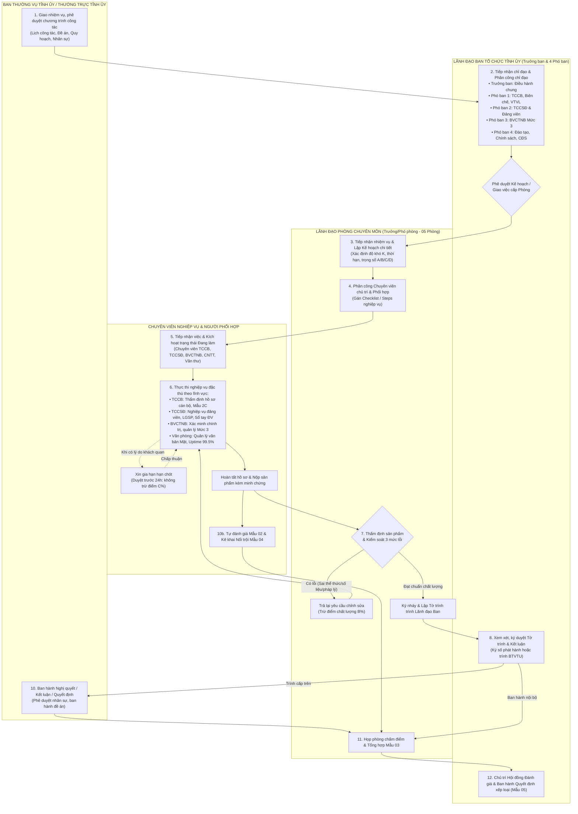
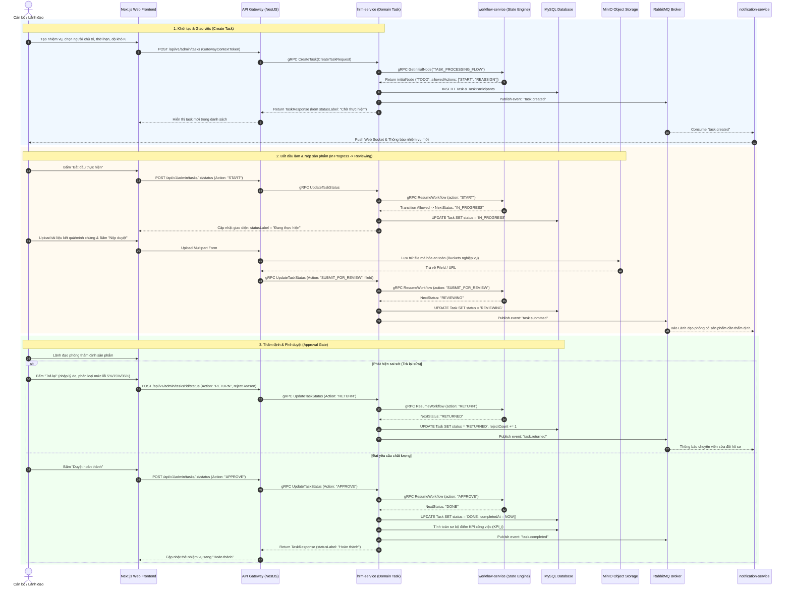
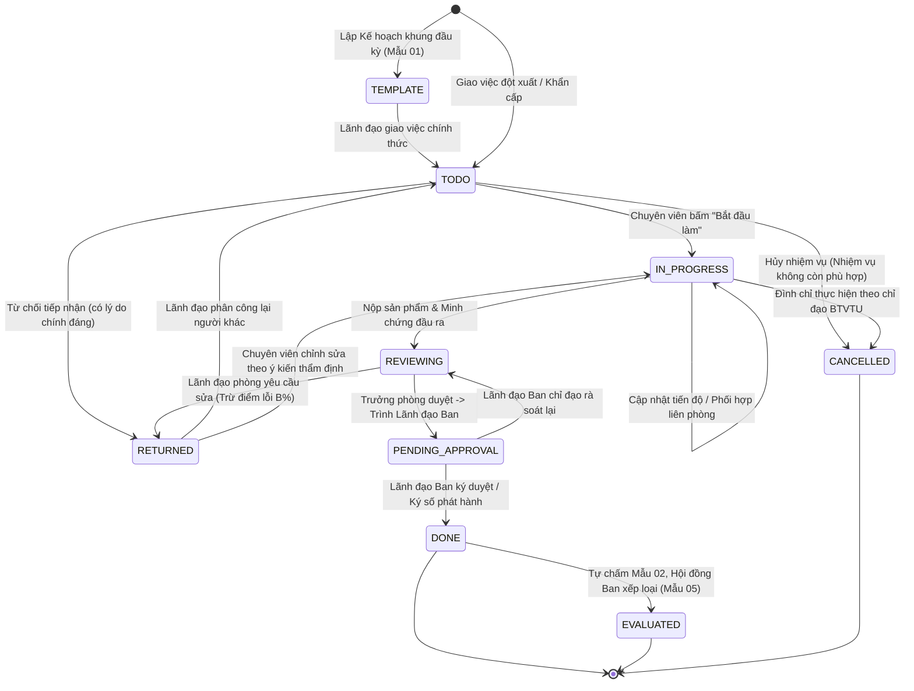
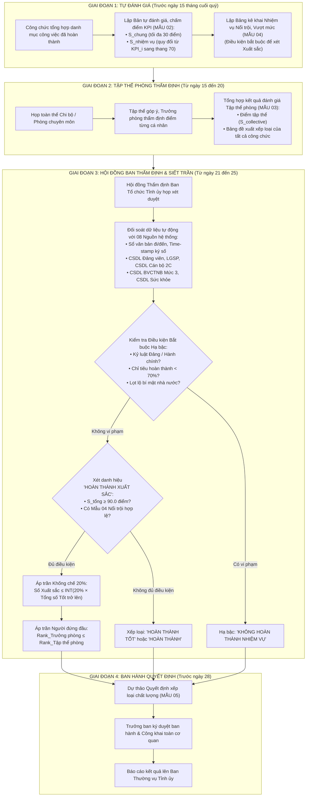

# SƠ ĐỒ LUỒNG QUẢN LÝ CÔNG VIỆC - BAN TỔ CHỨC TỈNH ỦY ĐẮK LẮK (BTCTU)

Tài liệu này chuẩn hóa toàn bộ luồng nghiệp vụ và luồng kỹ thuật của hệ thống Quản lý Công việc (Task & Work Management Lifecycle) tại **Ban Tổ chức Tỉnh ủy Đắk Lắk**, tuân thủ theo:
- **Quy định số 01-QĐ/BTCTU** về chức năng, nhiệm vụ và tổ chức bộ máy cơ quan Ban Tổ chức Tỉnh ủy.
- **Hướng dẫn số 05-HD/TU & Quy định số 39-QĐ/TU** của Ban Thường vụ Tỉnh ủy về đánh giá, xếp loại chất lượng cán bộ, công chức.
- **Quy định số 348-QĐ/BTCTW** của Ban Tổ chức Trung ương về bảo vệ chính trị nội bộ.
- **Nghị định số 85/2016/NĐ-CP** (An toàn thông tin Cấp độ 3) & **Nghị định số 63/2026/NĐ-CP** (Bảo vệ bí mật nhà nước trên môi trường số).

---

## 1. SƠ ĐỒ 1: LUỒNG NGHIỆP VỤ TỔNG THỂ (BUSINESS SWIMLANE WORKFLOW)

Sơ đồ phân làn (Swimlane) thể hiện chu trình khép kín từ khâu tiếp nhận chỉ đạo, phân công, thực thi, kiểm soát chất lượng 3 mức lỗi, ký duyệt phát hành đến nghiệm thu và đánh giá KPI.

---

## 2. SƠ ĐỒ 2: TUẦN TỰ KỸ THUẬT HỆ THỐNG (TECHNICAL SEQUENCE DIAGRAM)

Mô tả tương tác thời gian thực giữa **Web Frontend (Next.js)**, **API Gateway**, **HRM Service**, **Workflow Service**, **Message Queue (RabbitMQ)**, **Storage (MinIO)** và **Database (MySQL)**:

---

## 3. SƠ ĐỒ 3: MÁY TRẠNG THÁI VÒNG ĐỜI CÔNG VIỆC (TASK STATE MACHINE LIFECYCLE)

Sơ đồ biểu diễn tất cả các trạng thái chuẩn, sự kiện chuyển đổi và quy tắc chặn (Guard Conditions) của một công việc tại Ban Tổ chức Tỉnh ủy:

---

## 4. SƠ ĐỒ 4: LUỒNG ĐÁNH GIÁ KPI & KHỐNG CHẾ CHẤT LƯỢNG (KPI/OKR EVALUATION WORKFLOW)

Quy trình đánh giá, phân loại cán bộ hằng quý dựa trên 05 Mẫu biểu hành chính và thuật toán khống chế trần chất lượng:

---

## 5. MA TRẬN PHÂN QUYỀN VÀ TRÁCH NHIỆM THEO 05 PHÒNG BAN (RACI MATRIX)

| Giai đoạn / Tác vụ | Lãnh đạo Ban (`TT-01`) | Phòng TCCB (`TT-03`) | Phòng TCCSĐ (`TT-02`) | Phòng BVCTNB (`TT-04`) | Văn phòng Ban (`TT-05`) |
| :--- | :---: | :---: | :---: | :---: | :---: |
| **Giao nhiệm vụ BTVTU & Kế hoạch quý** | **A / R** | C | C | C | C |
| **Thẩm định hồ sơ cán bộ bổ nhiệm / Mẫu 2C** | A | **R** | C | C (Xác minh CT) | I |
| **Nghiệp vụ Đảng viên & Sổ tay ĐV qua LGSP** | A | C | **R** | C | I |
| **Xác minh chính trị & Quản lý CSDL Mức 3** | A | C | C | **R** | I |
| **Quản trị văn bản Mật & ATTT Cấp 3 (Uptime 99.5%)** | A | I | I | C | **R** |
| **Chấm điểm cá nhân Mẫu 02 & Nổi trội Mẫu 04** | A | **R** | **R** | **R** | **R** |
| **Tổng hợp điểm Tập thể phòng Mẫu 03** | A | **R** | **R** | **R** | **R** |
| **Hội đồng Ban thẩm định & Áp trần 20%** | **A / R** | C | C | C | C |
| **Ký quyết định phê duyệt xếp loại Mẫu 05** | **A / R** | I | I | I | I |

*(Ký hiệu RACI: **R** = Responsible - Người thực hiện; **A** = Accountable - Người phê duyệt/chịu trách nhiệm tối cao; **C** = Consulted - Đơn vị phối hợp/tham vấn; **I** = Informed - Nhận thông tin thông báo).*
